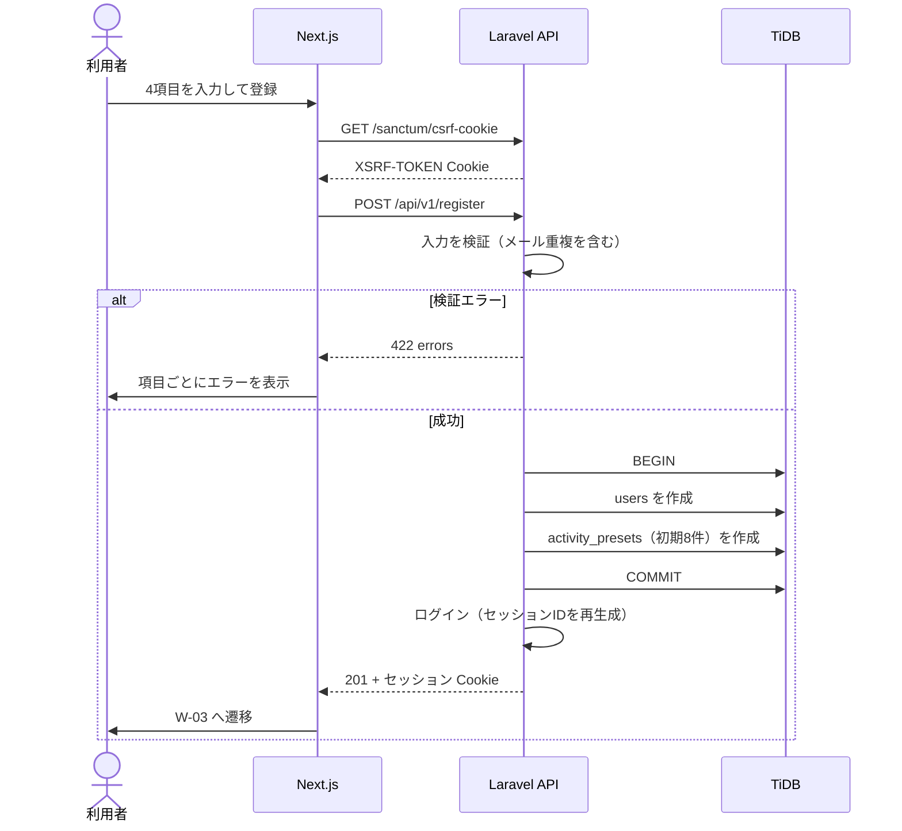

# F-01 ユーザー登録 — 機能設計書

> 共通事項（構成・認証方式・データ設計・エラー形式）は [設計書](../設計書.md) を参照。

| 項目 | 内容 |
| :--- | :--- |
| 機能ID / 優先度 | F-01 / 必須 |
| 画面 | W-02 ユーザー登録画面（`/register`） |
| API | A-01 `POST /api/v1/register` |
| テーブル | users（C）、activity_presets（C） |

## 1. 概要

ユーザー名、メールアドレス、パスワード、パスワード（確認用）の4項目でアカウントを作成する。登録に成功すると、そのままログイン状態になり W-03 へ遷移する。登録時に、行動の初期の選択肢（睡眠、食事、入浴、散歩、家事、介護、TV、リワーク）を作成する。

## 2. 画面（W-02）

| 項目 | 種別 | 入力チェック |
| :--- | :--- | :--- |
| ユーザー名 | text | 必須、50文字以内（表示名。重複可） |
| メールアドレス | email | 必須、メール形式、255文字以内、登録済みと重複不可（大文字小文字を区別しない） |
| パスワード | password | 必須、8文字以上 |
| パスワード（確認用） | password | 必須、パスワードと一致 |

- 操作: 「登録」ボタン、「ログインはこちら」リンク（W-01 へ）。
- 送信中はボタンを無効にして二重送信を防ぐ。
- ログイン済みで `/register` を開くと W-03 へ遷移する。
- エラーは各項目の下に表示する。入力内容（パスワード以外）は残す。

## 3. API

**A-01 ユーザー登録** `POST /api/v1/register`（認証不要、CSRF 必須）

```json
// 入力
{ "name": "山田太郎", "email": "taro@example.com", "password": "password123", "password_confirmation": "password123" }
// 出力 201（セッション Cookie が発行され、ログイン状態になる）
{ "data": { "id": 1, "name": "山田太郎", "email": "taro@example.com", "week_start_day": 6, "pdf_unlocked": false } }
```

| ステータス | 条件 |
| :--- | :--- |
| 422 | 入力エラー（必須欠落、形式不正、メール重複、パスワード不一致・短すぎ） |
| 403 | すでにログイン済み |
| 419 | CSRF トークン不一致 |

## 4. データ

- `users`: 1行作成。`email` は小文字に正規化して保存する（照合順序に依存せず大文字小文字の重複を防ぐ）。`password` は bcrypt。`week_start_day` は既定値（土曜=6）。
- `activity_presets`: 初期の選択肢8行を作成する。
- `users` と `activity_presets` の作成は1つのトランザクションで行う。

## 5. 振る舞い



- 同時に同じメールで登録された場合は、DB の UNIQUE 制約で後の1件が失敗する。API は 422（メール重複）として返す。
- 途中で失敗した場合はロールバックし、ユーザーは作られない。

## 6. 受け入れ条件とテスト観点

| 受け入れ条件 | 観点 |
| :--- | :--- |
| 有効な4項目で登録すると、アカウントが作られ、ログイン状態で W-03 に遷移する | 正常: 201、`users` に1行、ログイン状態（A-04 が 200） |
| 登録直後に、行動の初期の選択肢8件が使える | 正常: `activity_presets` が8件 |
| すでに登録済みのメール（大文字小文字違いを含む）では登録できない | 異常: `A@x.com` 登録後に `a@x.com` で 422 |
| パスワードが一致しない・短い・必須項目が空だと、項目ごとにエラーが出る | 異常: 不一致、7文字、空 |
| ユーザー名・メールが長すぎると登録できない | 境界: 名前50文字（可）・51文字（不可）、パスワード8文字（可）・7文字（不可） |
| ログイン済みで登録を呼ぶと 403 になる | 異常 |
| パスワードが平文で保存されない | 正常: `password` がハッシュ |
