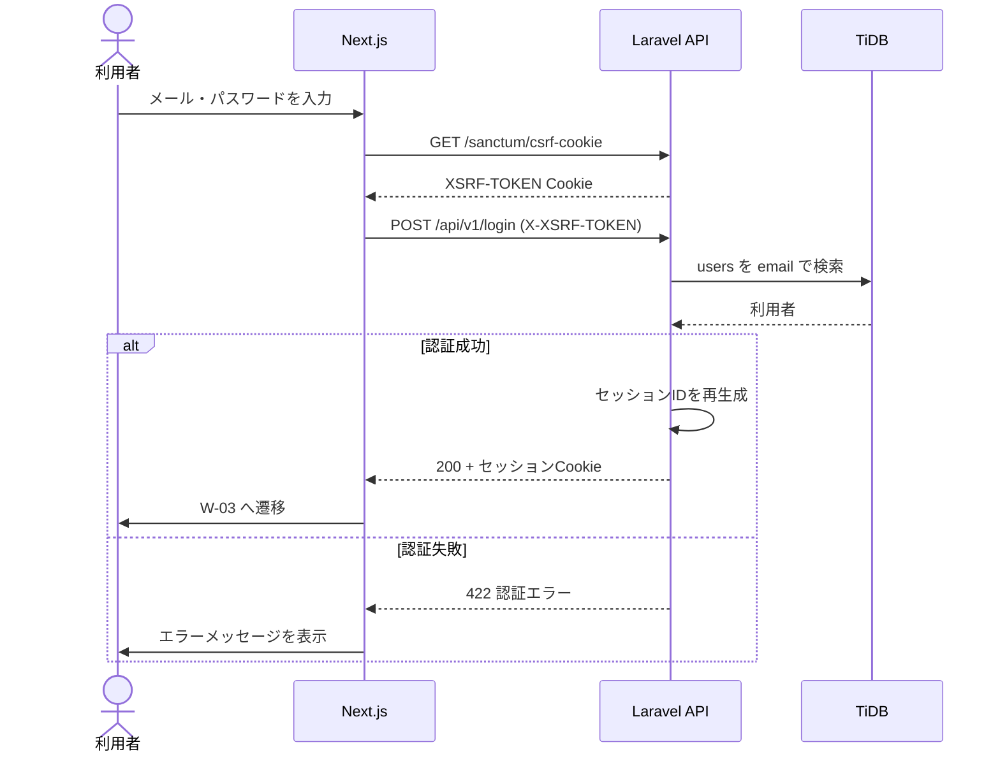
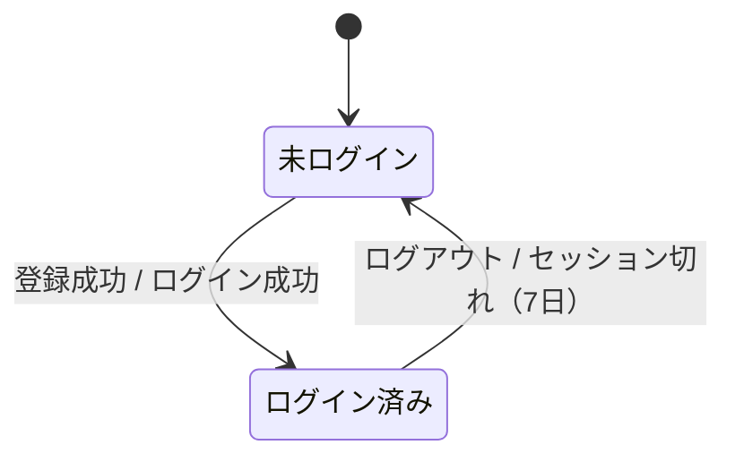

# F-02 ログイン・ログアウト — 機能設計書

> 共通事項（構成・認証方式・データ設計・エラー形式）は [設計書](../設計書.md) を参照。

| 項目 | 内容 |
| :--- | :--- |
| 機能ID / 優先度 | F-02 / 必須 |
| 画面 | W-01 ログイン画面（`/login`）、ログアウトは W-03・W-04 から |
| API | A-02 `POST /api/v1/login`、A-03 `POST /api/v1/logout`、A-04 `GET /api/v1/user` |
| テーブル | users（R） |

## 1. 概要

メールアドレスとパスワードで認証する。未ログインでは、保護された画面（W-03〜W-05）と API（`/api/v1/*` の保護対象）にアクセスできない。認証は Sanctum の SPA Cookie 認証（設計書 1.5）。

## 2. 画面（W-01）

| 項目 | 種別 | 入力チェック |
| :--- | :--- | :--- |
| メールアドレス | email | 必須、メール形式、255文字以内 |
| パスワード | password | 必須 |

- 操作: 「ログイン」ボタン、「新規登録はこちら」リンク（W-02 へ）。
- 失敗時のメッセージは、メールの存在有無を区別しない共通文言「メールアドレスまたはパスワードが正しくありません。」。
- 試行回数が超過した場合は「ログインの試行が多すぎます。しばらくしてからやり直してください。」。
- ログイン済みで `/login` を開くと W-03 へ遷移する。未ログインで保護画面を開くと `/login` へ遷移する。
- ログアウトは W-03 のヘッダーと W-04 のボタンから行い、成功後は W-01 へ遷移する。

## 3. API

**A-02 ログイン** `POST /api/v1/login`（認証不要、CSRF 必須）

```json
// 入力
{ "email": "taro@example.com", "password": "password123" }
// 出力 200（セッション Cookie が発行される）
{ "data": { "id": 1, "name": "山田太郎", "email": "taro@example.com", "week_start_day": 6, "pdf_unlocked": false } }
```

**A-03 ログアウト** `POST /api/v1/logout`（認証必要）: 204。セッションを破棄し、CSRF トークンを再生成する。

**A-04 ユーザー情報** `GET /api/v1/user`（認証必要）: A-02 の `data` と同じ形式を 200 で返す。フロントは起動時にこれを呼び、ログイン状態を判定する。

| ステータス | 条件 |
| :--- | :--- |
| 422 | 入力エラー、または認証失敗（`errors.email` に共通文言） |
| 429 | メール+IP で1分に5回を超えた |
| 403 | ログイン済みで A-02 を呼んだ |
| 401 | 未ログインで A-03・A-04 を呼んだ |
| 419 | CSRF トークン不一致 |

## 4. データ

- `users` を `email`（小文字に正規化）で検索し、`password` を照合する（参照のみ）。
- セッションは Cookie に保存する（`SESSION_DRIVER=cookie`）。有効期間は `SESSION_LIFETIME=10080`（7日）。

## 5. 振る舞い





- 保護 API が 401 を返したとき、フロントは W-01 へ遷移し「ログインの有効期限が切れました。もう一度ログインしてください。」を表示する。
- ログイン成功時にセッション ID を再生成する（セッション固定攻撃の対策）。

## 6. 受け入れ条件とテスト観点

| 受け入れ条件 | 観点 |
| :--- | :--- |
| 正しいメールとパスワードでログインすると、W-03 に遷移する | 正常: 200、以後 A-04 が 200 |
| メールまたはパスワードが誤っていると、同じエラー文言が出る | 異常: パスワード誤り、存在しないメール（文言が同一） |
| ログアウトすると、以後の保護 API が 401 になる | 正常: A-03 が 204、その後 A-04 が 401 |
| 未ログインで保護された API を呼ぶと 401 になる | 異常: 保護対象の全ルートを列挙して 401 を確認 |
| 未ログインで保護された画面を開くと W-01 に遷移する | 手動確認 |
| ログインを短時間に繰り返すと制限される | 境界: 1分に5回までは可、6回目が 429 |
| CSRF トークンなしのログインが拒否される | 異常: 419 |
