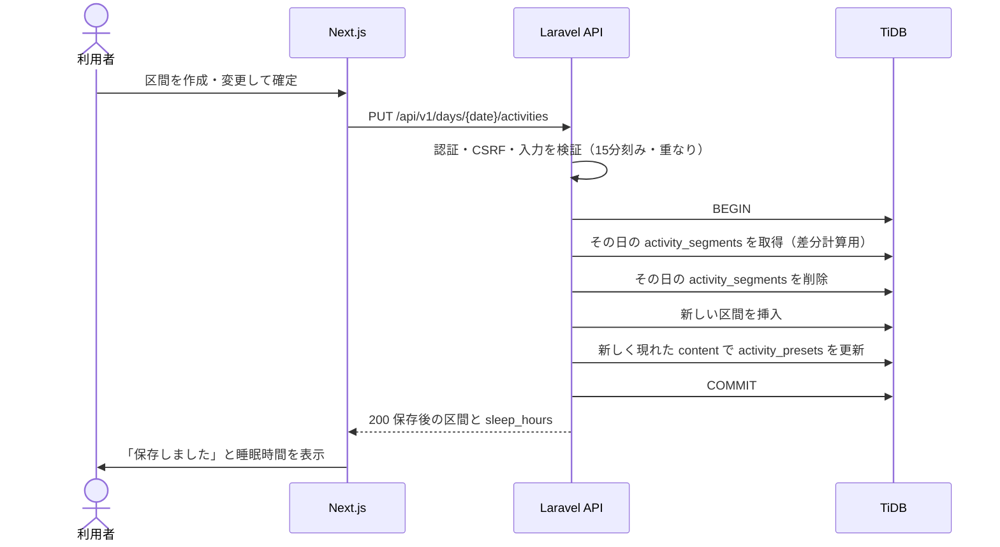

# F-03 24時間行動記録入力 — 機能設計書

> 共通事項（構成・認証方式・データ設計・エラー形式、R-01 週の取得）は [設計書](../設計書.md) を参照。

| 項目 | 内容 |
| :--- | :--- |
| 機能ID / 優先度 | F-03 / 必須 |
| 画面 | W-03 メイン画面（記録表） |
| API | R-02 行動記録の保存、R-05 選択肢の一覧、R-06 日の削除、P-01 選択肢の追加、P-02 選択肢の削除（表示は R-01） |
| テーブル | activity_segments（C/R/U/D）、activity_presets（C/R/U/D） |

## 1. 概要

24時間を、**15分単位の区間（開始〜終了時刻と行動内容）** で記録する。原紙は、24時間の横軸に手書きの縦線で行動を区切り、1つの行動を複数のマスにまたいで書く書式であり、同じ操作感を再現する。

- PC: 24時間のタイムラインを日ごとに表示し、範囲をドラッグして選び（15分に吸着）、行動内容を選択または入力する。
- スマホ: 日ごとに「開始時刻・終了時刻（15分刻み）・行動内容」の行を追加・編集・削除する。
- よく使う行動は選択肢から選べ、入力した独自の行動は自動で選択肢に学習される。
- 「睡眠」の区間の合計から、**1日の睡眠時間を自動で計算する**（入力は不要）。排便は記録しない（スコープ外）。
- 原紙で赤字で書いていた重要な予定（通院など）は、区間の入力フォームの **「強調する」チェックボックス**で表す。チェックした区間は、画面と印刷で赤字・太字になる。

## 2. 画面（W-03 の行動記録の領域）

| 領域 | 項目 | 入力チェック |
| :--- | :--- | :--- |
| PC | 日付（7日）ごとの24時間のタイムライン（0〜24時、2時間ごとに目盛り、1時間ごとに点線、15分に吸着）。区間をドラッグして作成し、クリックで編集・削除 | 区間は15分の倍数。同じ日の区間は重ならない |
| スマホ | 日ごとに「開始時刻」「終了時刻」「行動内容」の行を追加・編集・削除 | 開始は 00:00〜23:45、終了は開始より後で 24:00 まで（15分刻み） |
| 行動内容 | 選択肢から選ぶか、自由入力 | 必須、100文字以内 |
| 睡眠 | 選択肢の「睡眠」を選ぶと睡眠の区間になる | — |
| 強調する | チェックボックス（区間の入力フォームに表示。PC・スマホ共通）。既定はオフ | 真偽値 |
| 睡眠時間 | 日ごとに、睡眠の区間の合計を表示（例 `7.5`）。編集できない（自動計算） | — |
| 選択肢 | 利用回数の多い順に表示。追加と削除 | ラベルは100文字以内、重複不可 |

- 日をまたぐ行動（例: 23:00〜翌 7:30 の睡眠）は、当日の 23:00〜24:00 と翌日の 0:00〜7:30 に分割して保存する。画面では、前日から続く区間として表示する。
- 保存のタイミング: 区間の作成・変更・削除を確定したときに、その日の全区間を R-02 で送る。日をまたぐ場合は翌日分も同じ R-02 に含めて1回で送る（`next_day_segments`）。送る前に、既存の内容を取得して区間を合成する（その日の他の区間を消さないため）。保存中・保存済み・失敗を欄の脇に示す。
- 睡眠時間は、保存後の R-01 / R-02 の `sleep_hours`（小数1位に四捨五入して表示）をそのまま使う。日をまたぐ睡眠は日ごとの区間（当日の 23:00〜24:00 と翌日の 0:00〜7:30）に分かれるため、睡眠時間も**日ごとに算出し、その日の睡眠の区間の合計**を表示する（週の合計は原紙にないため出さない）。

## 3. API

**R-02 行動記録の保存** `PUT /api/v1/days/{date}/activities`（認証必要、CSRF 必須）

```json
// 入力（その日の区間をこの内容で置き換える。区間なしの時間帯は含めない）
{ "segments": [
    { "start": "00:00", "end": "07:30", "content": "睡眠", "is_sleep": true, "is_highlight": false },
    { "start": "09:00", "end": "09:30", "content": "診察", "is_sleep": false, "is_highlight": true } ],
  // 任意。日をまたぐ場合のみ、翌日（{date} の次の日）の区間をこの内容で置き換える
  "next_day_segments": [
    { "start": "00:00", "end": "06:00", "content": "睡眠", "is_sleep": true, "is_highlight": false } ] }
// 出力 200
{ "data": { "date": "2026-10-17", "segments": [ { "start": "00:00", "end": "07:30", "content": "睡眠", "is_sleep": true, "is_highlight": false } ], "sleep_hours": 7.5 } }
```

| 検証 | 内容 |
| :--- | :--- |
| `segments` | 必須（空配列は可。その日の区間をすべて消す）、最大96件 |
| `start` / `end` | 必須、`HH:MM`。分は 00・15・30・45 のみ。`start` は 00:00〜23:45、`end` は 00:15〜24:00。`end` は `start` より後 |
| `next_day_segments` | 任意。指定した場合は `segments` と同じ検証（最大96件、`start`/`end`、重なり、`content` など）を行う。空配列は翌日の区間をすべて消す |
| 区間どうし | 同じ配列内で重ならない（隣り合うのは可） |
| `content` | 必須、100文字以内（前後の空白は除去。空は不可） |
| `is_sleep` | 任意、真偽値（既定 false） |
| `is_highlight` | 任意、真偽値（既定 false。「強調する」） |
| `{date}` | `YYYY-MM-DD` として妥当な日付 |

**R-05 選択肢の一覧** `GET /api/v1/activity-presets` → 200 `{ "data": [ { "id": 1, "label": "睡眠", "is_sleep": true, "use_count": 12 } ] }`（`use_count` の降順、同数は `label` の昇順）

**P-01 選択肢の追加** `POST /api/v1/activity-presets` `{ "label": "読書" }` → 201。ラベルが100文字を超える、または既にある場合は 422。

**P-02 選択肢の削除** `DELETE /api/v1/activity-presets/{id}` → 204。他人の `id` は 404。

**R-06 日の削除** `DELETE /api/v1/days/{date}` → 204。その日の `activity_segments` と `daily_summaries`（F-04・F-05）を削除する。

| ステータス | 条件 |
| :--- | :--- |
| 401 | 未ログイン |
| 404 | 他人の選択肢の `id` |
| 419 | CSRF トークン不一致 |
| 422 | 入力エラー（時刻が15分刻みでない、終了が開始以前、24:00 を超える、区間の重なり、内容が空・長い、日付が不正） |

## 4. データ

| 操作 | テーブル | 内容 |
| :--- | :--- | :--- |
| 保存（R-02） | activity_segments | `DB::transaction` で、その日・その利用者の区間をすべて削除し、受け取った区間を挿入する（`start`/`end` は分に変換して保存）。`next_day_segments` がある場合は翌日分も同じトランザクションで行い、どちらかが失敗したら両日ともロールバックする |
| 学習（R-02 内） | activity_presets | 保存前のその日の区間になく、保存後にある `content` ごとに、無ければ追加（`use_count`=1）、あれば `use_count` を加算し `last_used_at` を更新する |
| 表示（R-01） | activity_segments | 週の日付範囲で取得する。`sleep_hours` は `is_sleep` の区間の長さの合計から計算する（保存しない） |
| 削除 | activity_segments / activity_presets | R-06 / P-02 |

- 学習のルール: 同じ日を何度保存しても `use_count` が増えすぎない。同じ内容が複数の区間にあっても1回として数える。
- 選択肢を削除しても、すでに記録された区間の内容は変わらない。
- 区間の `is_highlight`（強調する）も区間に保存する。強調した区間は、W-03 と W-05 で赤字・太字で表示する（色だけに頼らない）。
- 区間の `is_sleep` は区間に保存する。選択肢の `is_sleep` を後から変えても、過去の区間は変わらない。

## 5. 振る舞い



- 通信に失敗した場合は、入力を画面に残して「保存できませんでした。入力内容は残っています。もう一度お試しください。」を表示し、再試行できる。
- 同じ日を複数のタブで同時に編集した場合の競合は考慮しない。後に保存した内容で上書きされる（設計書 6.3）。
- 日をまたぐ保存では、2日分を1回の R-02 で送る。バックエンドは `DB::transaction` で2日分を保存し、どちらかが失敗した場合は両日ともロールバックする（片方だけ保存された状態にならない）。失敗したときは、入力を残したまま再試行できる。

## 6. 受け入れ条件とテスト観点

| 受け入れ条件 | 観点 |
| :--- | :--- |
| その日の区間を保存すると、再表示で同じ内容が出る | 正常: R-02 の後に R-01 で同じ内容 |
| 保存し直すと、その日の内容が置き換わる | 正常: 2回目の保存で前の区間が残らない |
| 睡眠の区間の合計から、睡眠時間が自動で計算される | 正常: 00:00〜07:30 と 23:00〜24:00 で 8.5 |
| 睡眠時間は手入力できず、保存もされない | 正常: `daily_summaries` に睡眠時間の列がない |
| 保存した行動が選択肢に追加され、使用回数の多い順に並ぶ | 正常: R-05 の並び順、同じ日を再保存しても `use_count` が増えすぎない |
| 15分刻みでない時刻、終了が開始以前、24:00 超、重なりは拒否される | 異常: 09:10、09:00〜09:00、24:15、09:00〜10:00 と 09:30〜11:00 |
| 内容が空・長すぎる区間は拒否される | 異常: 空、101文字 |
| 「強調する」をチェックした区間が、再表示でも強調され、印刷で赤字・太字になる | 正常: `is_highlight` が保存され R-01 で返る。印刷は手動確認 |
| 「強調する」を付けない区間は強調されない | 正常: 既定が false |
| 隣り合う区間は保存できる | 境界: 09:00〜10:00 と 10:00〜11:00 |
| 境界値が通る | 境界: 00:00 開始、24:00 終了、内容100文字、96件（15分×96） |
| 日をまたぐ範囲は2日に分割して保存される | 境界: 23:00〜翌7:30（`segments` と `next_day_segments` の1回の R-02。再表示で2日分が出る） |
| 日をまたぐ保存は、片方が失敗したら両日ともロールバックされる | 異常: 翌日分の保存を失敗させ、当日分も保存されていない（Feature テスト） |
| スマホの時刻入力が15分刻みで選べる | 手動確認 |
| 他人の選択肢は削除できない | 異常: P-02 で他人の `id` → 404 |
| 他人の記録は読み書きできない | 異常: 自分の `user_id` の区間だけが対象 |
