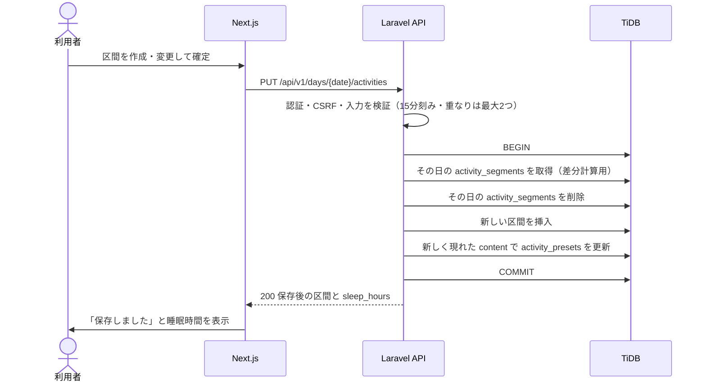

# F-03 24時間行動記録入力 — 機能設計書

> 共通事項（構成・認証方式・データ設計・エラー形式、R-01 週の取得）は [設計書](../設計書.md) を参照。

| 項目 | 内容 |
| :--- | :--- |
| 機能ID / 優先度 | F-03 / 必須 |
| 画面 | W-03 メイン画面（PC・記録表）、W-06 メイン画面（スマホ） |
| API | R-02 行動記録の保存、R-05 選択肢の一覧、R-06 日の削除、P-01 選択肢の追加、P-02 選択肢の削除（表示は R-01） |
| テーブル | activity_segments（C/R/U/D）、activity_presets（C/R/U/D） |

## 1. 概要

24時間を、**15分単位の区間（開始〜終了時刻と行動内容）** で記録する。原紙は、24時間の横軸に手書きの縦線で行動を区切り、1つの行動を複数のマスにまたいで書く書式であり、同じ操作感を再現する。

- PC: 24時間のタイムラインを日ごとに表示し、範囲をドラッグして選び（15分に吸着）、行動内容を選択または入力する。
- スマホ: その日の行動を時系列の**カード型リスト**で縦に並べ、カードのすぐ下（または隙間）に**入力フォームをその場で開いて**追加・編集・削除する。時刻は**ドラムロール**（15分刻み）で選び、行動内容は**クイックタグ**（よく使う行動）の1タップで入力できる。「開始時刻」は直前の行動などから自動で入る（2.2）。
- 時間が重なる行動（例: 食事をしながらテレビ）も、同じ時間帯に**最大2つまで**記録できる。重なっている**時間帯だけ**、タイムラインを**上下2段**に分割し、その時間帯の行動内容は**先頭の全角1文字（半角は2文字）だけ**を表示する（2.1）。重なっていない時間帯は変わらない。
- よく使う行動は選択肢から選べ、入力した独自の行動は自動で選択肢に学習される。
- 「睡眠」の区間の合計から、**1日の睡眠時間を自動で計算する**（入力は不要）。排便は記録しない（スコープ外）。
- 原紙で赤字で書いていた重要な予定（通院など）は、区間の入力フォームの **「強調する」チェックボックス**で表す。チェックした区間は、画面と印刷で赤字・太字になる。

## 2. 画面（W-03・W-06 の行動記録の領域）

| 領域 | 項目 | 入力チェック |
| :--- | :--- | :--- |
| PC | 日付（7日）ごとの24時間のタイムライン（0〜24時、2時間ごとに目盛り、1時間ごとに点線、15分に吸着）。区間をドラッグして作成し、クリックで編集・削除 | 区間は15分の倍数。同じ時間帯に重なってよいのは最大2つまで |
| スマホ | 日ごとの行動カードの一覧と、その場に開くインラインフォーム（開始時刻・終了時刻のドラムロール、クイックタグ、行動内容、強調する）。追加・編集・削除（2.2） | 開始は 00:00〜23:45、終了は開始より後で 24:00 まで（15分刻み） |
| 行動内容 | 選択肢から選ぶか、自由入力 | 必須、100文字以内 |
| 睡眠 | 選択肢の「睡眠」を選ぶと睡眠の区間になる | — |
| 強調する | チェックボックス（区間の入力フォームに表示。PC・スマホ共通）。既定はオフ | 真偽値 |
| 睡眠時間 | 日ごとに、睡眠の区間の合計を表示（例 `7.5`）。編集できない（自動計算） | — |
| 選択肢 | 利用回数の多い順に表示。追加と削除 | ラベルは100文字以内、重複不可 |

- 日をまたぐ行動（例: 23:00〜翌 7:30 の睡眠）は、当日の 23:00〜24:00 と翌日の 0:00〜7:30 に分割して保存する。画面では、前日から続く区間として表示する。
- 保存のタイミング: 区間の作成・変更・削除を確定したときに、その日の全区間を R-02 で送る。日をまたぐ場合は翌日分も同じ R-02 に含めて1回で送る（`next_day_segments`）。送る前に、既存の内容を取得して区間を合成する（その日の他の区間を消さないため）。保存中・保存済み・失敗を欄の脇に示す。
- 睡眠時間は、保存後の R-01 / R-02 の `sleep_hours`（小数1位に四捨五入して表示）をそのまま使う。日をまたぐ睡眠（例: 日曜 23:00〜月曜 7:30）は、日ごとの区間（日曜の 23:00〜24:00 と月曜の 0:00〜7:30）に分けて保存するが、**睡眠時間は起きた日（月曜）に全体（8.5）を数え**、日曜には数えない。月曜が新しい週の初日でも同じで、前の週の最終日の夜の区間を読んで計算する（週の境目の前後1日を読む）。週の合計は原紙にないため出さない。

### 2.1 時間が重なる部分のタイムライン表示

原紙（サンプル）は、重なっている時間帯だけ行を上下2段に分け、前後は1段のまま書いている。同じ見た目にする。

| 項目 | 内容 |
| :--- | :--- |
| 分割の範囲 | **2つの区間が重なっている時間帯だけ**を、行の上半分・下半分に分ける（間に横線）。重なっていない時間帯は、行の高さいっぱいの1段のまま。日全体は分割しない |
| 段の決め方 | 区間を開始が早い順（同じなら終了が早い順、それも同じなら `id` 順）に並べ、上段が空いていれば上段、そうでなければ下段の「段」を区間ごとに決める。重なっている時間帯では、上段の区間が上半分、下段の区間が下半分に入る。保存はせず、表示のたびにフロントエンドで決める |
| 重なっている時間帯の文字 | **先頭の1文字だけ**を表示する。先頭が全角なら全角1文字、半角なら半角2文字まで（全角1文字と半角2文字は同じ幅）。例: 「診察」→「診」、「TV視聴」→「TV」、「ab」→「ab」 |
| 重なっていない時間帯の文字 | 従来どおり全文を表示する（幅が狭い区間は縦書き）。1つの区間が重なりの前後に分かれる場合は、広い方の部分に1回だけ書く |
| 全文の確認 | PC は区間をクリックして開く編集フォームと、区間にマウスを置いたときの表示（`title`）に全文を出す。印刷（W-05）は、重なっている時間帯は先頭の文字だけで、全文は載らない（重なっていない時間帯に書いた区間は全文が載る） |
| 強調・睡眠 | 「強調する」の区間は、先頭の文字も赤字・太字。睡眠の区間も同じ規則で表示する |
| スマホ | カード型リストのため、段の分割はしない（全文のまま。重なる区間は、開始が早い順〔同じなら終了が早い順、`id` 順〕に並べる）（2.2） |

### 2.2 スマホの入力 UI（W-06）

スマホ（`md` 未満）では、PC のようなタイムラインやドラッグ操作は使わず、次の構成にする。

| 項目 | 内容 |
| :--- | :--- |
| 表示する日 | W-06 は1日を1画面として切り替えるため（設計書 3.5）、カード型リストは表示中の1日分。日の切り替えは画面中央の左右スワイプか、日付見出しの矢印アイコンのタップで行う（設計書 3.5）。フォームが開いている間は、横スワイプと日の矢印を無効にする |
| タイムライン表示 | その日の行動を、開始時刻の早い順（同じなら終了が早い順、それも同じなら `id` 順）に**カード型リスト**で縦に並べる。カードには時刻範囲（例 `09:00〜10:30`）と行動内容（全文）を出し、「強調する」の区間は赤字・太字、睡眠の区間は睡眠と分かる表示にする。上下2段の分割はしない |
| 隙間 | カードとカードの間（その日の最初の行動の前、最後の行動の後を含む）に、未入力の時間帯があるときは、その時間帯を「未入力 09:00〜10:00」のように示し、**「＋」ボタン**を置く |
| インライン・フォーム | 「＋」ボタン、リストの最後尾の「行動を追加」ボタン、または既存のカードをタップすると、**その位置のすぐ下にフォームが挿入されて開く**（別画面・ダイアログには移らない）。追加と編集は**同じデザインのフォーム**を使う（違いは、入力済みのデータがあるかどうかと、ボタンの文字だけ）。フォームは「開始時刻」「終了時刻」「行動内容」「クイックタグ」「強調する」と、ボタン（追加: 「追加」「やめる」、編集: 「更新」「やめる」「削除」）から成る。「削除」は、削除する対象がある編集のときだけ表示する。追加・編集のフォームは、同時に開けるのは1つだけ（別のカードや「＋」を押すと、開いていたフォームは閉じる） |
| 時刻の選択 | 「開始時刻」「終了時刻」は、**ドラムロール**（回して選ぶ形式。15分刻み）で選ぶ。開始は 00:00〜23:45、終了は開始より後で 24:00 まで。**終了時刻のドラムロールの最後の値は「24:00」**とし、「0:00」は並べない（時計では同じ時刻でも、1日単位では 24:00 は当日の終わり、0:00 は翌日の始まりで別のため）。開始時刻のドラムロールには「24:00」を入れない |
| クイックタグ | フォーム内に、`activity_presets`（R-05）の「よく使う行動」を**利用回数の多い順**にボタン（タグ）で並べる。タグを1回タップすると、行動内容にそのラベルが入る（睡眠のタグなら、区間が睡眠になる）。タップのあとで、行動内容は自由に直せる。選択肢にない行動は、行動内容の欄に直接入力する（保存すると選択肢に学習される） |
| 保存 | 「追加」または「更新」を押すと、その日の全区間を R-02 で送る（日をまたぐ場合は `next_day_segments` も同時に送る）。重なりが3つ以上になるときは、保存せずに設計書 3.4 のメッセージを出す |

**開始時刻の初期値（「行動を追加」を押したときの自動補完）**

毎回 `0:00` から回し直す操作をなくすため、フォームを開いたときの「開始時刻」の初期値は、フロントエンドで次の優先順位で決める。

| 優先 | 追加のしかた | 開始時刻の初期値 |
| :---: | :--- | :--- |
| 1 | 隙間の「＋」ボタンから追加 | その隙間の**開始時刻** |
| 2 | 最後尾の「行動を追加」から追加（その日に区間がある） | その日の**最後の行動の終了時刻**（終了が最も遅い区間の終了時刻） |
| 3 | その日にまだ区間が1件もない | `00:00` |

- 初期値はあくまで初期値で、ドラムロールで変えられる。
- 最後の行動の終了が 24:00 のときは、開始の上限（23:45）を超えるため、最後尾からの追加は `00:00` を初期値にする。

**終了時刻の初期値（保留）**

- 開始時刻から何分後を終了時刻の初期値にするかは、行動の長さが30分・1時間・1時間半などさまざまなため、**評価の段階に入ってから決める**。それまでは、**開始時刻の15分後**を初期値にする（開始が 23:45 のときは 24:00）。
- 初期値を設定する画面は、UI が複雑になるため作らない。
- 実装のあと、実際の画面での試用と評価期間のフィードバックをもとに、スクロール操作が最も少なくなる初期値（または連動のしかた）を決めて調整する（仕様チェックリスト Q-49）。

## 3. API

**R-02 行動記録の保存** `PUT /api/v1/days/{date}/activities`（認証必要、CSRF 必須）

```json
// 入力（その日の区間をこの内容で置き換える。区間なしの時間帯は含めない）
{ "segments": [
    { "start": "00:00", "end": "07:30", "content": "睡眠", "is_sleep": true, "is_highlight": false },
    { "start": "09:00", "end": "09:30", "content": "診察", "is_sleep": false, "is_highlight": true } ],
  // 任意。日をまたぐ場合のみ、翌日（{date} の次の日）の区間をこの内容で置き換える
  "next_day_segments": [
    { "start": "00:00", "end": "06:00", "content": "睡眠", "is_sleep": true, "is_highlight": false } ] }
// 出力 200
{ "data": { "date": "2026-10-17", "segments": [ { "start": "00:00", "end": "07:30", "content": "睡眠", "is_sleep": true, "is_highlight": false } ], "sleep_hours": 7.5 } }
```

| 検証 | 内容 |
| :--- | :--- |
| `segments` | 必須（空配列は可。その日の区間をすべて消す）、最大192件（15分×96を最大2段） |
| `start` / `end` | 必須、`HH:MM`。分は 00・15・30・45 のみ。`start` は 00:00〜23:45、`end` は 00:15〜24:00。`end` は `start` より後 |
| `next_day_segments` | 任意。指定した場合は `segments` と同じ検証（最大192件、`start`/`end`、重なり、`content` など）を行う。空配列は翌日の区間をすべて消す |
| 区間どうし | 同じ時間帯に重なってよいのは最大2つまで（3つ以上が重なると 422）。隣り合うのは可 |
| `content` | 必須、100文字以内（前後の空白は除去。空は不可） |
| `is_sleep` | 任意、真偽値（既定 false） |
| `is_highlight` | 任意、真偽値（既定 false。「強調する」） |
| `{date}` | `YYYY-MM-DD` として妥当な日付 |

**R-05 選択肢の一覧** `GET /api/v1/activity-presets` → 200 `{ "data": [ { "id": 1, "label": "睡眠", "is_sleep": true, "use_count": 12 } ] }`（`use_count` の降順、同数は `label` の昇順）

**P-01 選択肢の追加** `POST /api/v1/activity-presets` `{ "label": "読書" }` → 201。ラベルが100文字を超える、または既にある場合は 422。

**P-02 選択肢の削除** `DELETE /api/v1/activity-presets/{id}` → 204。他人の `id` は 404。

**R-06 日の削除** `DELETE /api/v1/days/{date}` → 204。その日の `activity_segments` と `daily_summaries`（F-04・F-05）を削除する。

| ステータス | 条件 |
| :--- | :--- |
| 401 | 未ログイン |
| 404 | 他人の選択肢の `id` |
| 419 | CSRF トークン不一致 |
| 409 | その日（日またぎの翌日分を含む）の週が確定済み（F-11）。2日分とも保存しない |
| 422 | 入力エラー（時刻が15分刻みでない、終了が開始以前、24:00 を超える、3つ以上の区間の重なり、内容が空・長い、日付が不正。重なりの文言は設計書 3.4） |

## 4. データ

| 操作 | テーブル | 内容 |
| :--- | :--- | :--- |
| 保存（R-02） | activity_segments | `DB::transaction` で、その日・その利用者の区間をすべて削除し、受け取った区間を挿入する（`start`/`end` は分に変換して保存）。`next_day_segments` がある場合は翌日分も同じトランザクションで行い、どちらかが失敗したら両日ともロールバックする |
| 学習（R-02 内） | activity_presets | 保存前のその日の区間になく、保存後にある `content` ごとに、無ければ追加（`use_count`=1）、あれば `use_count` を加算し `last_used_at` を更新する |
| 表示（R-01） | activity_segments | 週の日付範囲の前後1日を含めて取得する。`sleep_hours` は、起きた日に睡眠全体を数える規則（設計書 4.2）で計算する（保存しない） |
| 削除 | activity_segments / activity_presets | R-06 / P-02 |

- 学習のルール: 同じ日を何度保存しても `use_count` が増えすぎない。同じ内容が複数の区間にあっても1回として数える。
- 選択肢を削除しても、すでに記録された区間の内容は変わらない。
- 区間の `is_highlight`（強調する）も区間に保存する。強調した区間は、W-03・W-06・W-05 で赤字・太字で表示する（色だけに頼らない）。
- 区間の `is_sleep` は区間に保存する。選択肢の `is_sleep` を後から変えても、過去の区間は変わらない。

## 5. 振る舞い



- 通信に失敗した場合は、入力を画面に残して「保存できませんでした。入力内容は残っています。もう一度お試しください。」を表示し、再試行できる。
- 同じ日を複数のタブで同時に編集した場合の競合は考慮しない。後に保存した内容で上書きされる（設計書 6.3）。
- 日をまたぐ保存では、2日分を1回の R-02 で送る。バックエンドは `DB::transaction` で2日分を保存し、どちらかが失敗した場合は両日ともロールバックする（片方だけ保存された状態にならない）。失敗したときは、入力を残したまま再試行できる。

## 6. 受け入れ条件とテスト観点

| 受け入れ条件 | 観点 |
| :--- | :--- |
| その日の区間を保存すると、再表示で同じ内容が出る | 正常: R-02 の後に R-01 で同じ内容 |
| 保存し直すと、その日の内容が置き換わる | 正常: 2回目の保存で前の区間が残らない |
| 睡眠の区間から、睡眠時間が自動で計算され、起きた日に全体が数えられる | 正常: 日曜 23:00〜24:00 と月曜 0:00〜7:30 で、月曜が 8.5、日曜が 0 |
| 週をまたぐ睡眠が、新しい週の初日に数えられる | 境界: 旧週の最終日（日曜）23:00〜24:00 と新週の初日（月曜）0:00〜6:00 で、新週の月曜が 7.0。旧週の日曜は 0 |
| 旧週が確定済みのとき、その最終日の夜の区間は保存できない | 異常: 日曜の週が確定済みで、月曜から日曜 23:00 の睡眠を保存すると 409（2日分とも保存されない） |
| 睡眠時間は手入力できず、保存もされない | 正常: `daily_summaries` に睡眠時間の列がない |
| 保存した行動が選択肢に追加され、使用回数の多い順に並ぶ | 正常: R-05 の並び順、同じ日を再保存しても `use_count` が増えすぎない |
| 15分刻みでない時刻、終了が開始以前、24:00 超は拒否される | 異常: 09:10、09:00〜09:00、24:15 |
| 2つの区間の重なりは保存できる | 正常: 09:00〜10:00 と 09:30〜11:00。再表示で2つとも出る |
| 3つの区間が同じ時間帯に重なると拒否される | 異常: 09:00〜10:00、09:15〜10:15、09:30〜10:30（422、保存されない） |
| 重なった睡眠は二重に数えない | 境界: 睡眠 0:00〜6:00 と睡眠 5:00〜7:00 で睡眠時間が7.0（6.0+2.0=8.0にならない） |
| 重なっている時間帯だけ上下2段になり、先頭の1文字だけが出る | 正常: 手動確認（診察→「診」、TV視聴→「TV」）。重なっていない時間帯は1段のまま全文 |
| 一部だけ重なる区間で、重なる部分だけが2段になる | 境界: 09:00〜11:00 と 10:00〜10:30。手動確認（09:00〜10:00 と 10:30〜11:00 は1段） |
| 3つ以上の区間が連なっていても、上下2段に収まる | 境界: 09:00〜10:00、09:30〜10:30、10:00〜11:00（上段・下段の交互）。手動確認 |
| 内容が空・長すぎる区間は拒否される | 異常: 空、101文字 |
| 「強調する」をチェックした区間が、再表示でも強調され、印刷で赤字・太字になる | 正常: `is_highlight` が保存され R-01 で返る。印刷は手動確認 |
| 「強調する」を付けない区間は強調されない | 正常: 既定が false |
| 隣り合う区間は保存できる | 境界: 09:00〜10:00 と 10:00〜11:00 |
| 境界値が通る | 境界: 00:00 開始、24:00 終了、内容100文字、最大192件（15分×96を2段） |
| 日をまたぐ範囲は2日に分割して保存される | 境界: 23:00〜翌7:30（`segments` と `next_day_segments` の1回の R-02。再表示で2日分が出る） |
| 日をまたぐ保存は、片方が失敗したら両日ともロールバックされる | 異常: 翌日分の保存を失敗させ、当日分も保存されていない（Feature テスト） |
| スマホの時刻がドラムロールで15分刻みに選べる | 手動確認（開始 00:00〜23:45、終了 24:00 まで。終了の最後の値が「24:00」で「0:00」ではない。開始に「24:00」はない） |
| スマホで、行動が開始時刻順のカード型リストで並び、上下2段にならない | 手動確認（重なる区間は時刻順に並ぶ） |
| フォームが開いている間は、横スワイプでも日付見出しの矢印でも日が切り替わらない。閉じると切り替えられる | 手動確認（ドラムロールを回しても日が変わらない。矢印は薄く表示される） |
| 追加と編集が同じデザインのフォームで、ボタンの文字だけが違う（追加: 「追加」、編集: 「更新」と「削除」）。カードの下（隙間・最後尾・既存カード）にフォームが挿入されて開き、別画面に移らない。開けるのは1つだけ | 手動確認 |
| 「＋」ボタンから追加すると、開始時刻が隙間の開始時刻になる | 正常: 09:00〜10:00 が空きの日で、開始が 09:00（手動確認） |
| 最後尾から追加すると、開始時刻が最後の行動の終了時刻になる | 正常: 最後が 18:30 終了なら 18:30（手動確認） |
| その日に区間がなければ、開始時刻が 00:00 になる | 境界: 区間なしの日（手動確認） |
| 最後の行動が 24:00 終了のとき、最後尾からの追加は開始 00:00 になる | 境界: 手動確認 |
| フォームを開いたとき、終了時刻の初期値が開始時刻の15分後になる | 正常: 開始 09:00 なら 09:15。境界: 開始 23:45 なら 24:00（手動確認） |
| クイックタグが利用回数の多い順に並び、1タップで行動内容が入る | 正常: R-05 の並びと同じ。睡眠のタグで区間が睡眠になる（手動確認） |
| タグで入れた行動内容を、あとで書き換えられる | 正常: 手動確認 |
| 他人の選択肢は削除できない | 異常: P-02 で他人の `id` → 404 |
| 他人の記録は読み書きできない | 異常: 自分の `user_id` の区間だけが対象 |
