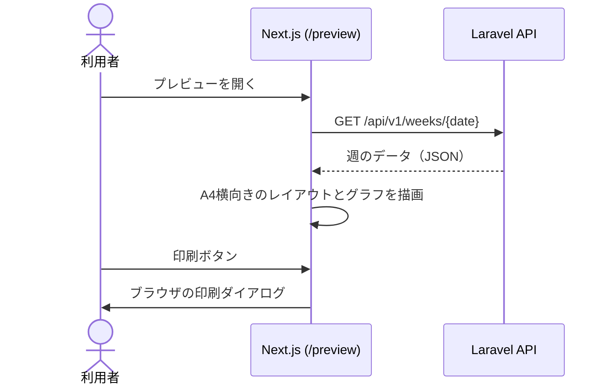

# F-07 PDF出力プレビュー — 機能設計書

> 共通事項は [設計書](../設計書.md) を参照。印刷・保存は [F-09](F-09_提出用PDF保存.md)。

| 項目 | 内容 |
| :--- | :--- |
| 機能ID / 優先度 | F-07 / 必須 |
| 画面 | W-05 PDFプレビュー画面（`/preview?date=YYYY-MM-DD`） |
| API | R-01 週の取得（専用の API は持たない） |
| テーブル | users、weeks、daily_summaries、activity_segments（R） |

## 1. 概要

紙の指定フォーマット（A4横向き）を再現した印刷プレビューを、フロントエンドで表示する。バックエンドは表示に必要なデータを R-01 で返すだけで、PDF は作らない。

## 2. 画面（W-05）

原紙（Excel）と記入例のスキャンの書式に合わせる。用紙は A4 横向き（原紙の Excel も A4 横向き）。

| 領域 | 内容（原紙の配置） |
| :--- | :--- |
| 見出し | 左上に「令和N年 M月」（週の開始日の年月。例: 2026-10-17 の週は「8 年 10 月」） |
| 24時間グリッド | 日ごとに1行（7行）。左端に「17 日(土)」の形式で日付と曜日（曜日は文字で示し、土は青・日は赤の色も付ける）。横軸は 0〜24 時（2時間ごとに数字と太い縦線、1時間ごとに点線）。15分単位の区間の境界を縦線で引き、区間の内容を区間内に表示する（幅が狭い区間は縦書き）。睡眠の区間は、1つの区間として内容を1回だけ書く。「強調する」を付けた区間は赤字・太字で書く（原紙の赤字の予定を再現。白黒印刷でも分かるよう太字も併用） |
| 右端の2列 | 「1日の気分」: `35%` の形式。「睡眠/排便」: 斜線で分けたマスで、**右上に睡眠時間**（自動計算。例 `8.0`、小数1位）。**左下（排便）は空欄**（スコープ外） |
| 下段左 | 「1日の出来事を1件でまとめましょう。」の枠に、日付つきで1日1行（例: `10/17(土): …`）。F-04 の日記 |
| 下段中 | 食事。日付つきで1日1行。F-04 の食事を、朝・昼・間食・夜（飲酒は夕食に含めて夜の後ろ）の順に並べる（例: `10/17 朝なし、昼カレースパ、夜豚しゃぶ、ビール500`、間食があれば `昼…、間食…、夜…`）。空欄の項目は出さない |
| 上部の枠 | 「今週の目標:」の1行の枠。F-11 の目標 |
| 下段 | 「気がついたことを書き出しましょう」の枠。F-11 の所感（複数行） |
| 右下 | 体調グラフ（F-06）。縦軸 10〜100（補助線は5刻み）、横軸 `（土）（日）…（金）`、◯は黒、△は赤 |
| 印刷ボタン | F-09 の操作（`window.print()`） |
| 戻るリンク | W-03 へ戻る |

- 用紙: `@page { size: A4 landscape; margin: 10mm; }`。操作用のボタンや戻るリンクは `@media print` で非表示にする。
- マス目は CSS Grid で、原紙の Excel と同じ比率にする（横は 2時間ごとの目盛りと15分単位の区間、縦は7日分の行）。
- 評価期間中は利用に制限を設けない。F-08 の決済導線は、将来の課金用に非表示にしておく。
- 記録がない週でも、空の書式を表示する。
- 日記・食事が1行に収まらない場合は、**折り返して表示する**（省略しない）。折り返した行数だけ、その日の行の高さを広げる。日記の枠と食事の枠は、日ごとに高さをそろえる。
- 折り返しで A4 の1ページに収まらなくなった場合は、文字サイズを段階的に下げて1ページに収める。

## 3. API

専用の API はない。R-01（設計書 5.2）で、`days`、`weekly_goal`、`weekly_reflection`、`week_start_day` を取得する。

## 4. データ

- 参照のみ。`weeks`（目標・所感）、`daily_summaries`、`activity_segments`、`users.week_start_day`。

## 5. 振る舞い

- 取得に失敗したときは、再試行ボタン付きのエラーを表示する（設計書 6.3）。
- 文字が長くてもセルからはみ出さないよう、折り返しと最大高さを指定する。

## 6. 受け入れ条件とテスト観点

| 受け入れ条件 | 観点 |
| :--- | :--- |
| `/preview` を開くと、W-03 と同じ内容が原紙と同じ配置の A4 横向きで表示される | 正常: 原紙と見比べて手動確認 |
| 右端の列に1日の気分（％）と睡眠時間が出て、排便の欄は空欄になる | 正常: 手動確認 |
| 強調した区間が赤字・太字で印刷される | 正常: 手動確認（白黒印刷でも太字で判別できる） |
| 食事の行が、朝・昼・間食・夜（飲酒を含む）の順で、空欄の項目を除いて出る | 正常: 間食なし・飲酒ありの日、間食あり・飲酒なしの日 |
| 今週の目標・所感が最下部に反映される | 正常: F-11 の保存内容が出る |
| 記録のない週でも空の書式が表示される | 境界: 全日未入力 |
| 長い日記・食事は折り返して全文が印刷される（省略されない） | 境界: 日記1000文字、食事100文字×5項目の日。手動確認 |
| 折り返しで行が増えても1ページに収まる | 境界: 全日で長い入力の週（文字サイズが下がる）。手動確認 |
| 長い入力でもレイアウトが崩れない | 境界: 100文字の行動、長い所感 |
| 未ログインでは開けず、W-01 に遷移する | 異常: 手動確認、R-01 が 401 |
| 他人のデータは表示されない | 異常: R-01 は自分のデータのみ（設計書 7.2） |
