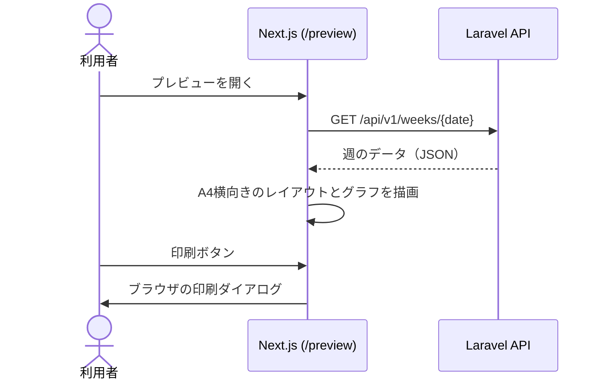

# F-07 PDF出力プレビュー — 機能設計書

> 共通事項は [設計書](../設計書.md) を参照。印刷・保存は [F-08](F-08_提出用PDF保存.md)。

| 項目 | 内容 |
| :--- | :--- |
| 機能ID / 優先度 | F-07 / 必須 |
| 画面 | W-05 PDFプレビュー画面（`/preview?date=YYYY-MM-DD`） |
| API | R-01 週の取得（専用の API は持たない） |
| テーブル | users、weeks、daily_summaries、activity_segments（R） |

## 1. 概要

紙の指定フォーマット（A4横向き）を再現した印刷プレビューを、フロントエンドで表示する。バックエンドは表示に必要なデータを R-01 で返すだけで、PDF は作らない。

## 2. 画面（W-05）

原紙（Excel）と記入例のスキャンの書式に合わせる。用紙は A4 横向き（原紙の Excel も A4 横向き）。

| 領域 | 内容（原紙の配置） |
| :--- | :--- |
| 見出し | 左上に「令和N年 M月」（週の開始日の年月。例: 2026-10-17 の週は「8 年 10 月」） |
| 24時間グリッド | 日ごとに1行（その週の日数分。通常7行）。左端に「17 日(土)」の形式で日付と曜日（曜日は文字で示し、土は青・日は赤の色も付ける）。横軸は 0〜24 時（2時間ごとに数字と太い縦線、1時間ごとに点線）。15分単位の区間の境界を縦線で引き、区間の内容を区間内に表示する（幅が狭い区間は縦書き）。**時間が重なっている時間帯だけ、行を上下2段に分け（原紙と同じ。行の高さは変えない）、その時間帯の行動内容は先頭の全角1文字（半角は2文字）だけを表示する**（F-03 の 2.1）。睡眠の区間は、1つの区間として内容を1回だけ書く。「強調する」を付けた区間は赤字・太字で書く（原紙の赤字の予定を再現。白黒印刷でも分かるよう太字も併用） |
| 右端の2列 | 「1日の気分」: `35%` の形式。「睡眠/排便」: 斜線で分けたマスで、**左上に睡眠時間**（自動計算。例 `8.0`、小数1位）。**右下（排便）は空欄**（スコープ外） |
| 下段左 | 「1日の出来事を1件でまとめましょう。」の枠に、日付つきで1日1行（例: `10/17(土): …`）。F-04 の日記 |
| 下段中 | 食事。日付つきで1日1行。F-04 の食事を、朝・昼・間食・夜（飲酒は夕食に含めて夜の後ろ）の順に並べる（例: `10/17 朝なし、昼カレースパ、夜豚しゃぶ、ビール500`、間食があれば `昼…、間食…、夜…`）。空欄の項目は出さない |
| 上部の枠 | 「今週の目標:」の1行の枠。F-10 の目標 |
| 下段 | 「気がついたことを書き出しましょう」の枠。F-10 の所感（複数行） |
| 右下 | 体調グラフ（F-06）。縦軸 10〜100（補助線は5刻み）、横軸 は週の開始曜日から順の曜日、◯は黒、△は赤 |
| 印刷ボタン | F-08 の操作（`window.print()`） |
| 戻るリンク | W-03 へ戻る |

- 用紙: `@page { size: A4 landscape; margin: 10mm; }`。操作用のボタンや戻るリンクは `@media print` で非表示にする。
- マス目は CSS Grid で、原紙の Excel と同じ比率にする（横は 2時間ごとの目盛りと15分単位の区間、縦はその週の日数分（通常7日）の行）。
- ログインしたすべての利用者が、追加料金なしで、すぐに保存・印刷できる（F-08）。
- 記録がない週でも、空の書式を表示する。
- **複数ページにまたがる出力は認めない。必ず A4 横向き1ページに収める。** シート全体の高さを、用紙の印刷可能な高さ（A4 横 210mm − 上下の余白 20mm = 190mm）に固定し、`break-inside: avoid`・`page-break-after: avoid` を指定する。
- 日記（150文字以内）・食事（1日の合計120文字以内）が1行に収まらない場合は、**折り返して表示する**（省略しない）。折り返した行数だけ、その日の行の高さを広げる。日記の枠と食事の枠は、日ごとに高さをそろえる。
- **文字サイズの自動縮小（フロントエンドの制御）**: 折り返しの結果、1ページに収まらない場合**に限り**、日記・食事記録エリア全体（全日分を同じサイズで）の文字サイズを段階的に下げる。
  - 標準 9pt から、8.5 → 8 → 7.5 → 7 → 6.5 → 6pt（下限）の順に下げる。各段階で、描画後にシートの高さを測り、収まった時点で止める。収まる場合は標準サイズのまま変えない。
  - 画面（W-05 のプレビュー）と印刷で、同じ結果になるようにする（印刷前に確定したサイズを、印刷用 CSS に反映する）。
  - 他の領域（24時間グリッド、グラフ、今週の目標）の文字サイズは変えない。
  - 今週の所感（250文字以内）の枠は、日記・食事とは独立に、同じ段階で文字サイズを下げる（収まる場合は標準のまま）。今週の目標（80文字以内）は、1行の枠に標準サイズで収まる量に制限している。
- 入力の上限（日記150文字、食事の合計120文字、目標80文字、所感250文字）は、最大入力でも下限の 6pt で1ページに収まるように、原紙の枠の寸法から見積もって定めている（収まることは、実装後に実測で確認する）。

### 2.1 スマホで開いたときの表示

サーバーで PDF を作ったり保存したりしない（無料枠の制約）ため、スマホでの表示もフロントエンド（Next.js）の CSS で制御する。

| 項目 | 内容 |
| :--- | :--- |
| 初期の縮小表示 | スマホ（`md` 未満）で W-05 を開くと、A4 横向き1ページ分の記録表の全体が、画面の横幅（100%）にちょうど収まるよう、`transform: scale()` などで自動的に縮小して描く（縮小率は画面幅と用紙の幅から計算する）。縦に持ったままでも、紙1枚の全体のイメージが一目で分かる |
| 拡大・スクロール | 縮小で小さくなった日記・食事などの文字は、ピンチ操作（2本指の拡大・縮小）、または画面上のズームボタン（拡大・縮小・全体表示に戻す）で拡大し、スクロールして確認できる。ページの表示倍率の変更を妨げないよう、`viewport` で拡大を禁止しない |
| 印刷への影響 | 縮小（`transform`）は画面表示だけに使う。印刷（`@media print`）では縮小を解除し、A4 横向き・余白10mm・1ページの指定で出力する。画面の縮小率が、印刷結果に影響しない |
| 操作ボタン | 印刷ボタンと戻るリンク（W-03 へ）は、縮小の対象にせず、画面の幅に合わせた大きさで常に押せる位置に置く |

## 3. API

専用の API はない。R-01（設計書 5.2）で、`days`、`weekly_goal`、`weekly_reflection`、`week_start_day` を取得する。

## 4. データ

- 参照のみ。`weeks`（目標・所感）、`daily_summaries`、`activity_segments`、`week_start_settings`。

## 5. 振る舞い

- 取得に失敗したときは、再試行ボタン付きのエラーを表示する（設計書 6.3）。
- 文字が長くてもセルからはみ出さないよう、折り返しと最大高さを指定する。

## 6. 受け入れ条件とテスト観点

| 受け入れ条件 | 観点 |
| :--- | :--- |
| `/preview` を開くと、W-03 と同じ内容が原紙と同じ配置の A4 横向きで表示される | 正常: 原紙と見比べて手動確認 |
| 右端の列に1日の気分（％）と睡眠時間が出て、排便の欄は空欄になる | 正常: 手動確認 |
| 重なっている時間帯だけ上下2段になり、先頭の1文字が印刷される | 正常: 手動確認（重なっていない時間帯は1段のまま） |
| 強調した区間が赤字・太字で印刷される | 正常: 手動確認（白黒印刷でも太字で判別できる） |
| 食事の行が、朝・昼・間食・夜（飲酒を含む）の順で、空欄の項目を除いて出る | 正常: 間食なし・飲酒ありの日、間食あり・飲酒なしの日 |
| 今週の目標・所感が最下部に反映される | 正常: F-10 の保存内容が出る |
| 記録のない週でも空の書式が表示される | 境界: 全日未入力 |
| 長い日記・食事は折り返して全文が印刷される（省略されない） | 境界: 日記150文字、食事の合計120文字の日。手動確認 |
| どの週でも、印刷が必ず A4 横向き1ページになる（2ページ目ができない） | 境界: 全日で日記150文字・食事の合計120文字、目標80文字、所感250文字の週。印刷プレビューのページ数が1。手動確認 |
| 1ページに収まる週は、標準の文字サイズのまま（縮小されない） | 正常: 短い入力の週。手動確認 |
| 収まらない週は、日記・食事記録エリア全体の文字サイズだけが段階的に下がる | 境界: 文字サイズが下がり、他の領域は変わらない。手動確認 |
| 長い入力でもレイアウトが崩れない | 境界: 100文字の行動、長い所感 |
| 未ログインでは開けず、W-01 に遷移する | 異常: 手動確認、R-01 が 401 |
| 他人のデータは表示されない | 異常: R-01 は自分のデータのみ（設計書 7.2） |
| スマホで開くと、A4 横向き1ページ全体が画面の横幅に収まる | 正常: iPhone の Safari で手動確認（縦持ちで全体が見える） |
| ピンチ操作とズームボタンで拡大・縮小・スクロールができる | 正常: 手動確認 |
| スマホで縮小表示していても、印刷（PDF）は縮小されず、A4 横向き1ページで出る | 異常: 縮小表示のまま印刷して、サイズ・ページ数を確認（手動確認） |
