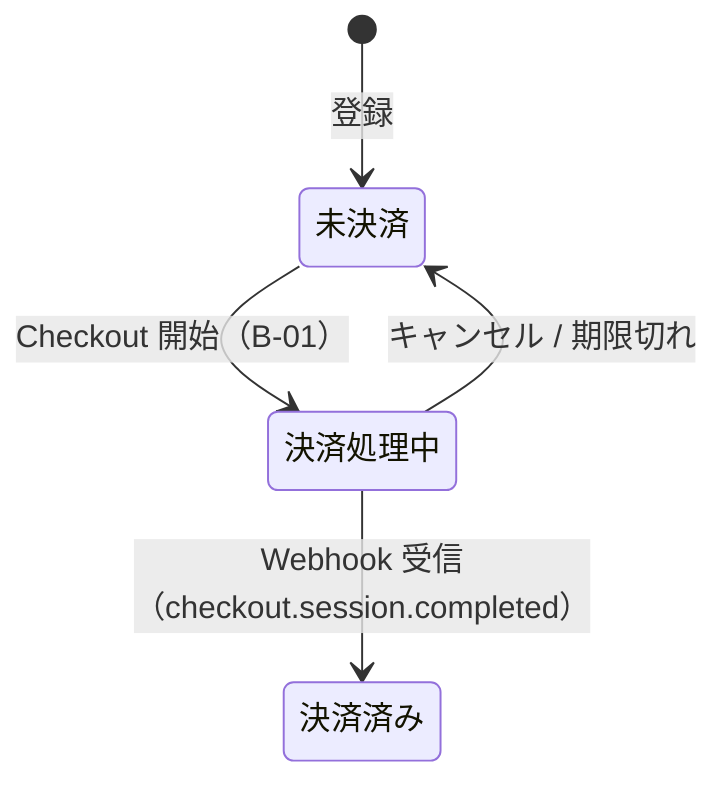
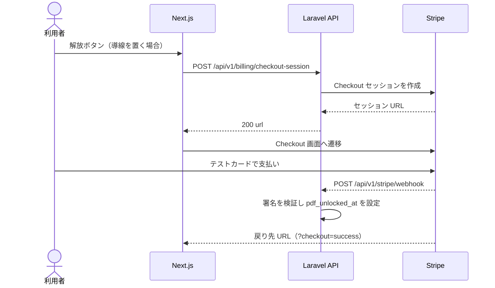

# F-08 Stripe決済連携（サンドボックス） — 機能設計書

> 共通事項は [設計書](../設計書.md) を参照。優先度は「優先」。サンドボックス（テストモード）のみで構築し、本番利用は将来の課金開始まで対象外。

| 項目 | 内容 |
| :--- | :--- |
| 機能ID / 優先度 | F-08 / 優先（サンドボックスのみ） |
| 画面 | W-05（導線）、W-06 Stripe の Checkout 画面（外部） |
| API | B-01 `POST /api/v1/billing/checkout-session`、B-02 `POST /api/v1/stripe/webhook` |
| テーブル | users（U：`pdf_unlocked_at`） |

## 1. 概要

将来の課金（PDF 保存機能の解放）に備えた決済機能。Stripe Checkout（サンドボックス）で1回払いの決済を行い、完了すると `users.pdf_unlocked_at` を設定する。**評価期間中は PDF の作成を制限しない**（F-09）ため、決済の有無は機能の利用に影響しない。

## 2. 画面

- W-05 には決済の導線を置かない（バックエンドの B-01・B-02 のみ用意する）。将来、導線を設けるときは「テスト用の決済です」と明示する。
- 決済後の戻り先: 成功は `{FRONTEND_URL}/preview?checkout=success`、キャンセルは `?checkout=cancel`。
- 決済画面（W-06）は Stripe が提供する。カード情報は当アプリのサーバー・画面を通らない。
- テストカード: Stripe が公開しているテスト用カード番号のみを使う。

## 3. API

**B-01 決済セッションの開始** `POST /api/v1/billing/checkout-session`（認証必要、CSRF 必須）

```json
// 出力 200
{ "data": { "url": "https://checkout.stripe.com/c/pay/..." } }
```

- フロントは `url` へ遷移する。すでに `pdf_unlocked_at` がある場合は 409（決済済み）。
- Checkout セッションは `mode=payment`、価格は `STRIPE_PRICE_ID`、`client_reference_id` に `users.id` を入れる。

**B-02 Stripe の Webhook** `POST /api/v1/stripe/webhook`（認証は署名検証）

- `Stripe-Signature` を `STRIPE_WEBHOOK_SECRET` で検証する。不正なら 400。
- 対象イベントは `checkout.session.completed`。`client_reference_id` の利用者の `pdf_unlocked_at` を現在時刻にする。すでに設定済みなら何もしない（再送に対して結果が変わらない）。
- その他のイベントは 200 で無視する。CSRF 検証の対象外にする。

| ステータス | 条件 |
| :--- | :--- |
| 401 | B-01 を未ログインで呼んだ |
| 409 | B-01 を決済済みの利用者が呼んだ |
| 400 | B-02 の署名が不正 |
| 502 | B-01 で Stripe API が失敗した（他機能には影響させない） |

## 4. データ

- `users.pdf_unlocked_at`（timestamp、NULL=未決済）。A-04 の `pdf_unlocked` は `pdf_unlocked_at` が NULL でないかどうか。
- Stripe の秘密情報（`STRIPE_SECRET`、`STRIPE_WEBHOOK_SECRET`）は環境変数にのみ置く。

## 5. 振る舞い





- Webhook が失敗した場合は Stripe が再送する。ブラウザの戻りだけでは `pdf_unlocked_at` を設定しない（改ざんを防ぐ）。
- Stripe の障害時は、この機能だけがエラーになり、他の機能は影響を受けない。

## 6. 受け入れ条件とテスト観点

| 受け入れ条件 | 観点 |
| :--- | :--- |
| テストカードで決済すると、`pdf_unlocked_at` が設定される | 正常: Webhook の処理（Stripe はモックし、署名付きのリクエストで確認） |
| 署名が不正な Webhook は拒否される | 異常: 400、`pdf_unlocked_at` は変わらない |
| 同じイベントが再送されても結果が変わらない | 境界: 2回送って `pdf_unlocked_at` が最初の時刻のまま |
| 決済済みの利用者は再度開始できない | 異常: B-01 が 409 |
| 未ログインでは B-01 を呼べない | 異常: 401 |
| 決済の有無に関わらず PDF を作成できる | 正常: F-09 に制限がない |
| 本物のカードは使えない | テストモードのキーのみ設定（手動確認） |
