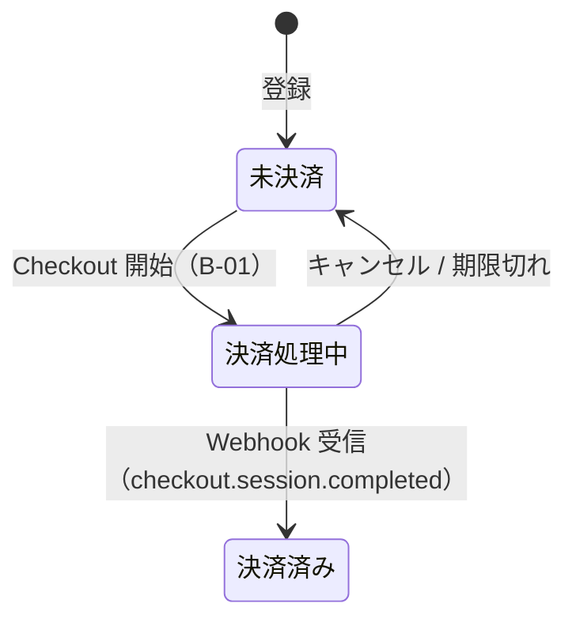
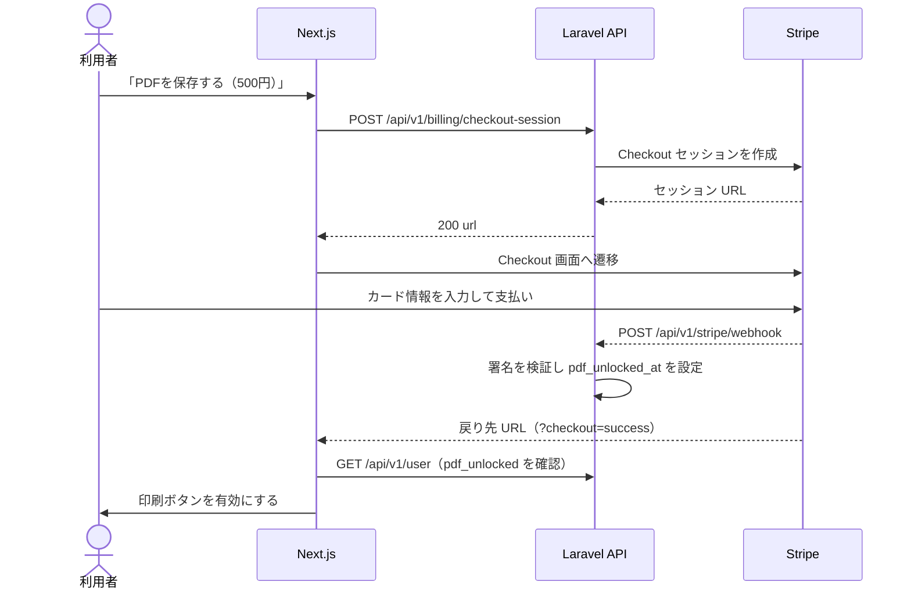

# F-08 Stripe決済連携 — 機能設計書

> 共通事項は [設計書](../設計書.md) を参照。優先度は「必須」。開発中・評価中は Stripe のテストモード、本番は正規の Stripe を使い、**利用者に見える画面・操作は変えない**（利用者にテストであることを意識させない）。

| 項目 | 内容 |
| :--- | :--- |
| 機能ID / 優先度 | F-08 / 必須 |
| 画面 | W-05（決済導線）、W-06 Stripe の Checkout 画面（外部） |
| API | B-01 `POST /api/v1/billing/checkout-session`、B-02 `POST /api/v1/stripe/webhook` |
| テーブル | users（U：`pdf_unlocked_at`） |

## 1. 概要

PDF の保存・印刷（F-09）を解放するための決済機能。Stripe Checkout で、商品 **「生活記録表アプリRePace」**・価格 **500円**（1回払い。見直しの可能性あり）を決済し、成功すると `users.pdf_unlocked_at` を設定する。**決済に成功した利用者のみ**、PDF の保存・印刷ができる。

| 時期 | Stripe | カード情報 |
| :--- | :--- | :--- |
| 開発中・評価中 | テストモード（テスト用のキー・商品・価格） | Stripe が公開しているダミーのカード情報。評価者には口頭で伝え、他者に口外しないよう依頼する。リポジトリや文書には書かない |
| 本番 | 正規の Stripe（本番のキー・商品・価格） | 利用者の実際のカード情報（Stripe の画面に入力する。当アプリは受け取らない） |

- 切り替えは環境変数（`STRIPE_SECRET`、`STRIPE_WEBHOOK_SECRET`、`STRIPE_PRICE_ID`）だけで行い、画面とコードは変えない。
- 商品と価格は、テストモードと本番のそれぞれで Stripe のダッシュボードに作成する。価格を見直すときは、新しい価格を作成して `STRIPE_PRICE_ID` を差し替える。

## 2. 画面

- W-05: 未決済のとき、印刷ボタンは無効にし、「PDFを保存する（500円）」の導線を表示する。決済済みのときは、導線は表示せず、印刷ボタンを有効にする。
- 「テスト用」「サンドボックス」などの表示は、当アプリの画面には出さない（開発中・評価中・本番で同じ画面）。
- 決済後の戻り先: 成功は `{FRONTEND_URL}/preview?checkout=success`、キャンセルは `?checkout=cancel`。成功で戻ったときは、決済の反映（Webhook）を待ってから、印刷ボタンを有効にする（反映が遅い場合は数秒おきに A-04 を確認する）。
- 決済画面（W-06）は Stripe が提供する。カード情報は当アプリのサーバー・画面を通らない。

## 3. API

**B-01 決済セッションの開始** `POST /api/v1/billing/checkout-session`（認証必要、CSRF 必須）

```json
// 出力 200
{ "data": { "url": "https://checkout.stripe.com/c/pay/..." } }
```

- フロントは `url` へ遷移する。すでに `pdf_unlocked_at` がある場合は 409（決済済み）。
- Checkout セッションは `mode=payment`、価格は `STRIPE_PRICE_ID`（「生活記録表アプリRePace」500円）、`client_reference_id` に `users.id` を入れる。

**B-02 Stripe の Webhook** `POST /api/v1/stripe/webhook`（認証は署名検証）

- `Stripe-Signature` を `STRIPE_WEBHOOK_SECRET` で検証する。不正なら 400。
- 対象イベントは `checkout.session.completed`。`client_reference_id` の利用者の `pdf_unlocked_at` を現在時刻にする。すでに設定済みなら何もしない（再送に対して結果が変わらない）。
- その他のイベントは 200 で無視する。CSRF 検証の対象外にする。
- Webhook のエンドポイントは、テストモードと本番で別々に Stripe に登録する（署名の秘密鍵も別）。

| ステータス | 条件 |
| :--- | :--- |
| 401 | B-01 を未ログインで呼んだ |
| 409 | B-01 を決済済みの利用者が呼んだ |
| 400 | B-02 の署名が不正 |
| 502 | B-01 で Stripe API が失敗した（他機能には影響させない） |

## 4. データ

- `users.pdf_unlocked_at`（timestamp、NULL=未決済）。A-04 の `pdf_unlocked` は `pdf_unlocked_at` が NULL でないかどうか。
- Stripe の秘密情報（`STRIPE_SECRET`、`STRIPE_WEBHOOK_SECRET`）は環境変数にのみ置く。
- 解放は1回の決済で、以後ずっと有効（`pdf_unlocked_at` は消さない）。

## 5. 振る舞い





- Webhook が失敗した場合は Stripe が再送する。ブラウザの戻りだけでは `pdf_unlocked_at` を設定しない（改ざんを防ぐ）。
- Stripe の障害時は、この機能だけがエラーになり、他の機能（記録・閲覧・プレビュー）は影響を受けない。

## 6. 受け入れ条件とテスト観点

| 受け入れ条件 | 観点 |
| :--- | :--- |
| テスト用のダミーのカード情報で決済すると、`pdf_unlocked_at` が設定され、印刷できるようになる | 正常: Webhook の処理（Stripe はモックし、署名付きのリクエストで確認）。画面は手動確認 |
| 決済に失敗・キャンセルした場合は、未決済のままで印刷できない | 異常: キャンセルで戻ると `pdf_unlocked` が false |
| 署名が不正な Webhook は拒否される | 異常: 400、`pdf_unlocked_at` は変わらない |
| 同じイベントが再送されても結果が変わらない | 境界: 2回送って `pdf_unlocked_at` が最初の時刻のまま |
| 決済済みの利用者は再度開始できない | 異常: B-01 が 409 |
| 未ログインでは B-01 を呼べない | 異常: 401 |
| 当アプリの画面に「テスト」「サンドボックス」の表示がない | 手動確認 |
| 開発中・評価中と本番で、画面・コードが同じで、環境変数だけが違う | 手動確認 |
| 本番では、テスト用のダミーのカード情報が使えない | 手動確認（本番のキーで確認） |
