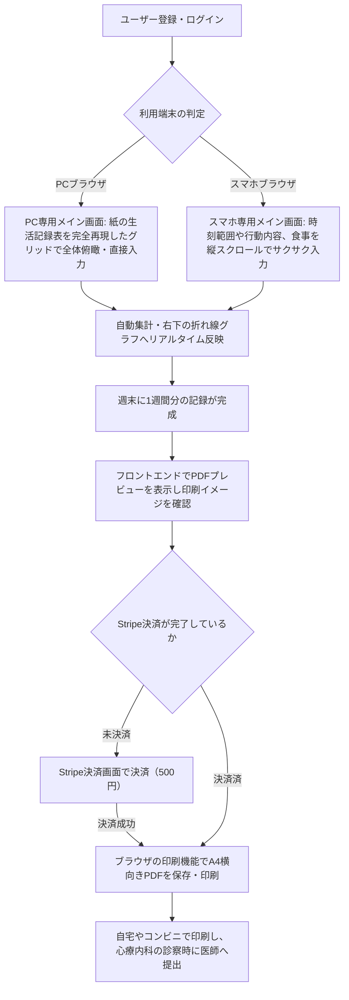

# 要件定義書

## 1. 概要
- **プロダクト名**: RePace - 週間行動＆気分記録アプリ
- **一文の説明**: リワーク復職支援で用いられる24時間の行動記録と気分・疲労感の数値可視化をデジタル化し、生活リズムの崩れを自己管理・検証できるWebアプリ。
- **背景と目的**: 前々からデジタル化したいと考えていた。EXCELシートは作っているが、入力の手間や思い通りに入力できないこともある、結局は手書きのままで運用している。
- **公開 URL**: （最終提出時に記載）

## 2. ビジネス要件

### 2.1 顧客セグメントとアーリーアダプター
- **誰の課題か（その人たちはおよそ何人いるか）**:
  うつ病や適応障害等からの復職を目指し、医療機関の指示やリワークプログラム（復職支援）で生活記録表の提出を求められている休職者。潜在的な対象者は全国に数万人以上、自身が所属していたリワークの規模感（過去の在籍者含め）としては約100名。
- **最初に使ってもらう人（アーリーアダプター）**:
  開発者自身（現在も習慣として生活記録をつけているため）、および元リワークの同期メンバー（身近な1名に検証協力を依頼）。
- **対象にしない人**:
  主治医やリワーク施設のスタッフなどの医療関係者（本アプリは利用者の自己管理・提出の省力化のためのツールであり、医療従事者側の管理システムではないため）。

### 2.2 課題と既存の代替手段
- **解く課題（3つ以内）**:
  1. **手書きによる記録・集計の手間**: 24時間を手書きで埋める、気分や疲労感を毎日5刻みの数値で計算してグラフを手描きする心理的・物理的負担。
  2. **提出・共有の不便さ**: 診察時に医師へ提出するためだけに、原本をそのまま持参するか、都度コンビニでコピーを取らなければならない手間。
  3. **フォーマットの形骸化とデータの蓄積不足**: 自由記述すぎるツールでは続かず、逆に紙のままだと過去の体調トレンド（「先月と比べてどう変化したか」）を遡って客観的に比較・分析することが困難。
- **その人が今どう対処しているか**:
  施設指定の紙の書式に毎日手書きで記入している。電子化を試みる人はExcelシートを自作しているが、スマホからの入力が極めて難しく、結局は手書き運用に戻っている。また、医師に見せるためにタブレットのカメラで写真撮影して保存している。
- **課題を知った経緯**:
  開発者自身がリワーク参加前に医師から行動記録の指示を受け、参加後は指定フォーマットでの手書き記録を義務付けられた経験から。周りのメンバーからも「毎日手描きでグラフを作るのが面倒」「診察前に慌ててコピーを取るのがストレス」という生の声を直接聞いていたため。

### 2.3 独自の価値提案
- **一文の価値提案**:
  世間にある汎用的な日記・スケジュールアプリと違い、**「リワークや心療内科で実際に使われる『24時間時間軸＋気分・疲労感の数値プロットグラフ』のフォーマットを完全に再現し、PC・スマホ双方から入力・過去ログ確認・提出用PDF印刷までを完結できる」**休職者専用の生活記録Webアプリ**。
- **既存の代替手段との違い**:
  一般的なライフログアプリはグラフの形式が固定されていたり、医療提出用のA4横向き印刷に対応していません。本アプリは、紙の手軽さ（選択式による入力アシスト）と、デジタルの強み（データベース化による過去のトレンド比較、1クリックでのA4提出用PDF生成）を両立しています。

### 2.4 ソリューション
- **課題に対応する主要機能**:
  - **選択式24時間タイムライン入力**: よく使う活動内容（睡眠、介護、TVなど）を選択肢からサクサク入力でき、独自の活動も自動で選択肢に学習・追加される入力アシスト機能。
  - **体調・疲労感の連動プロットグラフ**: 朝の気分（◯）と1日の疲労感（△）を5〜100の5刻みで入力すると、右下の折れ線グラフに自動で反映される機能。あわせて、1日の総合的な気分（％）を5％刻みの選択式で記録できる。
  - **提出用A4横向きPDF生成機能**: 医師や施設へそのまま提出できる、紙の指定フォーマットを忠実に再現したPDFの出力機能。プレビューはフロントエンドで表示し、PDF化はブラウザの印刷機能（「PDFとして保存」）で行う。
  - **3食分の食事・出来事のデイリーサマリー記録**: 朝食・昼食・夕食に加え、間食（昼食と夕食の間）と飲酒（夕食に含める）も、1日の生活習慣としてテキストで補足できる自由記述欄。間食や飲酒がない利用者は空欄のままでよい。

### 2.5 チャネル・収益・コスト
- **利用者に届ける経路**:
  まずは初期検証として、身近な元リワークメンバーやコミュニティへ直接URLを共有し、口コミを通じてアーリーアダプターを獲得する。将来的には、Web検索（「生活記録表 アプリ」「リワーク 生活記録表 PDF」など）のSEO対策を通じて、全国の休職者へリーチする。
- **お金の流れ（何をもって成功とするか）**:
  **【開発期間中・アーリーアダプター評価期間中の定義】**：COACHTECHの技術制約（完全無料・カード登録なし）を遵守するため、インフラ・DBに課金せず、基本機能（記録・閲覧・プレビュー）は無料で提供する。PDFの保存・印刷のみ、Stripeでの決済（500円・1回払い）に成功した利用者に限る。開発中・評価中はStripeのテストモード（ダミーのカード情報）で決済し、評価者にはダミーのカード情報を口頭で伝える（他者への口外を禁止するようお願いする）。画面と操作は、開発中・評価中・本番で変えない（利用者にテストであることを意識させない）。ユーザーが「スムーズにユーザー登録し、1週間継続して記録をつけ、PDFプレビューできたこと」をもって成功とする。
  **【本番のビジネスモデル】**：本番では、正規のStripe（本番キー）と実際のカード情報で決済する。基本機能は無料、PDFの保存・印刷を、Stripeを通じた1回限りの機能解放課金（都度課金・500円。見直しの可能性あり。アーリーアダプターの意見を聞いて見直す）とするモデルを目指す。商品名は「生活記録表アプリRePace」。
- **外部サービス・素材の費用と権利**:
  - Stripe: 決済サービス（商品「生活記録表アプリRePace」、500円。開発中・評価中はテストモードで費用無料。本番は正規のStripeで、決済手数料が決済額から差し引かれる）
  - Vercel: フロントエンドホスティング（無料プラン。カード登録不要）
  - Render: バックエンドAPIホスティング（無料プラン。カード登録不要）
  - TiDB Cloud Starter: MySQL互換のマネージドDB（無料枠・カード登録不要。行ストレージ5GiB、月5,000万RU）。Render（MySQL非対応）とAivenは不採用。制約と検証結果は設計書（1.7）を参照
  - Claude Code: AI開発エージェント（Proプラン導入済み、自己負担）

### 2.6 主要指標と検証
- **成功を測る指標**:
  - ユーザー登録したアーリーアダプターの「1週間以上の継続記録率（リテンション率）」50%以上。
  - 実際に医師へ提出するための「PDF生成機能」の実行回数。
- **前提となる仮説と確かめ方**:
  - **仮説**: 「手書きやExcelの入力に挫折した人でも、スマホ・PCからの選択式入力と自動グラフ化があれば、負担なく生活記録を継続でき、医師への提出ストレスも軽減される」。
  - **確かめ方**: 協力してくれる身近な休職者（1名）に実際に1週間アプリを使って生活記録をつけてもらい、週末にPDFを出力して医師に見せてもらう。その後、入力のしやすさや提出時の便益についてフィードバックをヒアリングする。

### 2.7 圧倒的な優位性
- **既存の提供者がそれをしていない理由**:
  大手企業が提供するヘルスケアアプリは「歩数」や「体重」「睡眠時間」といった自動計測データに特化しており、精神科医療やリワークという「ニッチかつ特定の書式を必要とする領域」に特化したA4印刷フォーマットの出力に対応していないため。
- **真似されにくい点（どう築くか）**:
  自身が実際にリワークプログラムを経験し、医師の指示の意図や、紙のフォーマットの「どの項目がなぜ必要なのか」を熟知しているというドメイン知識（当事者目線）。これに基づき、休職者のメンタル状態でもストレスなく操作できる、徹底的に削ぎ落とされたUI/UXを構築することで先行優位性を築く。

## 3. 業務要件
利用者がアプリを使って日々の記録をつけ、医師や施設に提出するまでの一般的な流れ（ユースケース）は以下の通りです。

## 4. 機能要件

### 4.1 機能一覧（優先度つき）

| 機能ID | 機能名 | 優先度 | 機能概要 |
| :--- | :--- | :---: | :--- |
| F-01 | ユーザー登録 | 必須 | ユーザー名（表示名）、メールアドレス、パスワード、パスワード（確認用）の4つを入力してアカウントを作成する。ログインにはメールアドレスを用いる。 |
| F-02 | ログイン・ログアウト | 必須 | メールアドレスとパスワードで認証を行う。未ログイン時は保護されたページおよびAPIへのアクセスを遮断する。 |
| F-03 | 24時間行動記録入力 | 必須 | **【PC】**24時間のタイムラインに、15分単位の区間（範囲を選択）と行動内容を入力する。 **【スマホ】**行動の開始/終了時刻（15分刻み）と行動内容を選択・入力するフォーム形式。よく使う独自項目は自動で選択肢に学習・追加される。「睡眠」の区間の合計から、1日の睡眠時間を自動で計算する。 |
| F-04 | 3食食事記録・日記入力 | 必須 | 朝食・昼食・夕食に加え、間食（昼食と夕食の間）と飲酒（夕食に含める）のテキスト、および1日の出来事をまとめる日記（テキスト。**150文字以内**）の入力機能。間食・飲酒は任意。食事（朝食・昼食・間食・夕食・飲酒）は、1日の合計を**120文字以内**とする（印刷を1ページに収めるため）。 |
| F-05 | 気分・疲労感数値記録 | 必須 | 朝の気分の良さ（◯）と1日の疲労感（△）を5〜100の5刻みで記録する。あわせて、1日の気分（％。朝の気分とは別の、その日の総合的な気分）を5〜100％の5％刻みの選択式で記録する。 |
| F-06 | 体調追跡グラフ自動生成 | 必須 | 記録された気分（◯）と疲労感（△）を元に、設定された開始曜日から1週間軸の折れ線グラフを自動描写する。 |
| F-07 | PDF出力プレビュー | 必須 | 元の紙の指定フォーマット（A4横向き）を忠実に再現した印刷プレビュー画面を**フロントエンドで**表示する（印刷用CSSで用紙サイズ・向きを指定）。**生活記録表は複数ページにまたがる出力を認めず、必ずA4横向き1ページに収める。** 日記・食事記録が多くて1ページに収まらない場合に限り、日記・食事記録エリア全体の文字サイズを段階的に下げる。今週の目標や所感も最下部に反映される。バックエンドはプレビューに必要なデータをAPIで返すのみ。 |
| F-08 | Stripe決済連携 | 必須 | PDFの保存・印刷を解放するための決済機能。商品「生活記録表アプリRePace」、価格500円（1回払い。見直しの可能性あり）。Stripe Checkoutで決済する。開発中・評価中はテストモード（ダミーのカード情報）、本番は正規のStripe・実際のカード情報とし、利用者に見える画面・操作は変えない。 |
| F-09 | 提出用PDF保存・ダウンロード| 必須 | プレビュー画面から**ブラウザの印刷機能**を呼び出し、A4横向き**1ページ**でPDFとして保存・印刷できる（2ページ以上にはしない）。**Stripe決済に成功した利用者のみ**保存・印刷できる（未決済ではプレビューのみ）。バックエンドはPDFを生成せず、表示に必要なデータをAPIで返すのみ。 |
| F-10 | 週開始曜日設定 | 優先 | 週の開始曜日は人によって異なるため、既定は**月曜始まり**とし、設定画面でカレンダーから「週の開始日」を選ぶと、その日の曜日が開始曜日になる。**すでに記録がある週は当時の開始曜日のまま維持し、選んだ日以降の新しい週から新しい開始曜日を適用する**（変則週や欠損期間を示す専用のフラグは設けない）。 |
| F-11 | 1週間の所感入力 | 必須 | 週末に、その週全体の振り返り（今週の目標は**80文字以内**、今週の所感は**250文字以内**。原紙の枠に合わせた上限）を入力・保存できる機能。 |

### 4.2 画面一覧

| 画面ID | 画面名 | 対応URL | 画面概要・レスポンシブ要件 |
| :--- | :--- | :--- | :--- |
| W-01 | ログイン画面 | `/login` | メールアドレス、パスワードの2入力によるシンプルな認証画面。 |
| W-02 | ユーザー登録画面 | `/register` | ユーザー名、メールアドレス、パスワード、確認用パスワードの4入力による新規作成画面。 |
| W-03 | メイン画面（記録表） | `/` | 設定された「開始曜日」を基準に自動で1週間分（通常7日間。開始曜日を切り替える直前の1週のみ7日未満）の枠を構成。 **【PC】**元の生活記録表そのもののレイアウト（24時間グリッド、食事、グラフ、今週の目標・所感が一画面に収まる形）。 **【スマホ】**行動時刻範囲、行動内容、食事記録（3食）、日記、数値を上から順に配置した縦スクロールの入力フォーム。画面下部に週の目標・所感エリアを配置。 |
| W-04 | 設定画面 | `/settings` | カレンダーで週の開始日を選ぶと、その日の曜日が1週間の始まりの曜日として設定される画面。 |
| W-05 | PDFプレビュー画面 | `/preview` | A4横向きの紙のフォーマットを完全に再現したプレビュー。必ずA4横向き1ページに収める（日記・食事が多い場合のみ、その領域の文字サイズを段階的に下げる）。未決済時は「保存ボタン」を非活性にして決済導線を表示し、決済済みの利用者のみ保存・印刷できる（F-09）。 |
| W-06 | 決済画面（Stripe） | 外部URL | Stripeが提供する安全なチェックアウト画面。開発中・評価中はテストモード（ダミーのカード情報）、本番は正規の決済。 |

### 4.3 主なデータ
* **ユーザーデータ**: ユーザーID、ユーザー名（表示名）、メールアドレス（ログインID）、パスワードハッシュ、Stripe決済ステータス（PDF保存の解放。決済の完了日時）
* **週開始曜日の設定データ**: 利用者ID、開始曜日（`week_start_day`: 0=日, 1=月... 6=土。**既定は月曜（1）**）、有効開始日。設定を変更しても過去の週は当時の開始曜日のまま維持するため、変更の履歴を持つ（設定画面でカレンダーから日付を選ぶと、その日の曜日が、選んだ日以降の新しい週に適用される）
* **行動記録データ**: 記録日、開始時刻・終了時刻（15分単位の区間）、行動内容テキスト、睡眠フラグ、強調フラグ（赤字で書いていた重要な予定を強調する。印刷時に赤字で表示）（睡眠時間は睡眠の区間の合計から自動計算し、保存しない）
* **サマリーデータ（日次）**: 記録日、朝の気分値（5〜100の5刻み）、疲労感値（5〜100の5刻み）、1日の気分（5〜100％の5％刻み）、朝食内容、昼食内容、間食内容（昼食と夕食の間）、夕食内容、飲酒内容（夕食に含める）、1日の日記（150文字以内）、食事の合計（120文字以内）
* **週次データ**: 週ID、ユーザーID、対象週の開始日、今週の目標（`weekly_goal`。80文字以内）、今週の所感（`weekly_reflection`。250文字以内）

### 4.4 外部インタフェース
* **Stripe API**: PDF保存の解放のための決済ステータス同期（Webhook）。開発中・評価中はテストモードのキー、本番は本番のキーを使い、環境変数で切り替える（画面・コードは変えない）。
* **内部API（Laravel → Next.js）**: プレビューとPDF生成に必要なデータ（週次の行動記録、日次サマリー、週次の目標・所感、ユーザー設定）をJSONで返す。PDFのレイアウト描画はフロントエンドが担い、PDF化はブラウザの印刷機能で行う。バックエンドはPDFを生成・保持しない。

## 5. 非機能要件
* **認証と権限**: Laravel Sanctum等によるセッション/トークン認証を実装（ログインIDはメールアドレス）。未ログイン状態でメイン画面やPDFプレビュー、および各種APIエンドポイント（`/api/*`）にアクセスした場合は、一律で401エラーを返しログイン画面へ強制リダイレクトする。
* **個人データの扱い**: パスワードは必ずハッシュ化（Bcrypt等）してデータベースに保存する。
* **レスポンシブ対応**: Tailwind CSSを用い、PCとスマホの画面幅（ブレイクポイント）を検知してコンポーネントの表示レイアウトを完全に切り替える。

## 6. 制約条件
* **開発期間**: 8週間（要件定義〜設計〜実装〜デプロイ〜検証まで）
* **費用・インフラの制約**: 完全無料枠で運用。クレジットカード登録が不要なプラン（Vercelの無料枠、Renderの無料Web Service、TiDB Cloud Starterの無料枠）を厳選して構築する。DBは、クレジットカード登録が不要なTiDB Cloud Starter（MySQL互換）を使用する（Render・Aivenは不採用）。
* **技術スタック**:
  * フロントエンド: Next.js 16.4.4 (React 19.3.0, Tailwind CSS v4) (frontend/ ディレクトリ配下)
  * バックエンド: PHP 8.5 / Laravel 13.x (リポジトリルート直下。ローカルのDocker環境・本番ともPHP 8.5に固定)
  * データベース: MySQL互換（ローカル開発はMySQL 8.0、本番はTiDB Cloud Starter。テスト時は sqlite メモリDB）
  * PDFのプレビュー・生成: フロントエンド側で実装。PDF化はブラウザの印刷機能を使用（バックエンドはデータの保持とAPIでの受け渡しのみ）
* **AIの利用**: 開発およびデバッグにはすべて「Claude Code」を使用し、生成されたコードのロジックは開発者がすべて口頭説明できるように理解を徹底する。

## 7. スコープ外
* **医療従事者用管理画面**: 主治医やリワーク施設スタッフがログインして患者のデータを閲覧・管理する機能は今回作成しない（あくまで利用者が印刷して手渡しする業務フローをデジタル化するため）。
* **評価期間中の実際のカードでの課金**: 開発中・評価中はStripeのテストモード（ダミーのカード情報）のみで決済し、実際のカードでの課金は行わない。本番での正規のStripe・実際のカードによる課金は、評価期間の終了後に切り替える。
* **複数ページにまたがる出力**: 生活記録表のPDF・印刷は、必ずA4横向き1ページに収める。2ページ以上になる出力は行わない（文字数の制限と、文字サイズの自動縮小で1ページに収める）。
* **排便の記録**: 原紙の「睡眠/排便」欄の排便は記録しない（印刷時は空欄とする）。
* **サーバー側でのPDF生成・保存**: PDFのプレビューはフロントエンドで行い、PDF化はブラウザの印刷機能に任せる。バックエンドにPDF生成機能やPDFファイルの保管は持たせない。
* **PDFライブラリによるPDFファイルの直接生成**: ブラウザの印刷機能を使うため、今回は対象外とする。
* **永続的な過去データの無制限保存**: 無料DBの容量制限を考慮し、数年レベルの過去ログをすべて保持する機能やデータエクスポート機能は今回のスコープ外とする。

## 8. 更新履歴
（※1回目の要件レビュー提出から変更があった場合、ここに内容と理由を追記します。現時点では空欄、または未記入で問題ありません）
