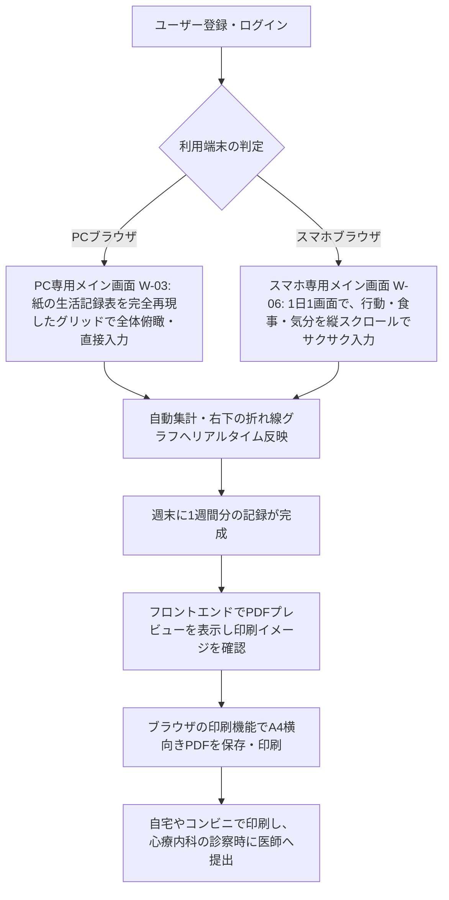

# 要件定義書

## 1. 概要
- **プロダクト名**: RePace - 週間行動＆気分記録アプリ
- **一文の説明**: リワーク復職支援で用いられる24時間の行動記録と気分・疲労感の数値可視化をデジタル化し、生活リズムの崩れを自己管理・検証できるWebアプリ。
- **背景と目的**: 開発者自身がリワークでの手書き経験を持つことに加え、現在休職中の家族の診察に同行した際、主治医からの問いに対し、休職中の本人が過去の体調変化を正確に思い出し、言語化することの難しさを痛感した。この課題を解決するため、本人がメンタル不調時でもPCやスマホから負担なく記録をつける習慣を身につけられ、診察時に医師へ客観的なデータ（A4横向き1枚のPDF）として正確に手渡しできるデジタルツールが必要であると確信し、開発を決意した。
- **設計方針（PC とスマホのハイブリッド）**: **PC 版**は、紙の生活記録表と同じフォーマットで1週間を一画面に収める。**スマホ版**は、気分が落ちているときでも負担にならないよう、1日を1画面にし、使わない入力欄を折りたたみ、顔絵文字やバッテリー型のスライダーなど直感的な入力アシストを使った「優しいユニバーサルな UI」にする。保存する値と提出用 PDF の内容はどちらも同じで、PDF には医師向けに数値だけを出す。（気分・疲労感は数値プロットグラフ）
- **公開 URL**: （最終提出時に記載）

## 2. ビジネス要件

### 2.1 顧客セグメントとアーリーアダプター
- **誰の課題か（その人たちはおよそ何人いるか）**:
  うつ病や適応障害等からの復職を目指し、医療機関の指示やリワークプログラム（復職支援）で生活記録表の提出を求められている休職者。潜在的な対象者は全国に数万人以上、自身が所属していたリワークの規模感（過去の在籍者含め）としては約100名。
- **最初に使ってもらう人（アーリーアダプター）**:
  今回の8週間の初期検証枠では、**PC・スマホ双方の環境を持つ開発者の家族（休職中）1名**をアーリーアダプターとする。開発者自身も、リワークでの手書き経験があり、生活記録をつけている当事者として利用する。元リワークの同期メンバーのコミュニティへの展開は、今後の課題（NEXTステップ。2.5）とする。
- **対象にしない人**:
  主治医やリワーク施設のスタッフなどの医療関係者（本アプリは利用者の自己管理・提出の省力化のためのツールであり、医療従事者側の管理システムではないため）。

### 2.2 課題と既存の代替手段
- **解く課題（3つ以内）**:
  1. **手書きによる記録・集計の手間**: 24時間を手書きで埋める、気分や疲労感を毎日5刻みの数値で計算してグラフを手描きする心理的・物理的負担。
  2. **提出・共有の不便さ**: 診察時に医師へ提出するためだけに、原本をそのまま持参するか、都度コンビニでコピーを取らなければならない手間。
  3. **フォーマットの形骸化とデータの蓄積不足**: 自由記述すぎるツールでは続かず、逆に紙のままだと過去の体調トレンド（「先月と比べてどう変化したか」）を遡って客観的に比較・分析することが困難。
- **その人が今どう対処しているか**:
  施設指定の紙の書式に毎日手書きで記入している。電子化を試みる人はExcelシートを自作しているが、スマホからの入力が極めて難しく、結局は手書き運用に戻っている。また、医師に見せるためにタブレットのカメラで写真撮影して保存している。
- **課題を知った経緯**:
  開発者自身がリワーク参加前に医師から行動記録の指示を受け、参加後は指定フォーマットでの手書き記録を義務付けられた経験から。周りのメンバーからも「毎日手描きでグラフを作るのが面倒」「診察前に慌ててコピーを取るのがストレス」という生の声を直接聞いていた。さらに、休職中の家族の診察に同行した際、本人が過去の体調変化を正確に思い出して医師に伝えることの難しさを目の当たりにしたため。

### 2.3 独自の価値提案
- **一文の価値提案**:
  世間にある汎用的な日記・スケジュールアプリと違い、「リワークや心療内科で実際に使われる『24時間時間軸＋気分・疲労感の数値プロットグラフ』のフォーマットを完全に再現し、PC・スマホ双方から入力・過去ログ確認・提出用PDF印刷までを完結できる」**休職者専用の生活記録Webアプリ**。
- **既存の代替手段との違い**:
  一般的なライフログアプリはグラフの形式が固定されていたり、医療提出用のA4横向き印刷に対応していない。本アプリは、紙の手軽さ（選択式による入力アシスト）と、デジタルの強み（データベース化による過去のトレンド比較、1クリックでのA4提出用PDF生成）を両立している。さらに、PC は紙と同じフォーマット、スマホは不調時でも負担にならない優しい UI（1日1画面、折りたたみ、顔絵文字・バッテリー型の入力）と、使う場面に合わせて UI を分けている点も違いである。

### 2.4 ソリューション
- **課題に対応する主要機能**:
  - **選択式24時間タイムライン入力**: よく使う活動内容（睡眠、介護、TVなど）を選択肢からサクサク入力でき、独自の活動も自動で選択肢に学習・追加される入力アシスト機能。
  - **体調・疲労感の連動プロットグラフ**: 朝の気分（◯）と1日の疲労感（△）を5〜100の5刻みで入力すると、右下の折れ線グラフに自動で反映される機能。あわせて、1日の総合的な気分（％）を5％刻みの選択式で記録できる。
  - **提出用A4横向きPDF生成機能**: 医師や施設へそのまま提出できる、紙の指定フォーマットを忠実に再現したPDFの出力機能。プレビューはフロントエンドで表示し、PDF化はブラウザの印刷機能（「PDFとして保存」）で行う。
  - **スマホ専用のやさしい入力アシスト**: 1日1画面、週と日をスワイプまたは矢印で切り替え、間食・飲酒は折りたたみ、1日の気分は顔絵文字で1タップ、疲労感は「元気の残量」のバッテリー型スライダーで直感的に入力する。保存・グラフ・PDF では、元の数値（疲労感の強さ）に自動で変換する。
  - **3食分の食事・出来事のデイリーサマリー記録**: 朝食・昼食・夕食に加え、間食（昼食と夕食の間）と飲酒（夕食に含める）も、1日の生活習慣としてテキストで補足できる自由記述欄。間食や飲酒がない利用者は空欄のままでよい。

### 2.5 チャネル・収益・コスト
- **利用者に届ける経路**:
  まずは初期検証（8週間の枠内）として、休職中の家族1名に直接URLを共有して使ってもらう。その後、12月末に元リワーク同期メンバーのコミュニティへ展開し、口コミを通じて利用者を広げる。将来的には、Web検索（「生活記録表 アプリ」「リワーク 生活記録表 PDF」など）のSEO対策を通じて、全国の休職者へリーチする。
- **お金の流れ（何をもって成功とするか）**:
  **【最終目標】**：本プロジェクトは、ポートフォリオとして公開できる品質に到達することを最終目標とする。COACHTECHの技術制約（完全無料・カード登録なし）を遵守するため、インフラ・DBに課金せず、すべての機能を無料で提供する。本プロジェクト（8週間内）では**完全無料**で提供し、収益化（マネタイズ）は今回の範囲外とする。ユーザーが「スムーズにユーザー登録し、1週間継続して記録をつけ、提出用PDFをプレビューできたこと」をもって成功とする。
  **【今後の課題（NEXTステップ）】**：(1) 12月末に、元リワーク同期メンバーのコミュニティへ展開し、実利用データとさらなるフィードバックを収集してアップデートする。(2) プロダクトが十分に成熟した段階で、当初検討していたStripe決済連携を実装し、有料機能の解放モデルによる収益化へ踏み出す。(3) 管理者権限（管理者ロール・管理画面）の追加。(1)〜(3)とも本プロジェクトの範囲外（7. スコープ外）。
  **【データのバックアップ】**：毎日03:00（JST）にGitHub Actionsのscheduleで起動し、`mysqldump`でTiDBのデータを抽出、`age`の公開鍵で暗号化して、GitHub Actionsの無料アーティファクトに最大90日間保存する（暗号化しているため公開リポジトリでも内容は読めない）。アプリ（Laravel/Render）側のcron、TiDBのCLI、S3/GCSなどの外部ストレージへの転送は、Renderの無料枠の制限とカード登録を避けるため採用しない。
- **外部サービス・素材の費用と権利**:
  - Vercel: フロントエンドホスティング（無料プラン。カード登録不要）
  - Render: バックエンドAPIホスティング（無料プラン。カード登録不要。リージョンはシンガポール）
  - TiDB Cloud Starter: MySQL互換のマネージドDB（無料枠・カード登録不要。行ストレージ5GiB、月5,000万RU。リージョンはシンガポール）。Render（MySQL非対応）とAivenは不採用。制約と検証結果は設計書（1.7）を参照
  - GitHub Actions: DBの定期バックアップ（無料。公開リポジトリのため暗号化したファイルのみ保存）
  - Claude Code: AI開発エージェント（Proプラン導入済み、自己負担）

### 2.6 主要指標と検証
- **成功を測る指標**:
  - アーリーアダプター（休職中の家族）が、**1週間継続して記録をつけ、提出用PDFをプレビューできたこと**（成功の定義）。利用者が増えた段階（NEXTステップ）では、「1週間以上の継続記録率（リテンション率）」50%以上も指標とする。
  - 実際に医師へ提出するための「PDF生成機能」の実行回数。
  - **評価期間**: 開発者とアーリーアダプター（休職中の家族）による評価期間を2週間とする（このうち、アーリーアダプターには実際に1週間、生活記録をつけてもらう）（週の確定［F-11］、開始曜日の切り替え、日またぎ睡眠など、週をまたぐ動作の確認を含む）。評価期間はアプリの利用期限ではなく、ユーザー登録後の利用に制限はない。
- **前提となる仮説と確かめ方**:
  - **仮説**: 「手書きやExcelの入力に挫折した人でも、スマホ・PCからの選択式入力と自動グラフ化があれば、負担なく生活記録を継続でき、医師への提出ストレスも軽減される」。
  - **確かめ方**: 休職中の家族（1名。PC・スマホ双方の環境を持つ）に、実際に1週間アプリを使って生活記録をつけてもらい、週末にPDFを出力して医師に見せてもらう。メンタルが優れない状態での操作性（PCの24時間グリッドと、スマホの縦スクロールによるレスポンシブ切り替え）と、医師への状況共有における便益を、ヒアリングで定性的に検証する。

### 2.7 圧倒的な優位性
- **既存の提供者がそれをしていない理由**:
  大手企業が提供するヘルスケアアプリは「歩数」や「体重」「睡眠時間」といった自動計測データに特化しており、精神科医療やリワークという「ニッチかつ特定の書式を必要とする領域」に特化したA4印刷フォーマットの出力に対応していないため。
- **真似されにくい点（どう築くか）**:
  自身が実際にリワークプログラムを経験し、医師の指示の意図や、紙のフォーマットの「どの項目がなぜ必要なのか」を熟知しているというドメイン知識（当事者目線）。これに基づき、休職者のメンタル状態でもストレスなく操作できる、徹底的に削ぎ落とされたUI/UXを構築することで先行優位性を築く。

## 3. 業務要件
利用者がアプリを使って日々の記録をつけ、医師や施設に提出するまでの一般的な流れ（ユースケース）は以下の通りです。

## 4. 機能要件

### 4.1 機能一覧（優先度つき）

| 機能ID | 機能名 | 優先度 | 機能概要 |
| :--- | :--- | :---: | :--- |
| F-01 | ユーザー登録 | 必須 | ユーザー名（表示名）、メールアドレス、パスワード、パスワード（確認用）の4つを入力してアカウントを作成する。ログインにはメールアドレスを用いる。 |
| F-02 | ログイン・ログアウト | 必須 | メールアドレスとパスワードで認証を行う。未ログイン時は保護されたページおよびAPIへのアクセスを遮断する。 |
| F-03 | 24時間行動記録入力 | 必須 | **【PC】**24時間のタイムラインに、15分単位の区間（範囲を選択）と行動内容を入力する。 **【スマホ】**その日の行動を時系列のカード型リストで並べ、カードのすぐ下にその場で開く入力フォームで、開始/終了時刻（15分刻みのドラムロール）と行動内容を入力する。よく使う行動は、利用回数の多い順のクイックタグで1タップ入力できる。開始時刻は、隙間の「＋」からはその隙間の開始、最後尾からは最後の行動の終了（行動がなければ00:00）が自動で入る。よく使う独自項目は自動で選択肢に学習・追加される。「睡眠」の区間の合計から、1日の睡眠時間を自動で計算する。 **時間が重なる行動**（例: 食事をしながらテレビ）も、同じ時間帯に最大2つまで記録できる。**重なっている時間帯だけ**、タイムラインを**上下2段に分割**し（原紙と同じ書き方）、その時間帯の行動内容は**先頭の全角1文字（半角は2文字）だけ**を表示する（全文は区間を選ぶと確認できる）。重なっていない時間帯は、これまでどおり行動内容を区間いっぱいに表示する。 |
| F-04 | 3食食事記録・日記入力 | 必須 | 朝食・昼食・夕食に加え、間食（昼食と夕食の間）と飲酒（夕食に含める）のテキスト、および1日の出来事をまとめる日記（テキスト。**150文字以内**）の入力機能。間食・飲酒は任意。**【PC・スマホ共通】**入力中の枠線の色を文字数に応じて緑→黄→赤へ滑らかに変え、上限を超えても入力はロックせず、超えた文字を赤字にして、やさしいメッセージで削除を促す（上限を超えた内容は保存しない）。**【スマホ（W-06）】**基本の「朝食」「昼食」「夕食」だけを初期表示し、「間食」「飲酒」は折りたたみ、夕食の下の「＋ 間食・飲酒を記録する」をタップするとその場で展開する（データがある日・編集中の日は展開したまま）。食事（朝食・昼食・間食・夕食・飲酒）は、**各項目を100文字以内、かつ1日の5項目の合計を120文字以内**とする二重の制限とする（A4横向き1ページに収めるための最終手段）。 |
| F-05 | 気分・疲労感数値記録 | 必須 | 朝の気分の良さ（◯）と1日の疲労感（△）を5〜100の5刻みで記録する。あわせて、1日の気分（％。朝の気分とは別の、その日の総合的な気分）を5〜100％の5％刻みの選択式で記録する。**【スマホ（W-06）】**朝の気分（◯）は5刻みのドラムロール（5から100の全20段階）。1日の気分（％）は5つの顔絵文字（1タップでドラムロールに入力）とドラムロール。疲労感（△）は、バッテリー型のスライダーで「元気の残量」を選び（色と言葉が変わる）、保存・グラフ・PDF では疲労感の強さ（100−残量）に自動で変換する。提出用 PDF には数値だけを出す。 |
| F-06 | 体調追跡グラフ自動生成 | 必須 | 記録された気分（◯）と疲労感（△）を元に、設定された開始曜日から1週間軸の折れ線グラフを自動描写する。PC のメイン画面（W-03）でのみ表示し、スマホのメイン画面（W-06）では表示しない（スマホでは W-05 で確認する）。 |
| F-07 | PDF出力プレビュー | 必須 | 元の紙の指定フォーマット（A4横向き）を忠実に再現した印刷プレビュー画面を**フロントエンドで**表示する（印刷用CSSで用紙サイズ・向きを指定）。**生活記録表は複数ページにまたがる出力を認めず、必ずA4横向き1ページに収める。** 日記・食事記録が多くて1ページに収まらない場合に限り、日記・食事記録エリア全体の文字サイズを段階的に下げる。今週の目標や所感も最下部に反映される。過去に記録した週についても、カレンダーや週切り替えボタン等から選択することで、いつでも再表示（再プレビュー）できる。バックエンドはプレビューに必要なデータをAPIで返すのみ。**スマホで開いたときは、A4横向き1ページ全体が画面の横幅に収まるよう自動で縮小表示し、ピンチ操作やズームボタンで拡大して細部を確認できる。** |
| F-08 | 提出用PDF保存・ダウンロード| 必須 | プレビュー画面から**ブラウザの印刷機能**を呼び出し、A4横向き**1ページ**でPDFとして保存・印刷できる（2ページ以上にはしない）。アカウントを作成してログインしたユーザーであれば、追加料金なしで誰でも保存・印刷できる（未ログインではプレビュー画面を含め、アプリのすべての画面・APIにアクセスできない）。過去に記録した週も、カレンダーや週切り替えボタン等から選択して再プレビューし、ブラウザの印刷機能でいつでも再印刷（PDF保存）できる。バックエンドはPDFを生成せず、表示に必要なデータをAPIで返すのみ。スマホ（iPhone など）でも、プレビュー画面の印刷ボタン（またはブラウザの共有メニューの「プリント」）から印刷ダイアログを開き、端末標準の「PDF として保存」で、サーバー負荷や追加料金なしに A4横向き1ページの PDF を保存できる。 |
| F-09 | 週開始曜日設定 | 優先 | 週の開始曜日は人によって異なるため、既定は**月曜始まり**とし、設定画面でカレンダーから「週の開始日」を選ぶと、その日の曜日が開始曜日になる。**すでに記録がある週は当時の開始曜日のまま維持し、選んだ日以降の新しい週から新しい開始曜日を適用する**（変則週や欠損期間を示す専用のフラグは設けない）。選べる日付は、**まだ確定していない現在進行中の最新の週の初日、またはそれより未来の日付のみ**（確定済みの週に属する日付は選べない。F-11）。 |
| F-10 | 1週間の所感入力 | 必須 | 週末に、その週全体の振り返り（今週の目標は**80文字以内**、今週の所感は**250文字以内**。原紙の枠に合わせた上限）を入力・保存できる機能。 |
| F-11 | 週の確定（所感を保存して週を完成） | 必須 | 時間による締め切りは設けず、次の週に入った後でも、確定前の週は最終日の睡眠やサマリーなどをいつでも入力・編集できる。週末または週明けに、利用者が「今週の所感」（250文字以内）を入力して**【所感を保存してこの週を完成させる】**ボタンを押すと、その週を確定する（週次データの `is_confirmed` フラグで管理）。確定後は、その週のすべての行動記録・日次サマリー・週次データ（目標・所感）が**読み取り専用（ロック）**となり、閲覧と、再プレビュー・再印刷（提出用のA4横向きPDF保存。F-08）だけができる（バックエンドも確定済みの週への書き込みを拒否する）。確定の取り消しはできない。日をまたぐ睡眠は日ごとの区間に分けて保存し、睡眠時間は「起きた日」に全体を数える（例: 日曜 23:00〜月曜 6:00 の7時間は、新しい週の初日が月曜なら、月曜の睡眠時間として数える。そのため睡眠時間の計算は、週の境目の前後1日を読む週またぎの集計を行う）。 |

### 4.2 画面一覧

| 画面ID | 画面名 | 対応URL | 画面概要・レスポンシブ要件 |
| :--- | :--- | :--- | :--- |
| W-01 | ログイン画面 | `/login` | メールアドレス、パスワードの2入力によるシンプルな認証画面。 |
| W-02 | ユーザー登録画面 | `/register` | ユーザー名、メールアドレス、パスワード、確認用パスワードの4入力による新規作成画面。 |
| W-03 | メイン画面（PC・記録表） | `/` | 設定された「開始曜日」を基準に自動で1週間分（通常7日間。開始曜日を切り替える直前の1週のみ7日未満）の枠を構成。元の生活記録表そのもののレイアウト（24時間グリッド、食事、グラフ、今週の目標・所感が一画面に収まる形）。週の所感を入力して「所感を保存してこの週を完成させる」を押すと、その週は確定し、読み取り専用になる（F-11）。画面幅が `md` 未満のときは、同じ URL で W-06 を表示する。 |
| W-04 | 設定画面 | `/settings` | カレンダーで週の開始日を選ぶと、その日の曜日が1週間の始まりの曜日として設定される画面。選べるのは、まだ確定していない現在進行中の最新の週の初日またはそれより未来の日付のみ（確定済みの週の日付は選べない）。 |
| W-05 | PDFプレビュー画面 | `/preview` | A4横向きの紙のフォーマットを完全に再現したプレビュー。必ずA4横向き1ページに収める（日記・食事が多い場合のみ、その領域の文字サイズを段階的に下げる）。ログインしたすべてのユーザーが、追加料金なしですぐに保存・印刷できる（F-08）。過去に記録した週も、カレンダーや週切り替えボタン等から選択することで、いつでも再表示（再プレビュー）およびブラウザ機能を用いた再印刷（PDF保存）ができる。 |
| W-06 | メイン画面（スマホ・1日記録） | `/`（画面幅が `md` 未満のとき） | 7日分を縦に並べず、**1日を1画面**として日ごとに切り替える（週は日の集まり）。最上部の週表示エリアの左右スワイプまたは矢印で週を、画面中央の左右スワイプまたは日付見出しの矢印で日を切り替え、週表示エリアのタップでカレンダーから過去の週へ移動できる（未来の週へは進めない。週の境目では前後の週へ自動で切り替わる）。行動の入力フォームを開いている間は、横スワイプと日の矢印を無効にする。1画面に、行動（時系列のカード型リストとインライン入力フォーム）、食事（基本3食。間食・飲酒は折りたたみ）、日記、気分・疲労感（顔絵文字・バッテリー型スライダー・ドラムロール）を縦スクロールで配置し、最下部に週の目標・所感と週の確定ボタンを置く。体調追跡グラフは表示しない。詳細は設計書 3.5。 |

### 4.3 主なデータ
* **ユーザーデータ**: ユーザーID、ユーザー名（表示名）、メールアドレス（ログインID）、パスワードハッシュ
* **週開始曜日の設定データ**: 利用者ID、開始曜日（`week_start_day`: 0=日, 1=月... 6=土。**既定は月曜（1）**）、有効開始日。設定を変更しても過去の週は当時の開始曜日のまま維持するため、変更の履歴を持つ（設定画面でカレンダーから日付を選ぶと、その日の曜日が、選んだ日以降の新しい週に適用される）
* **行動記録データ**: 記録日、開始時刻・終了時刻（15分単位の区間。同じ時間帯に最大2つまで重なってよい）、行動内容テキスト、睡眠フラグ、強調フラグ（赤字で書いていた重要な予定を強調する。印刷時に赤字で表示）（睡眠時間は睡眠の区間から自動計算し、保存しない。日をまたぐ睡眠は日ごとの区間に分けて保存し、睡眠時間は起きた日に全体を数える。週の最初の日は前日［前の週の最終日］の夜からの睡眠を含めて計算する）
* **サマリーデータ（日次）**: 記録日、朝の気分値（5〜100の5刻み）、疲労感値（5〜100の5刻み）、1日の気分（5〜100％の5％刻み）、朝食内容、昼食内容、間食内容（昼食と夕食の間）、夕食内容、飲酒内容（夕食に含める）（各項目は100文字以内。かつ、1日の5項目の合計は120文字以内）、1日の日記（150文字以内）
* **週次データ**: 週ID、ユーザーID、対象週の開始日、今週の目標（`weekly_goal`。80文字以内）、今週の所感（`weekly_reflection`。250文字以内）、確定フラグ（`is_confirmed`。確定後は取り消せない）、確定日時（`confirmed_at`）

### 4.4 外部インタフェース
* **内部API（Laravel → Next.js）**: プレビューとPDF生成に必要なデータ（週次の行動記録、日次サマリー、週次の目標・所感、ユーザー設定）をJSONで返す。PDFのレイアウト描画はフロントエンドが担い、PDF化はブラウザの印刷機能で行う。バックエンドはPDFを生成・保持しない。

## 5. 非機能要件
* **認証と権限**: Laravel Sanctum等によるセッション/トークン認証を実装（ログインIDはメールアドレス）。未ログイン状態でメイン画面やPDFプレビュー、および各種APIエンドポイント（`/api/*`）にアクセスした場合は、一律で401エラーを返しログイン画面へ強制リダイレクトする。利用者の種別は「利用者（本人）」のみで、管理者権限（ロール）は設けない（7. スコープ外。NEXTステップで追加）。
* **個人データの扱い**: パスワードは必ずハッシュ化（Bcrypt等）してデータベースに保存する。
* **レスポンシブ対応**: Tailwind CSSを用い、PCとスマホの画面幅（ブレイクポイント）を検知してコンポーネントの表示レイアウトを完全に切り替える（PC は W-03、スマホは W-06。URL は同じ `/`）。
* **ユニバーサルデザイン（スマホ）**: 気分が落ちているときでも使えるよう、1日1画面、折りたたみ、1タップの入力アシストを用いる。スワイプだけに頼らず、矢印のタップやキーボードでも操作でき、色だけに頼らず文字や形も併用する。

## 6. 制約条件
* **開発期間**: 8週間（要件定義〜設計〜実装〜デプロイ〜検証まで）
* **利用者向けマニュアル**: 機能の追加ではなく成果物として、デプロイ後に、利用者向けのマニュアル（PDF）を作成する（登録・ログイン、行動と食事・気分の入力、週の確定、PDFプレビューと印刷、開始曜日の設定の手順を、実際の画面で説明する）。アプリ内に組み込まず、評価期間の前にアーリーアダプターへ渡せる状態にする。
* **費用・インフラの制約**: 完全無料枠で運用。クレジットカード登録が不要なプラン（Vercelの無料枠、Renderの無料Web Service、TiDB Cloud Starterの無料枠）を厳選して構築する。DBは、クレジットカード登録が不要なTiDB Cloud Starter（MySQL互換）を使用する（Render・Aivenは不採用）。 APIとDBは、通信の遅延を小さくするため、同じシンガポールのリージョンにそろえる（Renderの無料枠で日本のリージョンが選べないため）。
* **バックアップ**: バックアップはGitHub Actions（毎日03:00 JSTのschedule → `mysqldump` → `age`公開鍵暗号化 → 無料アーティファクトに最大90日保存）で行う。バックエンド（Laravel/Render）にはバックアップ機能もcronも持たせない。
* **技術スタック**:
  * フロントエンド: Next.js 16.4.4 (React 19.3.0, Tailwind CSS v4) (frontend/ ディレクトリ配下)
  * バックエンド: PHP 8.5 / Laravel 13.x (リポジトリルート直下。ローカルのDocker環境・本番ともPHP 8.5に固定)
  * データベース: MySQL互換（ローカル開発はMySQL 8.0、本番は TiDB Cloud Starter（MySQL 8.0互換、実機バージョン: TiDB v8.5.3、リージョン: シンガポール）。ローカル開発のMySQLは本番の互換性に合わせて8.4から8.0へ下げた。テスト時は sqlite メモリDB）
  * PDFのプレビュー・生成: フロントエンド側で実装。PDF化はブラウザの印刷機能を使用（バックエンドはデータの保持とAPIでの受け渡しのみ）
* **AIの利用**: 開発およびデバッグにはすべて「Claude Code」を使用し、生成されたコードのロジックは開発者がすべて口頭説明できるように理解を徹底する。

## 7. スコープ外
* **管理者権限（管理者ロール・管理画面）**: 今回は対応しない。全利用者が同じ権限（自分のデータのみ参照・更新できる）で、運営者向けの利用者一覧・利用状況の確認・利用者データの管理などの機能は設けない。NEXTステップで追加する。
* **医療従事者用管理画面**: 主治医やリワーク施設スタッフがログインして患者のデータを閲覧・管理する機能は今回作成しない（あくまで利用者が印刷して手渡しする業務フローをデジタル化するため）。
* **収益化（課金）機能**: マネタイズは今後の課題とし、今回は実装しない。すべての機能を無料で提供する。プロダクトが十分に成熟した段階で、Stripe決済連携による有料機能の解放モデルを実装する（本プロジェクトの範囲外）。
* **元リワーク同期メンバーのコミュニティへの展開**: 12月末に展開し、実利用データとフィードバックを収集してアップデートする（本プロジェクトの範囲外）。
* **複数ページにまたがる出力**: 生活記録表のPDF・印刷は、必ずA4横向き1ページに収める。2ページ以上になる出力は行わない（文字数の制限と、文字サイズの自動縮小で1ページに収める）。
* **排便の記録**: 原紙の「睡眠/排便」欄の排便は記録しない（印刷時は空欄とする）。
* **サーバー側でのPDF生成・保存**: PDFのプレビューはフロントエンドで行い、PDF化はブラウザの印刷機能に任せる。バックエンドにPDF生成機能やPDFファイルの保管は持たせない。
* **PDFライブラリによるPDFファイルの直接生成**: ブラウザの印刷機能を使うため、今回は対象外とする。
* **アプリ内のバックアップ機能**: バックアップのためのcronやコマンド、TiDBのCLI、S3/GCSなど外部ストレージへの転送は、バックエンド（Laravel/Render）には持たせない（バックアップはGitHub Actionsのみで行う）。
* **過去データの再入力・編集機能**: 週の開始曜日変更の履歴管理に起因するデータ整合性維持の観点から、「週の確定」（F-11）をした週の行動記録やサマリー、目標・所感を後から再入力・編集する機能、および確定の取り消し機能は今回のスコープ外（考慮しない）とする。確定前の週は、次の週に入った後でも通常どおり入力・編集できる。確定した週の再表示（再プレビュー）と再印刷（PDF保存）は可能とする（F-07・F-08）。
* **永続的な過去データの無制限保存**: 無料DBの容量制限を考慮し、数年レベルの過去ログをすべて保持する機能やデータエクスポート機能は今回のスコープ外とする。

## 8. 更新履歴
（※1回目の要件レビュー提出から変更があった場合、ここに内容と理由を追記します。現時点では空欄、または未記入で問題ありません）
