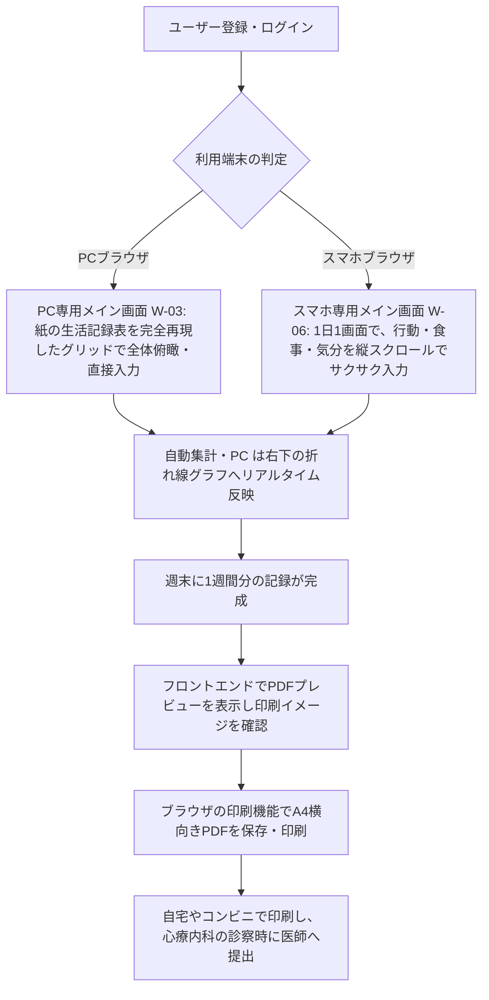

# 要件定義書

## 1. 概要
- **プロダクト名**: RePace - 週間行動＆気分記録アプリ
- **一文の説明**: リワーク復職支援で用いられる24時間の行動記録と気分・疲労感の数値可視化をデジタル化し、生活リズムの崩れを自己管理・検証できるWebアプリ。
- **背景と目的**: 開発者自身がリワークでの手書き経験を持つことに加え、現在休職中の家族の診察に同行した際、主治医からの問いに対し、休職中の本人が過去の体調変化を正確に思い出し、言語化することの難しさを痛感した。この課題を解決するため、本人がメンタル不調時でもPCやスマホから負担なく記録をつける習慣を身につけられ、診察時に医師へ客観的なデータ（A4横向き1枚のPDF）として正確に手渡しできるデジタルツールが必要であると確信し、開発を決意した。
- **設計方針（PC とスマホのハイブリッド）**: **PC 版**は、紙の生活記録表と同じフォーマットで1週間を一画面に収める。**スマホ版**は、気分が落ちているときでも負担にならないよう、1日を1画面にし、使わない入力欄を折りたたみ、顔絵文字やバッテリー型のスライダーなど直感的な入力アシストを使った「優しいユニバーサルな UI」にする。保存する値と提出用 PDF の内容はどちらも同じで、PDF には医師向けに数値だけを出す。
- **公開 URL**: （デプロイ後に記載）

## 2. ビジネス要件

### 2.1 顧客セグメントとアーリーアダプター
- **誰の課題か（その人たちはおよそ何人いるか）**:
  - **数える対象**: うつ病や適応障害等で休職し、復職を目指して、医療機関の指示やリワークプログラム（復職支援）で生活記録表の記入・提出を求められている人。
  - **全国の規模は「数万人以上」**。根拠は、種類を分けて次のとおり。
    1. 【事実・出典あり】精神疾患を有する総患者数は約603.0万人（令和5年。厚生労働省「患者調査」。[出典: 厚生労働省 検討会資料](https://www.mhlw.go.jp/content/11121000/001374464.pdf)）。この数字には認知症なども含まれ、対象より広い。
    2. 【仮定・開発者の置いた値】このうち、休職して復職支援や記録の提出を求められる人の割合を0.5〜1％程度と置く。この割合を示す統計は確認できていない。約603万人 × 0.5〜1％ ＝ 約3万〜6万人。
    3. 【位置づけ】この数字は市場の大きさの目安であり、成功の指標には使わない（成功の定義は2.6）。
  - **約100名**: 開発者が所属していたリワークの在籍規模（過去の在籍者を含む）を、開発者が把握している範囲で示した概数（名簿などで数えた数字ではない）。全国の数字の根拠ではなく、身近な利用者の広がり（NEXTステップの展開先。2.5）の目安である。
- **最初に使ってもらう人（アーリーアダプター）**:
  今回の8週間の初期検証枠では、**PC・スマホ双方の環境を持つ開発者の家族（休職中）1名**をアーリーアダプターとする。この1名は、上の約100名（開発者が所属していたリワークの在籍者）には含まれない別枠の最初の利用者である。開発者自身も、リワークでの手書き経験があり、生活記録をつけている当事者として利用する。元リワークの同期メンバーのコミュニティへの展開は、今後の課題（NEXTステップ。2.5）とする。
- **対象にしない人**:
  主治医やリワーク施設のスタッフなどの医療関係者（本アプリは利用者の自己管理・提出の省力化のためのツールであり、医療従事者側の管理システムではないため）。

### 2.2 課題と既存の代替手段
- **解く課題（3つ以内）**:
  1. **手書きによる記録・集計の手間**: 24時間を手書きで埋める、気分や疲労感を毎日5刻みの数値で計算してグラフを手描きする心理的・物理的負担。**頻度: 毎日1回（1日1枚。1週間で7枚）**。
  2. **提出・共有の不便さ**: 診察時に医師へ提出するためだけに、原本をそのまま持参するか、都度コンビニでコピーを取らなければならない手間。**頻度: 診察のたび（月1回程度）**。
  3. **フォーマットの形骸化とデータの蓄積不足**: 自由記述すぎるツールでは続かず、逆に紙のままだと過去の体調トレンド（「先月と比べてどう変化したか」）を遡って客観的に比較・分析することが困難。**頻度: 診察のたび（月1回程度）に、前回からの変化を聞かれる。そのたびに、約1か月分（4〜5週・約30枚）の記録を見比べることになる**。
- **その人が今どう対処しているか**:
  施設指定の紙の書式に毎日手書きで記入している。電子化を試みる人はExcelシートを自作しているが、スマホからの入力が極めて難しく、結局は手書き運用に戻っている。また、医師に見せるためにタブレットのカメラで写真撮影して保存している。
- **既存の手段（実在するサービス）**:

  | 手段 | 確認できた内容 |
  | :--- | :--- |
  | 紙の生活記録表（施設・医療機関指定の書式） | 開発者自身がリワークで毎日手書きした（上の「その人が今どう対処しているか」） |
  | Excel の自作シート、タブレットでの写真撮影 | 周囲の人の対処として聞いた事実。開発者自身は使っていない |
  | [MoodTrend（気分グラフ）](https://apps.apple.com/us/app/%E6%B0%97%E5%88%86%E3%82%B0%E3%83%A9%E3%83%95-mood-trend/id6480364789) | iPhone・iPad・Apple Watch 向け。気分を-5〜+5で記録し、歩数・睡眠を Apple Health と連携してグラフ化する。双極性障害向けとされ、疲労の記録項目の記載はない。PDF・Excel で出力できるが、プレミアム会員限定かは明記されていない。基本無料でアプリ内課金あり |
  | [心想計](https://www.oricon.co.jp/pressrelease/2969768/) | iOS・Android 向け。心の状態、睡眠や活動の時間を記録する。基本無料で、有料版は月額500円。PDF 出力の記載は確認できなかった（プレスリリースの本文が一部読み取れなかった） |
  | eMoods Wellness Tracker、Symptom & Mood Tracker | 検索結果の説明では、PDF のレポートを出して医師やセラピストに共有できる海外製アプリ。詳細は未確認 |

  **確認できた範囲では、リワークで使う「24時間の行動の時間軸＋気分・疲労感の数値グラフ」を、A4横向き1枚の PDF に出せる既存のサービスは見つからなかった**。ただし、網羅的な調査ではない。
- **既存の手段を探した記録**: 2026-11-13、開発者の依頼で Claude Code の Web 検索（日本語）と、App Store の掲載ページの確認で行った。

  | 検索語 | 結果 |
  | :--- | :--- |
  | リワーク 生活記録表 アプリ 気分 疲労感 グラフ PDF | リワーク専用のアプリや生活記録表は見つからなかった。一般的な気分記録アプリ（eMoods、Symptom & Mood Tracker、気分グラフ Mood Trend、自分日誌など）が見つかった |
  | うつ病 睡眠 気分 記録 アプリ 診察 提出 生活リズム | 睡眠・生活リズムの記録アプリ（心想計など）と、紙の生活記録表の解説が見つかった。リワークの書式を再現するサービスは見つからなかった |
  | 厚生労働省 患者調査 気分［感情］障害 総患者数 適応障害 | 総患者数の公的統計（2.1 の出典）が見つかった |
  | リワークプログラム 実施施設数 利用者数 医療機関 調査 | 全国のリワークの施設数・利用者数を示す資料は見つからなかった（2.1 の「約100名」を概数とした理由） |
- **既存の手段を試した記録**: **試していない**。理由は次のとおり。(1) 上の調査で、リワークの書式（24時間タイムライン＋気分・疲労感グラフ＋A4横1枚 PDF）に対応するサービスが見つからず、試す対象がなかった。(2) 見つかった MoodTrend は、双極性障害向けで疲労の記録項目がなく、PDF 出力が有料機能の可能性もあり、課金が必要になる場合がある（無料・カード登録なしの制約に合わない）。(3) eMoods と Symptom & Mood Tracker は英語中心の海外製アプリで、日本の医療機関での利用実績を確認できなかった。紙は、開発者自身が毎日手書きした経験がある。
- **課題を知った経緯**:
  開発者自身がリワーク参加前に医師から行動記録の指示を受け、参加後は指定フォーマットでの手書き記録を義務付けられた経験から。周りのメンバーからも「毎日手描きでグラフを作るのが面倒」「診察前に慌ててコピーを取るのがストレス」という生の声を直接聞いていた。さらに、休職中の家族の診察に同行した際、本人が過去の体調変化を正確に思い出して医師に伝えることの難しさを目の当たりにしたため。

### 2.3 独自の価値提案
- **一文の価値提案**:
  世間にある汎用的な日記・スケジュールアプリと違い、「リワークや心療内科で実際に使われる『24時間時間軸＋気分・疲労感の数値プロットグラフ』のフォーマットを完全に再現し、PC・スマホ双方から入力・過去ログ確認・提出用PDF印刷までを完結できる」**休職者専用の生活記録Webアプリ**。
- **既存の代替手段との違い**:
  一般的なライフログアプリはグラフの形式が固定されていたり、医療提出用のA4横向き印刷に対応していない。本アプリは、紙の手軽さ（選択式による入力アシスト）と、デジタルの強み（データベース化による過去のトレンド比較、1クリックでのA4提出用PDF生成）を両立している。さらに、PC は紙と同じフォーマット、スマホは不調時でも負担にならない優しい UI（1日1画面、折りたたみ、顔絵文字・バッテリー型の入力）と、使う場面に合わせて UI を分けている点も違いである。

### 2.4 ソリューション
- **課題に対応する主要機能（3つ）**:
  - **A. 選択式の記録入力**（課題1「手書きによる記録・集計の手間」に対応。F-03・F-04・F-05）: よく使う活動内容（睡眠、介護、TVなど）を選択肢から入力でき、独自の活動も自動で選択肢に学習・追加される。朝食・昼食・夕食に加え、間食（昼食と夕食の間）と飲酒（夕食に含める）、1日の日記もテキストで補足できる（間食・飲酒がない日は空欄のままでよい）。朝の気分（◯）と1日の疲労感（△）を5〜100の5刻みで、1日の総合的な気分（％）を5％刻みの選択式で記録する。スマホでは、1日1画面、週と日をスワイプまたは矢印で切り替え、間食・飲酒は折りたたみ、1日の気分は顔絵文字で1タップ、疲労感は「元気の残量」のバッテリー型スライダーで直感的に入力する（保存・グラフ・PDF では、元の数値（疲労感の強さ）に自動で変換する）。
  - **B. 体調の自動グラフ化と、過去の週の再表示**（課題3「データの蓄積不足・比較の困難」に対応。F-06・F-07・F-09）: 朝の気分（◯）と1日の疲労感（△）を、PC 画面と PDF の右下の折れ線グラフに自動で反映する。確定した過去の週もいつでも再表示でき、診察のたびに前回からの変化を見比べられる。
  - **C. 提出用A4横向きPDF**（課題2「提出・共有の不便さ」に対応。F-07・F-08・F-11）: 医師や施設へそのまま提出できる、紙の指定フォーマットを忠実に再現したPDFを出力する。プレビューはフロントエンドで表示し、PDF化はブラウザの印刷機能（「PDFとして保存」）で行う。

### 2.5 チャネル・収益・コスト
- **利用者に届ける経路**:
  まずは初期検証（8週間の枠内）として、休職中の家族1名に直接URLを共有して使ってもらう。その後、12月末に元リワーク同期メンバーのコミュニティへ展開し、口コミを通じて利用者を広げる。将来的には、Web検索（「生活記録表 アプリ」「リワーク 生活記録表 PDF」など）のSEO対策を通じて、全国の休職者へリーチする。
- **お金の流れ（何をもって成功とするか）**:
  **【最終目標】**：本プロジェクトは、ポートフォリオとして公開できる品質に到達することを最終目標とする。COACHTECHの技術制約（完全無料・カード登録なし）を遵守するため、インフラ・DBに課金せず、すべての機能を無料で提供する。本プロジェクト（8週間内）では**完全無料**で提供し、収益化（マネタイズ）は今回の範囲外とする。ユーザーが「スムーズにユーザー登録し、1週間継続して記録をつけ、提出用PDFをプレビューできたこと」をもって成功とする。**成功に必要な利用者数は1名（アーリーアダプター）**とする。根拠は、収益化をしないため収益から逆算する利用者数が不要であること、および検証したい仮説（2.6）が「1人が1週間、負担なく記録を続けられ、PDFを提出できるか」であり、1名の7日分の記録で操作性と提出までの流れを確かめられることである。利用者を広げる段階（NEXTステップ）では、2.6 のリテンション率を指標にする。
  **【今後の課題（NEXTステップ）】**：(1) 12月末に、元リワーク同期メンバーのコミュニティへ展開し、実利用データとさらなるフィードバックを収集してアップデートする。(2) プロダクトが十分に成熟した段階で、当初検討していたStripe決済連携を実装し、有料機能の解放モデルによる収益化へ踏み出す。(3) 管理者権限（管理者ロール・管理画面）の追加。(1)〜(3)とも本プロジェクトの範囲外（7. スコープ外）。
  **【データのバックアップ】**：毎日03:00（JST）にGitHub Actionsのscheduleで起動し、`mysqldump`でTiDBのデータを抽出、`age`の公開鍵で暗号化して、GitHub Actionsの無料アーティファクトに最大90日間保存する（暗号化しているため公開リポジトリでも内容は読めない）。アプリ（Laravel/Render）側のcron、TiDBのCLI、S3/GCSなどの外部ストレージへの転送は、Renderの無料枠の制限とカード登録を避けるため採用しない。
- **外部サービス・素材の費用と権利**:
  - Vercel: フロントエンドホスティング（無料プラン。カード登録不要）
  - Render: バックエンドAPIホスティング（無料プラン。カード登録不要。リージョンはシンガポール）
  - TiDB Cloud Starter: MySQL互換のマネージドDB（無料枠・カード登録不要。行ストレージ5GiB、月5,000万RU。リージョンはシンガポール）。Render（MySQL非対応）とAivenは不採用。MySQL互換だが一部の機能（バックアップの `mysqldump --single-transaction` など）が使えないため、実機で接続・バックアップ・復元が動くことを確認して採用した
  - GitHub Actions: DBの定期バックアップ（無料。公開リポジトリのため暗号化したファイルのみ保存）
  - Claude Code: AI開発エージェント（Proプラン導入済み、自己負担）
- **外部 API の利用**: **今回は外部 API を使わない**。無料・カード登録なしの制約（6）と、PDF をブラウザの印刷機能で作る方針のためである。確認日は2026-11-13。
  - 決済（Stripe）: 収益化は範囲外（7）のため使わない。料金ページ（https://stripe.com/jp/pricing）に月額料金はないが、カード決済のたびに3.6%の手数料がかかり、無料で完結しない。
  - メール送信（Resend）: メール認証やパスワード再設定など、メールを送る機能を今回は設けないため使わない。無料プランは月3,000通・1日100通までで（https://resend.com/pricing）、規約上、無料プランでは請求情報の提供は不要（https://resend.com/legal/terms-of-service 第6条）だが、不要なため採用しない。
  - PDF 生成 API: 外部に個人の記録を渡さず、無料の範囲に収めるため、ブラウザの印刷機能で代替する（F-08）。無料枠や規約は調べていない（候補にしなかったため）。
- **素材の権利**: UI のアイコンは [Lucide Icons](https://lucide.dev/license)（ISC ライセンス。一部は MIT ライセンスの Feather 由来）を使う。商用利用・公開が可能で、条件は著作権表示とライセンス文を保持すること（実装時にリポジトリへ含める）。フォントは端末標準のシステムフォント、絵文字（顔絵文字など）は OS 標準の絵文字を使い、画像素材は同梱しない。以上、すべて商用・公開可能であることを2026-11-13に確認した。

### 2.6 主要指標と検証
- **成功を測る指標**:
  - アーリーアダプター（休職中の家族）が、**１週間継続して記録をつけ、提出用PDFをプレビューできたこと**（成功の定義）。利用者が増えた段階（NEXTステップ）では、「1週間以上の継続記録率（リテンション率）」50%以上も指標とする。
  - 実際に医師へ提出した回数（ヒアリングで確認する。サーバーはPDFを生成しないため、自動では計測しない）。
  - **評価期間**: 開発者とアーリーアダプター（休職中の家族）による評価期間を2週間とする。このうち、アーリーアダプターには実際に1週間、生活記録をつけてもらう。評価では、週の確定［F-11］、開始曜日の切り替え、日またぎ睡眠など、週をまたぐ動作も確認する。評価期間はアプリの利用期限ではなく、ユーザー登録後の利用に制限はない。
- **前提となる仮説と確かめ方**:
  - **仮説**: 「手書きやExcelの入力に挫折した人でも、スマホ・PCからの選択式入力と自動グラフ化があれば、負担なく生活記録を継続でき、医師への提出ストレスも軽減される」。
  - **確かめ方**: 休職中の家族（1名。PC・スマホ双方の環境を持つ）に、実際に1週間アプリを使って生活記録をつけてもらい、週末にPDFを出力して医師に見せてもらう。メンタルが優れない状態での操作性（PCの24時間グリッドと、スマホの縦スクロールによるレスポンシブ切り替え）と、医師への状況共有における便益を、ヒアリングで定性的に検証する。
  - **第三者を確保できない場合の代替の検証**: アーリーアダプター（家族）の協力が得られない場合や、途中で続けられなくなった場合は、開発者自身が実際の生活記録を1週間つけ、毎日次の3点を記録して検証に代える。(1) 1日の入力にかかった時間、(2) つまずいた操作、(3) 出力した PDF が A4 横向き1ページで読めるか。開発者はリワークで手書きした経験のある当事者のため、手書きとの所要時間の違いも比べられる。開発者自身の記録は第三者の都合に左右されないので、検証は必ず行える。結果は同じ項目で、最終提出時に 2.6 へ追記する（第三者の氏名は書かない）。

### 2.7 圧倒的な優位性
- **既存の提供者がそれをしていない理由**:
  大手企業が提供するヘルスケアアプリは「歩数」や「体重」「睡眠時間」といった自動計測データに特化しており、精神科医療やリワークという「ニッチかつ特定の書式を必要とする領域」に特化したA4印刷フォーマットの出力に対応していないため。
- **真似されにくい点（どう築くか）**:
  自身が実際にリワークプログラムを経験し、医師の指示の意図や、紙のフォーマットの「どの項目がなぜ必要なのか」を熟知しているというドメイン知識（当事者目線）。これに基づき、休職者のメンタル状態でもストレスなく操作できる、徹底的に削ぎ落とされたUI/UXを構築することで先行優位性を築く。

## 3. 業務要件
利用者がアプリを使って日々の記録をつけ、医師や施設に提出するまでの一般的な流れ（ユースケース）は以下の通りです。

## 4. 機能要件

### 4.1 機能一覧（優先度つき）

区分の意味は次のとおり。**最初に作る**＝最初に作る機能（第4〜5週）、**後回し**＝最初の機能のあとに作る機能（第6週）、または NEXT ステップで作る機能、**やらない**＝今回は作らないと決めた機能。「対応する課題・主要機能」は、2.2 の課題1〜3と、2.4 の主要機能A〜Cとの対応を示す。今回作らない機能（後回し・やらない）は、末尾の N-01〜N-07 に載せる。

| 機能ID | 機能名 | 優先度 | 区分 | 対応する課題・主要機能 | 機能概要 |
| :--- | :--- | :---: | :---: | :--- | :--- |
| F-01 | ユーザー登録 | 必須 | 最初に作る | 全体の基盤（課題には直接対応しない。自分のデータだけを見られるようにする） | ユーザー名（表示名）、メールアドレス、パスワード、パスワード（確認用）の4つを入力してアカウントを作成する。ログインにはメールアドレスを用いる。 |
| F-02 | ログイン・ログアウト | 必須 | 最初に作る | 全体の基盤（課題には直接対応しない。未ログインで記録を見られないようにする） | メールアドレスとパスワードで認証を行う。未ログイン時は保護されたページおよびAPIへのアクセスを遮断する。 |
| F-03 | 24時間行動記録入力 | 必須 | 最初に作る | 課題1／主要機能A | **【PC】**24時間のタイムラインに、15分単位の区間（範囲を選択）と行動内容を入力する。 **【スマホ】**その日の行動を時系列のカード型リストで並べ、カードのすぐ下にその場で開く入力フォームで、開始/終了時刻（15分刻みのドラムロール）と行動内容を入力する。よく使う行動は、利用回数の多い順のクイックタグで1タップ入力できる。開始時刻は、隙間の「＋」からはその隙間の開始、最後尾からは最後の行動の終了（行動がなければ00:00）が自動で入る。終了時刻は、開始時刻の15分後を一律の初期値としてシステムが自動でセットする。よく使う独自項目は自動で選択肢に学習・追加される。「睡眠」の区間の合計から、1日の睡眠時間を自動で計算する。 **時間が重なる行動**（例: 食事をしながらテレビ）も、同じ時間帯に最大2つまで記録できる。**重なっている時間帯だけ**、タイムラインを**上下2段に分割**し（原紙と同じ書き方）、その時間帯の行動内容は**先頭の全角1文字（半角は2文字）だけ**を表示する（全文は区間を選ぶと確認できる）。重なっていない時間帯は、これまでどおり行動内容を区間いっぱいに表示する。 |
| F-04 | 3食食事記録・日記入力 | 必須 | 最初に作る | 課題1／主要機能A | 朝食・昼食・夕食に加え、間食（昼食と夕食の間）と飲酒（夕食に含める）のテキスト、および1日の出来事をまとめる日記（テキスト。**150文字以内**）の入力機能。間食・飲酒は任意。**【PC・スマホ共通】**入力中の枠線の色を文字数に応じて緑→黄→赤へ滑らかに変え、上限を超えても入力はロックせず、超えた文字を赤字にして、やさしいメッセージで削除を促す（上限を超えた内容は保存しない）。**【スマホ（W-06）】**基本の「朝食」「昼食」「夕食」だけを初期表示し、「間食」「飲酒」は折りたたみ、夕食の下の「＋ 間食・飲酒を記録する」をタップするとその場で展開する（データがある日・編集中の日は展開したまま）。食事（朝食・昼食・間食・夕食・飲酒）は、**各項目を100文字以内、かつ1日の5項目の合計を120文字以内**とする二重の制限とする（A4横向き1ページに収めるための最終手段）。 |
| F-05 | 気分・疲労感数値記録 | 必須 | 最初に作る | 課題1／主要機能A | 朝の気分の良さ（◯）と1日の疲労感（△）を5〜100の5刻みで記録する。あわせて、1日の気分（％。朝の気分とは別の、その日の総合的な気分）を5〜100％の5％刻みの選択式で記録する。**【スマホ（W-06）】**朝の気分（◯）は5刻みのドラムロール（5から100の全20段階）。1日の気分（％）は5つの顔絵文字（1タップでドラムロールに入力）とドラムロール。疲労感（△）は、バッテリー型のスライダーで「元気の残量」を選び（色と言葉が変わる）、保存・グラフ・PDF では疲労感の強さ（100−残量）に自動で変換する。提出用 PDF には数値だけを出す。 |
| F-06 | 体調追跡グラフ自動生成 | 必須 | 最初に作る | 課題3／主要機能B | 記録された気分（◯）と疲労感（△）を元に、設定された開始曜日から1週間軸の折れ線グラフを自動描写する。PC のメイン画面（W-03）でのみ表示し、スマホのメイン画面（W-06）では表示しない（スマホでは W-05 で確認する）。1日の気分（％）はグラフのプロット対象外とし、数値のテキスト表示のみとする。 |
| F-07 | PDF出力プレビュー | 必須 | 最初に作る | 課題2・課題3／主要機能B・C | 元の紙の指定フォーマット（A4横向き）を忠実に再現した印刷プレビュー画面を**フロントエンドで**表示する（印刷用CSSで用紙サイズ・向きを指定）。**生活記録表は複数ページにまたがる出力を認めず、必ずA4横向き1ページに収める。** 日記・食事記録が多くて1ページに収まらない場合に限り、日記・食事記録エリア全体の文字サイズを段階的に下げる。今週の目標や所感も最下部に反映される。過去に記録した週についても、カレンダーや週切り替えボタン等から選択することで、いつでも再表示（再プレビュー）できる。バックエンドはプレビューに必要なデータをAPIで返すのみ。**スマホで開いたときは、A4横向き1ページ全体が画面の横幅に収まるよう自動で縮小表示し、ピンチ操作やズームボタンで拡大して細部を確認できる。** |
| F-08 | 提出用PDF保存・ダウンロード | 必須 | 最初に作る | 課題2／主要機能C | プレビュー画面から**ブラウザの印刷機能**を呼び出し、A4横向き**1ページ**でPDFとして保存・印刷できる（2ページ以上にはしない）。アカウントを作成してログインしたユーザーであれば、追加料金なしで誰でも保存・印刷できる（未ログインではプレビュー画面を含め、アプリのすべての画面・APIにアクセスできない）。過去に記録した週も、カレンダーや週切り替えボタン等から選択して再プレビューし、ブラウザの印刷機能でいつでも再印刷（PDF保存）できる。バックエンドはPDFを生成せず、表示に必要なデータをAPIで返すのみ。スマホ（iPhone など）でも、プレビュー画面の印刷ボタン（またはブラウザの共有メニューの「プリント」）から印刷ダイアログを開き、端末標準の「PDF として保存」で、サーバー負荷や追加料金なしに A4横向き1ページの PDF を保存できる。 |
| F-09 | 週開始曜日設定 | 優先 | 後回し | 課題3／主要機能B（人によって違う週の区切りで、過去の週を正しく見比べる） | 週の開始曜日は人によって異なるため、既定は**月曜始まり**とし、設定画面でカレンダーから「週の開始日」を選ぶと、その日の曜日が開始曜日になる。**すでに記録がある週は当時の開始曜日のまま維持し、選んだ日以降の新しい週から新しい開始曜日を適用する**（変則週や欠損期間を示す専用のフラグは設けない）。そのためシステムは、利用者ごとに設定の変更履歴（適用開始日と曜日の組）を保持し、過去の週の区切りを当時の設定で一意に決める。選べる日付は、**まだ確定していない現在進行中の最新の週の初日、またはそれより未来の日付のみ**（確定済みの週に属する日付は選べない。F-11）。 |
| F-10 | 1週間の所感入力 | 必須 | 最初に作る | 課題1／主要機能A（原紙の「今週の目標・所感」欄の記入） | 週末に、その週全体の振り返り（今週の目標は**80文字以内**、今週の所感は**250文字以内**。原紙の枠に合わせた上限）を入力・保存できる機能。 |
| F-11 | 週の確定（所感を保存して週を完成） | 必須 | 最初に作る | 課題2／主要機能C（提出する週を確定し、確定後も再印刷できる） | 時間による締め切りは設けず、次の週に入った後でも、確定前の週は最終日の睡眠やサマリーなどをいつでも入力・編集できる。週末または週明けに、利用者が「今週の所感」（250文字以内）を入力して**【所感を保存してこの週を完成させる】**ボタンを押すと、その週を確定する（週次データの `is_confirmed` フラグで管理）。確定後は、その週のすべての行動記録・日次サマリー・週次データ（目標・所感）が**読み取り専用（ロック）**となり、閲覧と、再プレビュー・再印刷（提出用のA4横向きPDF保存。F-08）だけができる（バックエンドも確定済みの週への書き込みを拒否する）。確定の取り消しはできない。日をまたぐ睡眠は日ごとの区間に分けて保存し、睡眠時間は「起きた日」に全体を数える（例: 日曜 23:00〜月曜 6:00 の7時間は、新しい週の初日が月曜なら、月曜の睡眠時間として数える。そのため睡眠時間の計算は、週の境目の前後1日を読む週またぎの集計を行う）。 |
| N-01 | 管理者権限（管理者ロール・管理画面） | — | 後回し | 運営側の機能（3つの課題には対応しない） | NEXT ステップで作る。利用者一覧・利用状況の確認など（7. スコープ外） |
| N-02 | 収益化（Stripe 決済・有料機能の解放） | — | 後回し | 3つの課題には対応しない | NEXT ステップで作る。今回は完全無料（2.5・7） |
| N-03 | 医療従事者用管理画面 | — | やらない | 課題2は、利用者が印刷して手渡す流れで解く | 主治医やスタッフがログインして閲覧する機能は作らない |
| N-04 | サーバー側の PDF 生成・保存（PDF ライブラリを含む） | — | やらない | 課題2は、ブラウザの印刷機能で解く | 外部 API に個人の記録を渡さず、無料の範囲に収めるため |
| N-05 | 排便の記録 | — | やらない | 原紙の欄は空欄で印刷する | 原紙の「睡眠/排便」欄の排便は記録しない |
| N-06 | 確定した週の再編集・確定の取り消し | — | やらない | 課題2・3のデータの整合性を守る | 確定後は閲覧と再印刷だけ（F-11） |
| N-07 | 数年分の無制限の保存・データのエクスポート | — | やらない | 3つの課題には対応しない | 無料 DB の容量制限のため |

### 4.2 画面一覧

| 画面ID | 画面名 | 対応URL | 画面概要・レスポンシブ要件 |
| :--- | :--- | :--- | :--- |
| W-01 | ログイン画面 | `/login` | メールアドレス、パスワードの2入力によるシンプルな認証画面。 |
| W-02 | ユーザー登録画面 | `/register` | ユーザー名、メールアドレス、パスワード、確認用パスワードの4入力による新規作成画面。 |
| W-03 | メイン画面（PC） | `/` | 設定された「開始曜日」を基準に自動で1週間分（通常7日間。開始曜日を切り替える直前の1週のみ7日未満）の枠を構成。元の生活記録表そのもののレイアウト（24時間グリッド、食事、グラフ、今週の目標・所感が一画面に収まる形）。週の所感を入力して「所感を保存してこの週を完成させる」を押すと、その週は確定し、読み取り専用になる（F-11）。画面幅が `md` 未満のときは、同じ URL で W-06 を表示する。 |
| W-04 | 設定画面 | `/settings` | カレンダーで週の開始日を選ぶと、その日の曜日が1週間の始まりの曜日として設定される画面。選べるのは、まだ確定していない現在進行中の最新の週の初日またはそれより未来の日付のみ（確定済みの週の日付は選べない）。 |
| W-05 | PDFプレビュー画面 | `/preview` | A4横向きの紙のフォーマットを完全に再現したプレビュー。必ずA4横向き1ページに収める（日記・食事が多い場合のみ、その領域の文字サイズを段階的に下げる）。ログインしたすべてのユーザーが、追加料金なしですぐに保存・印刷できる（F-08）。過去に記録した週も、カレンダーや週切り替えボタン等から選択することで、いつでも再表示（再プレビュー）およびブラウザ機能を用いた再印刷（PDF保存）ができる。 |
| W-06 | メイン画面（スマホ） | `/`（画面幅が `md` 未満のとき） | 7日分を縦に並べず、**1日を1画面**として日ごとに切り替える（週は日の集まり）。最上部の週表示エリアの左右スワイプまたは矢印で週を、画面中央の左右スワイプまたは日付見出しの矢印で日を切り替え、週表示エリアのタップでカレンダーから過去の週へ移動できる（未来の週へは進めない。週の境目では前後の週へ自動で切り替わる）。行動の入力フォームを開いている間は、横スワイプと日の矢印を無効にする。1画面に、行動（時系列のカード型リストとインライン入力フォーム）、食事（基本3食。間食・飲酒は折りたたみ）、日記、気分・疲労感（顔絵文字・バッテリー型スライダー・ドラムロール）を縦スクロールで配置し、最下部に週の目標・所感と週の確定ボタンを置く。体調追跡グラフは表示しない。 |

### 4.3 主なデータ
* **ユーザーデータ**: ユーザーID、ユーザー名（表示名）、メールアドレス（ログインID）、パスワードハッシュ
* **行動の選択肢データ**: 利用者ID、行動名、睡眠かどうか、利用回数（登録時に初期の選択肢を用意し、独自に入力した行動は自動で追加する。利用回数の多い順にクイックタグとして表示する）
* **週開始曜日の設定データ**: 利用者ID、開始曜日（`week_start_day`: 0=日, 1=月... 6=土。**既定は月曜（1）**）、有効開始日。設定を変更しても過去の週は当時の開始曜日のまま維持するため、変更の履歴を持つ（設定画面でカレンダーから日付を選ぶと、その日の曜日が、選んだ日以降の新しい週に適用される）
* **行動記録データ**: 記録日、開始時刻・終了時刻（15分単位の区間。同じ時間帯に最大2つまで重なってよい）、行動内容テキスト、睡眠フラグ、強調フラグ（赤字で書いていた重要な予定を強調する。印刷時に赤字で表示）（睡眠時間は睡眠の区間から自動計算し、保存しない。日をまたぐ睡眠は日ごとの区間に分けて保存し、睡眠時間は起きた日に全体を数える。週の最初の日は前日［前の週の最終日］の夜からの睡眠を含めて計算する）
* **サマリーデータ（日次）**: 記録日、朝の気分値（5〜100の5刻み）、疲労感値（5〜100の5刻み）、1日の気分（5〜100％の5％刻み）、朝食内容、昼食内容、間食内容（昼食と夕食の間）、夕食内容、飲酒内容（夕食に含める）（各項目は100文字以内。かつ、1日の5項目の合計は120文字以内）、1日の日記（150文字以内）
* **週次データ**: 週ID、ユーザーID、対象週の開始日、今週の目標（`weekly_goal`。80文字以内）、今週の所感（`weekly_reflection`。250文字以内）、確定フラグ（`is_confirmed`。確定後は取り消せない）、確定日時（`confirmed_at`）

### 4.4 外部インタフェース
* **内部API（Laravel → Next.js）**: プレビューとPDF生成に必要なデータ（週次の行動記録、日次サマリー、週次の目標・所感、ユーザー設定）をJSONで返す。PDFのレイアウト描画はフロントエンドが担い、PDF化はブラウザの印刷機能で行う。バックエンドはPDFを生成・保持しない。

## 5. 非機能要件
* **認証と権限**: Laravel Sanctum等によるセッション/トークン認証を実装（ログインIDはメールアドレス）。未ログイン状態でメイン画面やPDFプレビュー、および各種APIエンドポイント（`/api/*`）にアクセスした場合は、一律で401エラーを返しログイン画面へ強制リダイレクトする。利用者の種別は「利用者（本人）」のみで、管理者権限（ロール）は設けない（7. スコープ外。NEXTステップで追加）。
* **個人データの扱い**: パスワードは必ずハッシュ化（Bcrypt等）してデータベースに保存する。
* **レスポンシブ対応**: Tailwind CSSを用い、PCとスマホの画面幅（ブレイクポイント）を検知してコンポーネントの表示レイアウトを完全に切り替える（PC は W-03、スマホは W-06。URL は同じ `/`）。
* **性能・運用**: 通常の操作は1秒以内の応答を目標にする（週間画面は1回のAPI呼び出しで取得する）。Renderの無料枠はしばらく使われないとスリープし、初回のアクセスに約1分かかるため、画面に「サーバーを起動しています…」と表示して自動で再試行する。データは毎日自動でバックアップする（6. 制約条件）。ログには日記・食事の内容やパスワードを出さない。
* **ユニバーサルデザイン（スマホ）**: 気分が落ちているときでも使えるよう、1日1画面、折りたたみ、1タップの入力アシストを用いる。スワイプだけに頼らず、矢印のタップやキーボードでも操作でき、色だけに頼らず文字や形も併用する。

## 6. 制約条件
* **開発期間**: 8週間（要件定義〜設計〜実装〜デプロイ〜検証まで）。週ごとの配分は次のとおり。

  | 週 | 作業 | 完了の目安 |
  | :--- | :--- | :--- |
  | 第1週 | 課題を決める。要件定義書を書く | 要件定義書の初稿 |
  | 第2週 | 要件定義書を仕上げる。1回目の提出（要件レビュー） | LMS に提出 |
  | 第3週 | レビューを反映する。設計書を書く。開発環境（Docker・Laravel・Next.js）と公開先（Vercel・Render・TiDB）のアカウントを準備する | 設計書 |
  | 第4〜5週 | 区分「最初に作る」の機能を実装する（認証→行動・食事・気分の入力→グラフ→PDF プレビュー→週の確定）。作業の区切りごとに細かくコミットする | ローカルで一通り動く |
  | 第6週 | 区分「後回し」の機能（週開始曜日 F-09）を実装する。公開先にデプロイする。利用者向けマニュアルを作る | 公開 URL で動く |
  | 第7週 | 動作確認と修正をする。評価期間を始める（アーリーアダプターが1週間記録する） | 評価の開始 |
  | 第8週 | 評価期間を終え、ヒアリングする。結果を 2.6 に追記する。README と CLAUDE.md を仕上げ、最終提出をする | 最終提出 |
  | 提出後〜面談まで | **面談準備**: 説明の流れ（誰のどんな課題か、なぜ選んだか、どう解いたか、検証して分かったこと、技術選定と苦労）と、デモの手順を作る。認証まわりの1箇所と、一番長いメソッドの1箇所を、自分の言葉で説明できるよう練習する。公開 URL を自分で一度開いて確認する | 面談（提出後1か月以内が目安） |
* **利用者向けマニュアル**: 機能の追加ではなく成果物として、デプロイ後に、利用者向けのマニュアル（PDF）を作成する（登録・ログイン、行動と食事・気分の入力、週の確定、PDFプレビューと印刷、開始曜日の設定の手順を、実際の画面で説明する）。アプリ内に組み込まず、評価期間の前にアーリーアダプターへ渡せる状態にする。
* **費用・インフラの制約**: 完全無料枠で運用。クレジットカード登録が不要なプラン（Vercelの無料枠、Renderの無料Web Service、TiDB Cloud Starterの無料枠）を厳選して構築する。DBは、クレジットカード登録が不要なTiDB Cloud Starter（MySQL互換）を使用する（Render・Aivenは不採用）。 APIとDBは、通信の遅延を小さくするため、同じシンガポールのリージョンにそろえる（Renderの無料枠で日本のリージョンが選べないため）。
* **バックアップ**: バックアップはGitHub Actions（毎日03:00 JSTのschedule → `mysqldump` → `age`公開鍵暗号化 → 無料アーティファクトに最大90日保存）で行う。バックエンド（Laravel/Render）にはバックアップ機能もcronも持たせない。
* **技術スタック**:
  * フロントエンド: Next.js 16.4.4 (React 19.3.0, Tailwind CSS v4) (frontend/ ディレクトリ配下)
  * バックエンド: PHP 8.5 / Laravel 13.x (リポジトリルート直下。ローカルのDocker環境・本番ともPHP 8.5に固定)
  * データベース: MySQL互換（ローカル開発はMySQL 8.0、本番は TiDB Cloud Starter（MySQL 8.0互換、実機バージョン: TiDB v8.5.3、リージョン: シンガポール）。ローカル開発のMySQLは本番の互換性に合わせて8.4から8.0へ下げた。テスト時は sqlite メモリDB）
  * PDFのプレビュー・生成: フロントエンド側で実装。PDF化はブラウザの印刷機能を使用（バックエンドはデータの保持とAPIでの受け渡しのみ）
* **AIの利用**: 開発およびデバッグにはすべて「Claude Code」を使用し、生成されたコードのロジックは開発者がすべて口頭説明できるように理解を徹底する。AI との分担は次のとおり。
  * **開発者が自分で判断すること**: 解く課題と対象者、要件と優先度（最初に作る／後回し／やらない）、スコープ、画面の使いやすさと文言の最終判断、AI の提案を採用するかどうか、コミット・プッシュ・マージ（開発者が依頼したときだけ AI が行う）、実機での動作確認と検証結果の評価、第三者（アーリーアダプター）への依頼。
  * **AI（Claude Code）に任せること**: コード・テスト・ドキュメントの下書き、既存サービスや仕様の調査の補助、文書どうしの矛盾の指摘、定型的な修正。
  * **共通のルール**: AI の出力は、開発者が内容を確認してから採用する。判断の理由は、開発者が自分の言葉で説明できるようにする。

## 7. スコープ外
* **管理者権限（管理者ロール・管理画面）**: 今回は対応しない。全利用者が同じ権限（自分のデータのみ参照・更新できる）で、運営者向けの利用者一覧・利用状況の確認・利用者データの管理などの機能は設けない。NEXTステップで追加する。
* **医療従事者用管理画面**: 主治医やリワーク施設スタッフがログインして患者のデータを閲覧・管理する機能は今回作成しない（あくまで利用者が印刷して手渡しする業務フローをデジタル化するため）。
* **収益化（課金）機能**: マネタイズは今後の課題とし、今回は実装しない。すべての機能を無料で提供する。プロダクトが十分に成熟した段階で、Stripe決済連携による有料機能の解放モデルを実装する（本プロジェクトの範囲外）。
* **元リワーク同期メンバーのコミュニティへの展開**: 12月末に展開し、実利用データとフィードバックを収集してアップデートする（本プロジェクトの範囲外）。
* **複数ページにまたがる出力**: 生活記録表のPDF・印刷は、必ずA4横向き1ページに収める。2ページ以上になる出力は行わない（文字数の制限と、文字サイズの自動縮小で1ページに収める）。
* **排便の記録**: 原紙の「睡眠/排便」欄の排便は記録しない（印刷時は空欄とする）。
* **サーバー側でのPDF生成・保存**: PDFのプレビューはフロントエンドで行い、PDF化はブラウザの印刷機能に任せる。バックエンドにPDF生成機能やPDFファイルの保管は持たせない。
* **PDFライブラリによるPDFファイルの直接生成**: ブラウザの印刷機能を使うため、今回は対象外とする。
* **アプリ内のバックアップ機能**: バックアップのためのcronやコマンド、TiDBのCLI、S3/GCSなど外部ストレージへの転送は、バックエンド（Laravel/Render）には持たせない（バックアップはGitHub Actionsのみで行う）。
* **過去データの再入力・編集機能**: 週の開始曜日変更の履歴管理に起因するデータ整合性維持の観点から、「週の確定」（F-11）をした週の行動記録やサマリー、目標・所感を後から再入力・編集する機能、および確定の取り消し機能は今回のスコープ外（考慮しない）とする。確定前の週は、次の週に入った後でも通常どおり入力・編集できる。確定した週の再表示（再プレビュー）と再印刷（PDF保存）は可能とする（F-07・F-08）。
* **永続的な過去データの無制限保存**: 無料DBの容量制限を考慮し、数年レベルの過去ログをすべて保持する機能やデータエクスポート機能は今回のスコープ外とする。

## 8. 更新履歴

| 日付 | 変更内容 | 理由（運営のレビューの指摘） |
| :--- | :--- | :--- |
| 2026-11-15 | 2.1: 数える対象の定義、数字の根拠の種類（事実・仮定）、約100名とアーリーアダプターの関係を追記 | 規模の数字が誰を指すか、根拠の種類、最初の利用者との関係が読み取れないという指摘（1〜3） |
| 2026-11-15 | 2.2: 課題ごとの頻度、実在する既存のサービス名、探した記録、試した記録（試せなかった理由）を追記 | 課題の重さ、まだ解決されていない根拠、調べた範囲、不満の裏付けが弱いという指摘（4〜7） |
| 2026-11-15 | 2.4: 主要機能を5つから3つ（A〜C）に絞り、各機能が対応する課題を明記 | 中心となる機能と、2.2 とのつながりが読み取れないという指摘（8・9） |
| 2026-11-15 | 4.1: 「区分」（最初に作る／後回し／やらない）と「対応する課題・主要機能」の列を追加し、今回作らない機能を N-01〜N-07 として追加 | 作る順番、どこまで作らないか、機能を作る理由が読み取れないという指摘（10〜12） |
| 2026-11-15 | 2.5: 外部 API の利用の有無と根拠、素材の権利確認の結果を追記 | 費用と規約の面で作れる範囲、素材を公開できるかが読み取れないという指摘（13・14） |
| 2026-11-15 | 2.6: 第三者を確保できない場合の代替の検証方法を追記 | 検証を必ず行える見通しが弱いという指摘（15） |
| 2026-11-15 | 6: 開発期間に週ごとの配分と面談準備の工程を追記。AI の利用に、開発者が判断する範囲と AI に任せる範囲を追記 | 8週間で終えられるか、AI との分担が読み取れないという指摘（16・17） |
