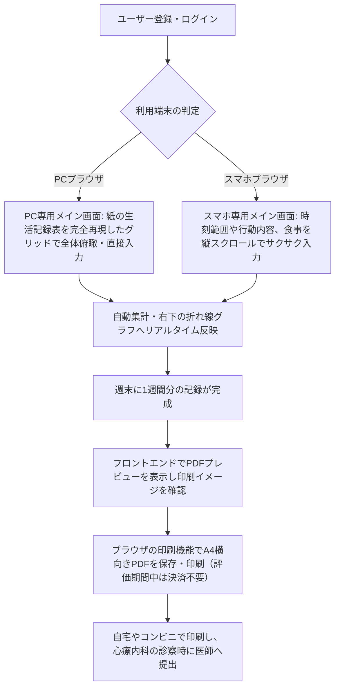

# 要件定義書

## 1. 概要
- **プロダクト名**: RePace - 週間行動＆気分記録アプリ
- **一文の説明**: リワーク復職支援で用いられる24時間の行動記録と気分・疲労感の数値可視化をデジタル化し、生活リズムの崩れを自己管理・検証できるWebアプリ。
- **背景と目的**: 前々からデジタル化したいと考えていた。EXCELシートは作っているが、入力の手間や思い通りに入力できないこともある、結局は手書きのままで運用している。
- **公開 URL**: （最終提出時に記載）

## 2. ビジネス要件

### 2.1 顧客セグメントとアーリーアダプター
- **誰の課題か（その人たちはおよそ何人いるか）**:
  うつ病や適応障害等からの復職を目指し、医療機関の指示やリワークプログラム（復職支援）で生活記録表の提出を求められている休職者。潜在的な対象者は全国に数万人以上、自身が所属していたリワークの規模感（過去の在籍者含め）としては約100名。
- **最初に使ってもらう人（アーリーアダプター）**:
  開発者自身（現在も習慣として生活記録をつけているため）、および元リワークの同期メンバー（身近な1名に検証協力を依頼）。
- **対象にしない人**:
  主治医やリワーク施設のスタッフなどの医療関係者（本アプリは利用者の自己管理・提出の省力化のためのツールであり、医療従事者側の管理システムではないため）。

### 2.2 課題と既存の代替手段
- **解く課題（3つ以内）**:
  1. **手書きによる記録・集計の手間**: 24時間を手書きで埋める、気分や疲労感を毎日5刻みの数値で計算してグラフを手描きする心理的・物理的負担。
  2. **提出・共有の不便さ**: 診察時に医師へ提出するためだけに、原本をそのまま持参するか、都度コンビニでコピーを取らなければならない手間。
  3. **フォーマットの形骸化とデータの蓄積不足**: 自由記述すぎるツールでは続かず、逆に紙のままだと過去の体調トレンド（「先月と比べてどう変化したか」）を遡って客観的に比較・分析することが困難。
- **その人が今どう対処しているか**:
  施設指定の紙の書式に毎日手書きで記入している。電子化を試みる人はExcelシートを自作しているが、スマホからの入力が極めて難しく、結局は手書き運用に戻っている。また、医師に見せるためにタブレットのカメラで写真撮影して保存している。
- **課題を知った経緯**:
  開発者自身がリワーク参加前に医師から行動記録の指示を受け、参加後は指定フォーマットでの手書き記録を義務付けられた経験から。周りのメンバーからも「毎日手描きでグラフを作るのが面倒」「診察前に慌ててコピーを取るのがストレス」という生の声を直接聞いていたため。

### 2.3 独自の価値提案
- **一文の価値提案**:
  世間にある汎用的な日記・スケジュールアプリと違い、**「リワークや心療内科で実際に使われる『24時間時間軸＋気分・疲労感の数値プロットグラフ』のフォーマットを完全に再現し、PC・スマホ双方から入力・過去ログ確認・提出用PDF印刷までを完結できる」**休職者専用の生活記録Webアプリ**。
- **既存の代替手段との違い**:
  一般的なライフログアプリはグラフの形式が固定されていたり、医療提出用のA4横向き印刷に対応していません。本アプリは、紙の手軽さ（選択式による入力アシスト）と、デジタルの強み（データベース化による過去のトレンド比較、1クリックでのA4提出用PDF生成）を両立しています。

### 2.4 ソリューション
- **課題に対応する主要機能**:
  - **選択式24時間タイムライン入力**: よく使う活動内容（睡眠、介護、TVなど）を選択肢からサクサク入力でき、独自の活動も自動で選択肢に学習・追加される入力アシスト機能。
  - **体調・疲労感の連動プロットグラフ**: 朝の気分（◯）と1日の疲労感（△）を10〜100で入力すると、右下の折れ線グラフに自動で反映される機能。
  - **提出用A4横向きPDF生成機能**: 医師や施設へそのまま提出できる、紙の指定フォーマットを忠実に再現したPDFの出力機能。プレビューはフロントエンドで表示し、PDF化はブラウザの印刷機能（「PDFとして保存」）で行う。
  - **3食分の食事・出来事のデイリーサマリー記録**: 1日の生活習慣をテキストで補足できる自由記述欄。

### 2.5 チャネル・収益・コスト
- **利用者に届ける経路**:
  まずは初期検証として、身近な元リワークメンバーやコミュニティへ直接URLを共有し、口コミを通じてアーリーアダプターを獲得する。将来的には、Web検索（「生活記録表 アプリ」「リワーク 生活記録表 PDF」など）のSEO対策を通じて、全国の休職者へリーチする。
- **お金の流れ（何をもって成功とするか）**:
  **【開発期間中・アーリーアダプター評価期間中の定義】**：COACHTECHの技術制約（完全無料・カード登録なし）を遵守するため、全機能を無料で提供する。Stripeはサンドボックス（テストモード）のみで対応し、本番の課金処理は行わない。ユーザーが「スムーズにユーザー登録し、1週間継続して記録をつけ、PDFプレビューできたこと」をもって成功とする。
  **【将来的なビジネスモデル】**：一般公開後に課金を開始する段階で、基本機能を無料とし、過去データの永続保存やPDF生成を行う際に、Stripeを通じた1回限りの機能解放課金（都度課金）を行うモデルを目指す。Stripeの本番利用は、この課金を開始するまではスコープ外とする。
- **外部サービス・素材の費用と権利**:
  - Stripe: 決済サービス（開発中およびアーリーアダプター評価中はサンドボックスのみ使用。費用無料。本番利用は将来の課金開始時）
  - Vercel: フロントエンドホスティング（無料プラン。カード登録不要）
  - Render: バックエンドAPIホスティング（無料プラン。カード登録不要）
  - TiDB Cloud Starter: MySQL互換のマネージドDB（無料枠・カード登録不要。行ストレージ5GiB、月5,000万RU）。Render（MySQL非対応）とAivenは不採用。制約と検証事項は「9. 未決事項・要確認」を参照
  - Claude Code: AI開発エージェント（Proプラン導入済み、自己負担）

### 2.6 主要指標と検証
- **成功を測る指標**:
  - ユーザー登録したアーリーアダプターの「1週間以上の継続記録率（リテンション率）」50%以上。
  - 実際に医師へ提出するための「PDF生成機能」の実行回数。
- **前提となる仮説と確かめ方**:
  - **仮説**: 「手書きやExcelの入力に挫折した人でも、スマホ・PCからの選択式入力と自動グラフ化があれば、負担なく生活記録を継続でき、医師への提出ストレスも軽減される」。
  - **確かめ方**: 協力してくれる身近な休職者（1名）に実際に1週間アプリを使って生活記録をつけてもらい、週末にPDFを出力して医師に見せてもらう。その後、入力のしやすさや提出時の便益についてフィードバックをヒアリングする。

### 2.7 圧倒的な優位性
- **既存の提供者がそれをしていない理由**:
  大手企業が提供するヘルスケアアプリは「歩数」や「体重」「睡眠時間」といった自動計測データに特化しており、精神科医療やリワークという「ニッチかつ特定の書式を必要とする領域」に特化したA4印刷フォーマットの出力に対応していないため。
- **真似されにくい点（どう築くか）**:
  自身が実際にリワークプログラムを経験し、医師の指示の意図や、紙のフォーマットの「どの項目がなぜ必要なのか」を熟知しているというドメイン知識（当事者目線）。これに基づき、休職者のメンタル状態でもストレスなく操作できる、徹底的に削ぎ落とされたUI/UXを構築することで先行優位性を築く。

## 3. 業務要件
利用者がアプリを使って日々の記録をつけ、医師や施設に提出するまでの一般的な流れ（ユースケース）は以下の通りです。

## 4. 機能要件

### 4.1 機能一覧（優先度つき）

| 機能ID | 機能名 | 優先度 | 機能概要 |
| :--- | :--- | :---: | :--- |
| F-01 | ユーザー登録 | 必須 | ユーザー名（表示名）、メールアドレス、パスワード、パスワード（確認用）の4つを入力してアカウントを作成する。ログインにはメールアドレスを用いる。 |
| F-02 | ログイン・ログアウト | 必須 | メールアドレスとパスワードで認証を行う。未ログイン時は保護されたページおよびAPIへのアクセスを遮断する。 |
| F-03 | 24時間行動記録入力 | 必須 | **【PC】**24時間のタイムライングリッドへ直接テキスト入力。 **【スマホ】**行動の開始/終了時刻、行動内容を選択・入力するフォーム形式。よく使う独自項目は自動で選択肢に学習・追加される。 |
| F-04 | 3食食事記録・日記入力 | 必須 | 朝食・昼食・夕食のテキストおよび、1日の出来事をまとめる日記（テキスト）の入力機能。 |
| F-05 | 気分・疲労感数値記録 | 必須 | 朝の気分の良さ（◯）と1日の疲労感（△）を10〜100の10刻みで記録する。 |
| F-06 | 体調追跡グラフ自動生成 | 必須 | 記録された気分（◯）と疲労感（△）を元に、設定された開始曜日から1週間軸の折れ線グラフを自動描写する。 |
| F-07 | PDF出力プレビュー | 必須 | 元の紙の指定フォーマット（A4横向き）を忠実に再現した印刷プレビュー画面を**フロントエンドで**表示する（印刷用CSSで用紙サイズ・向きを指定）。今週の目標や所感も最下部に反映される。バックエンドはプレビューに必要なデータをAPIで返すのみ。 |
| F-08 | Stripe決済連携（サンドボックス）| 優先 | 将来の課金（PDF保存機能の解放）に備えた決済機能。サンドボックスのみで構築・動作確認し、本番利用は課金開始時まで対象外。評価期間中、PDF作成は決済の有無に関わらず制限しない（F-09）。 |
| F-09 | 提出用PDF保存・ダウンロード| 必須 | プレビュー画面から**ブラウザの印刷機能**を呼び出し、A4横向きでPDFとして保存・印刷できる。**開発中およびアーリーアダプター評価期間中は利用に制限を設けない**（決済は不要）。課金開始後の制限は将来検討。バックエンドはPDFを生成せず、表示に必要なデータをAPIで返すのみ。 |
| F-10 | 週開始曜日設定 | 優先 | カレンダーおよびグラフの「1週間の始まりの曜日（例：土曜日、月曜日等）」を設定画面から選択・変更できる機能。 |
| F-11 | 1週間の所感入力 | 必須 | 週末に、その週全体の振り返り（自由テキスト）を入力・保存できる機能。 |

### 4.2 画面一覧

| 画面ID | 画面名 | 対応URL | 画面概要・レスポンシブ要件 |
| :--- | :--- | :--- | :--- |
| W-01 | ログイン画面 | `/login` | メールアドレス、パスワードの2入力によるシンプルな認証画面。 |
| W-02 | ユーザー登録画面 | `/register` | ユーザー名、メールアドレス、パスワード、確認用パスワードの4入力による新規作成画面。 |
| W-03 | メイン画面（記録表） | `/` | 設定された「開始曜日」を基準に自動で1週間分（7日間）の枠を構成。 **【PC】**元の生活記録表そのもののレイアウト（24時間グリッド、食事、グラフ、今週の目標・所感が一画面に収まる形）。 **【スマホ】**行動時刻範囲、行動内容、食事記録（3食）、日記、数値を上から順に配置した縦スクロールの入力フォーム。画面下部に週の目標・所感エリアを配置。 |
| W-04 | 設定画面 | `/settings` | 1週間の始まりの曜日（日〜土）を選択・変更できる画面。 |
| W-05 | PDFプレビュー画面 | `/preview` | A4横向きの紙のフォーマットを完全に再現したプレビュー。未決済時は「保存ボタン」を非活性、または決済導線を表示する。 |
| W-06 | 決済画面（Stripe） | 外部URL | Stripeが提供する安全なチェックアウト画面（サンドボックス）。 |

### 4.3 主なデータ
* **ユーザーデータ**: ユーザーID、ユーザー名（表示名）、メールアドレス（ログインID）、パスワードハッシュ、Stripe決済ステータス（サンドボックス）、週開始曜日設定（`week_start_day`: 0=日, 1=月... 6=土）
* **行動記録データ**: 記録日、時間帯（0〜23時）、行動内容テキスト、睡眠フラグ、排便フラグ
* **サマリーデータ（日次）**: 記録日、朝の気分値（10〜100）、疲労感値（10〜100）、朝食内容、昼食内容、夕食内容、1日の日記
* **週次データ**: 週ID、ユーザーID、対象週の開始日、今週の目標（`weekly_goal`）、今週の所感（`weekly_reflection`）

### 4.4 外部インタフェース
* **Stripe API**: PDF保存権限を解放するための決済ステータス同期（Webhookまたはセッションチェック）。サンドボックス（テストモード）のキーのみ使用する。
* **内部API（Laravel → Next.js）**: プレビューとPDF生成に必要なデータ（週次の行動記録、日次サマリー、週次の目標・所感、ユーザー設定）をJSONで返す。PDFのレイアウト描画はフロントエンドが担い、PDF化はブラウザの印刷機能で行う。バックエンドはPDFを生成・保持しない。

## 5. 非機能要件
* **認証と権限**: Laravel Sanctum等によるセッション/トークン認証を実装（ログインIDはメールアドレス）。未ログイン状態でメイン画面やPDFプレビュー、および各種APIエンドポイント（`/api/*`）にアクセスした場合は、一律で401エラーを返しログイン画面へ強制リダイレクトする。
* **個人データの扱い**: パスワードは必ずハッシュ化（Bcrypt等）してデータベースに保存する。
* **レスポンシブ対応**: Tailwind CSSを用い、PCとスマホの画面幅（ブレイクポイント）を検知してコンポーネントの表示レイアウトを完全に切り替える。

## 6. 制約条件
* **開発期間**: 8週間（要件定義〜設計〜実装〜デプロイ〜検証まで）
* **費用・インフラの制約**: 完全無料枠で運用。クレジットカード登録が不要なプラン（Vercelの無料枠、Renderの無料Web Service/DB枠）を厳選して構築する。DBは、クレジットカード登録が不要なTiDB Cloud Starter（MySQL互換）を使用する（Render・Aivenは不採用）。
* **技術スタック**:
  * フロントエンド: Next.js 16.4.4 (React 19.3.0, Tailwind CSS v4) (frontend/ ディレクトリ配下)
  * バックエンド: PHP 8.5 / Laravel 13.x (リポジトリルート直下。ローカルのDocker環境・本番ともPHP 8.5に固定)
  * データベース: MySQL互換（ローカル開発はMySQL 8.4、本番はTiDB Cloud Starter。テスト時は sqlite メモリDB）
  * PDFのプレビュー・生成: フロントエンド側で実装。PDF化はブラウザの印刷機能を使用（バックエンドはデータの保持とAPIでの受け渡しのみ）
* **AIの利用**: 開発およびデバッグにはすべて「Claude Code」を使用し、生成されたコードのロジックは開発者がすべて口頭説明できるように理解を徹底する。

## 7. スコープ外
* **医療従事者用管理画面**: 主治医やリワーク施設スタッフがログインして患者のデータを閲覧・管理する機能は今回作成しない（あくまで利用者が印刷して手渡しする業務フローをデジタル化するため）。
* **Stripeの本番利用・実課金**: 将来的に課金を開始するまではスコープ外とする。開発中およびアーリーアダプターの評価期間中は、サンドボックス（テストモード）での決済完了シミュレーションまでを対象とする。
* **サーバー側でのPDF生成・保存**: PDFのプレビューはフロントエンドで行い、PDF化はブラウザの印刷機能に任せる。バックエンドにPDF生成機能やPDFファイルの保管は持たせない。
* **PDFライブラリによるPDFファイルの直接生成**: ブラウザの印刷機能を使うため、今回は対象外とする。
* **永続的な過去データの無制限保存**: 無料DBの容量制限を考慮し、数年レベルの過去ログをすべて保持する機能やデータエクスポート機能は今回のスコープ外とする。

## 8. 更新履歴
（※1回目の要件レビュー提出から変更があった場合、ここに内容と理由を追記します。）

| 日付 | 変更内容 | 理由 |
| :--- | :--- | :--- |
| 2026-11-03 | ログイン方式を「ユーザー名」から「メールアドレス」に変更（F-01, F-02, W-01, 4.3, 5） | Laravel標準の認証（Sanctum）に合わせるため |
| 2026-11-03 | PDFのプレビュー・生成をフロントエンド側に変更。バックエンドはデータ保持とAPI受け渡しのみ（2.4, F-07, F-09, 4.4, 6, 7） | 責務の分離とサーバー負荷の軽減 |
| 2026-11-03 | Stripeは将来の課金開始までスコープ外とし、開発中・評価中はサンドボックスのみに限定。F-08の優先度を「必須」から「優先」へ変更（2.5, 3, 4.1, 4.2, 7） | 無料運用の制約と段階的な課金導入のため |
| 2026-11-03 | 本番DBをTiDB Cloud Starter（MySQL互換、無料枠）に決定。Render・Aivenは不採用（2.5, 6, 9） | 公開版でもMySQL系を使うため。RenderはMySQLを提供せず、カード不要の無料枠で容量が大きいTiDBを選択 |
| 2026-11-03 | PHPのバージョンを8.5に統一し、本番も8.5に固定（当初の8.3から変更。ローカルDocker環境、`composer.json`の要求バージョン、CLAUDE.md、README.mdも8.5） | 開発と本番の差異をなくすため |
| 2026-11-03 | PDF化はブラウザの印刷機能に決定。評価期間中はPDF作成に制限を設けない（F-07, F-09, 3） | 実装の簡素化と評価のしやすさのため |
| 2026-11-03 | 技術スタックを調査結果に更新（Next.js 16.4.4 / React 19.3.0 / Tailwind CSS v4、Laravel 13.x、MySQL）（6） | 調査に基づくバージョン確定 |

## 9. 未決事項・要確認
* **TiDB Cloud Starter の採用に伴う確認事項**（2026-11-03時点の調査。条件は変わるため、契約・利用前に公式ページで再確認する）
  * 無料枠は1インスタンスあたり、行ストレージ5GiB・カラム型5GiB・月5,000万RU。組織あたり無料インスタンスは5つまで。
  * 上限（容量・RU）を超えると**新規接続が拒否**される。利用状況を定期的に確認する。
  * **TLS接続が必須**。Laravelでは `MYSQL_ATTR_SSL_CA` にCA証明書を指定する。
  * ユーザー名にインスタンスのプレフィックス（例: `<prefix>.root`）が必要。`DB_USERNAME` に含める。接続ポートは4000。
  * トランザクションは30分、接続は30分で切断される場合がある。
  * **実機検証（2026-11-03）**: TiDB Cloud Starter（AWS 東京 `ap-northeast-1`）に、Docker内のLaravelからTLSで接続できた。
    * バージョン: `8.0.11-TiDB-v8.5.3-serverless`（MySQL 8.0互換。外部キーはv8.5でGA）。
    * Laravel標準の3マイグレーション（users / cache / jobs）が成功。外部キー（`foreignId()->constrained()->cascadeOnDelete()`）は**制約が有効**で、存在しない親IDの挿入は拒否された。
    * `utf8mb4_unicode_ci` を指定した列は照合順序どおりに動作し、メールアドレスの一意制約は**大文字小文字を区別せず**重複を拒否した（DBの既定は `utf8mb4_bin` のため、列やDBの照合順序を明示する）。
    * 分離レベルは REPEATABLE-READ、トランザクションは悲観ロック。SQLモードは `ONLY_FULL_GROUP_BY` を含むSTRICT。
    * 1マイグレーションあたり1〜2秒かかった（東京リージョン、DDLは遅め）。通常のクエリ遅延は未計測。
  * 未確認: アイドル時の一時停止・削除の有無（コールドスタート）、通常クエリの遅延、アプリが使う全クエリでの動作。
  * **MySQL互換性（2026-11-03調査）**: TiDBが互換を謳うのは **MySQL 5.7 / 8.0** で、ローカルのMySQL 8.4は明示されていない。8.4での削除機能（`mysql_native_password` の既定無効化など）に関する記載もない。

    | 区分 | 内容 | RePaceへの影響 |
    | :--- | :--- | :--- |
    | 使える | 外部キー（v6.6で追加、v8.5でGA。既定で有効）、トランザクション、JSON、utf8mb4 | マイグレーションの `foreignId()->constrained()` は利用可能の見込み。ただしStarterのバージョンは未確認 |
    | 使えない | ストアドプロシージャ/関数、トリガー、イベント、空間型/索引、`SKIP LOCKED`、`SELECT ... INTO @var`、XML関数 | これらは使わない。FULLTEXTも原則非対応（一部AWSリージョンのStarterのみ） |
    | 挙動が違う | AUTO_INCREMENTが連番にならない、既定の照合順序が `utf8mb4_bin`（MySQL 8.0は `utf8mb4_0900_ai_ci`）、同一ALTER内で同じ列/索引を複数変更不可、一部の列型変更が不可、`lower_case_table_names` は2のみ | IDの連番に依存しない。メールの一意制約や検索が大文字小文字を区別するか要確認。複雑な `->change()` は1つずつ分ける |
    | 結果の順序 | `ORDER BY` が一意でないと結果順が不定 | `orderBy` を必ず付け、同値のときは `id` なども追加する（特に週間の行動記録の取得） |
    | Starter固有 | 一部のtidb_*変数・`max_allowed_packet`・`wait_timeout` は読み取り専用。`LOAD DATA` は `LOCAL INFILE` のみ。強いパスワードが必須（8文字以上） | DBパスワードは8文字以上の強いものにする |

  * Laravel向けの公式ガイドは見つからなかった（TiDBのドキュメントにPHP/Laravelの項目がない）。接続設定は上記の手順とLaravel標準のMySQLドライバ設定に従い、実機で確認する。
  * 対応方針: (1) 早い段階で無料インスタンスを作り、マイグレーション・テスト・主要なクエリを通す。(2) 開発環境にもTiDBコンテナを追加して本番との差をなくすかを検討する（現状はMySQL 8.4）。(3) 互換性の問題が出た場合は、DBをAivenへ切り替える選択肢を残す。
  * 本番と開発でDBの種類が異なる（ローカルはMySQL 8.4、本番はTiDB）。TiDBの無料インスタンスでLaravelのマイグレーションとテストが通るか、早期に検証する。必要ならローカルもTiDB互換の環境に寄せる。
* **F-08（Stripeサンドボックス）の範囲**: 評価期間中はPDF作成を制限しないため、サンドボックス決済を画面に出すか、バックエンドだけ用意しておくかを決める。
* **印刷レイアウト**: ブラウザ差（Chrome/Safari）で、A4横向き・余白・フォントが崩れないかを検証する。日本語フォントの扱いも確認する。
