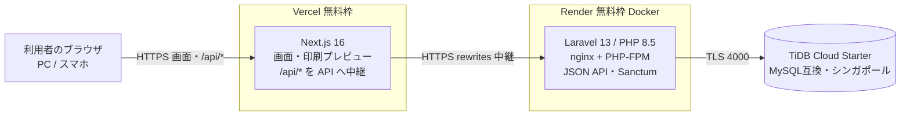
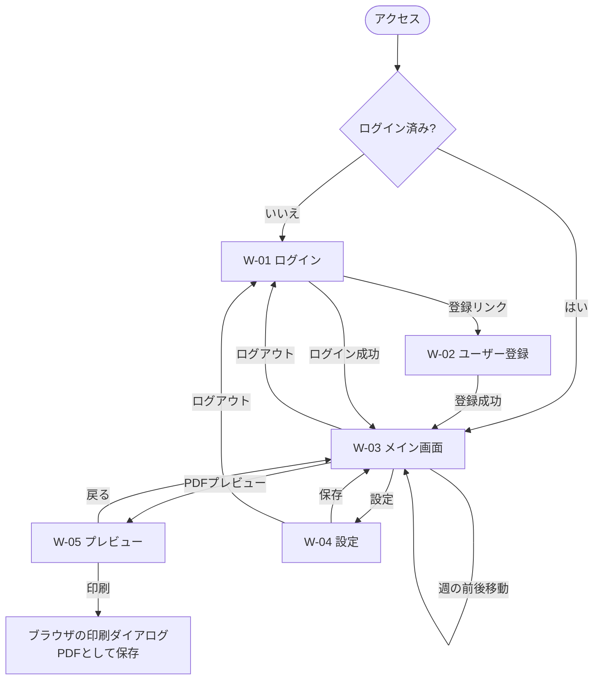
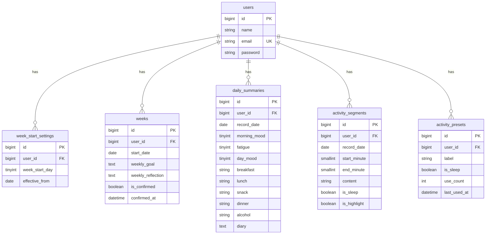

# RePace 設計書

- 対象: [要件定義書](要件定義書.md) の機能 F-01〜F-11、画面 W-01〜W-05
- ステータス: ドラフト（実装の進行に合わせて更新する）
- 構成: 共通事項（構成・データ・API 一覧・方針）は本書、機能ごとの設計は [docs/design/](design/) の F-01〜F-11 に分けている（2 章の表からリンク）
- 機能名・画面名は要件定義書と同じ語を使う

## 1. システム構成

### 1.1 構成図



- ブラウザは常に Vercel のドメインだけと通信する。`/api/*` と `/sanctum/*` は Next.js の rewrites で Laravel（Render）へ中継する。ブラウザから見ると同一オリジンになり、Cookie が第三者 Cookie にならない（Safari 等で遮断されない）。
- PDF は Laravel では作らない。`/preview` を印刷用CSSで描画し、ブラウザの印刷機能で保存する。

### 1.2 技術スタックと選んだ理由

| 領域 | 採用 | 選んだ理由（比べた候補） |
| :--- | :--- | :--- |
| フロントエンド | Next.js 16.4.4 / React 19.3.0 / TypeScript / Tailwind CSS v4 | 課題の技術要件（JSフレームワーク）を満たす。Tailwindのブレイクポイントで PC とスマホの表示を切り替えられる（要件 5）。Vercel の無料枠でそのまま公開できる |
| バックエンド | PHP 8.5 / Laravel 13.x（API） | 要件。認証（Sanctum）、バリデーション、日本語言語ファイルが標準で揃う |
| 認証 | Laravel Sanctum（SPA の Cookie 認証） | トークンをブラウザ（localStorage）に置かずに済む。XSS でトークンを盗まれるリスクを避けられる（比較: Sanctum のAPIトークン方式、JWT） |
| DB | 本番: TiDB Cloud Starter（MySQL互換）。開発: MySQL 8.0（Docker） | カード登録不要で MySQL 系が使える唯一に近い無料枠（比較: Render=MySQL非対応、Aiven=自動停止の懸念、PlanetScale=無料枠なし）。詳細は 1.4 |
| 印刷・PDF | 印刷用CSS + ブラウザの印刷機能 | サーバー負荷ゼロ。日本語フォントを埋め込むPDFライブラリが不要（比較: react-pdf、サーバー側 dompdf） |
| グラフ | 自作の SVG 折れ線グラフ | 印刷でベクターのまま出力でき、◯△のマーカーを自由に描ける（比較: Chart.js は canvas で印刷時にぼやけやすい） |
| テスト | Laravel 標準のテスト（PHPUnit 12）。DB は sqlite メモリ | 課題の技術要件 |
| 整形 | Laravel Pint / ESLint | 課題の技術要件 |

### 1.3 公開先とその制約への対応

| 対象 | 公開先 | 無料枠の制約 | 対応 |
| :--- | :--- | :--- | :--- |
| フロントエンド | Vercel（Hobby） | 商用利用不可（ポートフォリオ公開は問題なし） | ポートフォリオとして公開する間は問題なし。将来、収益化する場合はプランを見直す |
| API | Render Web Service（Docker、無料インスタンス） | 一定時間アクセスがないとスリープし、初回アクセスが遅い。ファイルは永続しない | フロントで「接続中…」「サーバーを起動しています」を表示して再試行する（6.3）。セッションは Cookie に持ち、ファイル保存に依存しない。ログは標準エラー出力へ |
| DB | TiDB Cloud Starter | 容量5GiB・月5,000万RU。超過で新規接続が拒否される。TLS必須 | 1ユーザー1日あたりの行数は最大192区間（15分×96を最大2段）+サマリー1行と小さく、容量は問題になりにくい。使用量を定期確認する |

- 起動時に実行するもの: `php artisan migrate --force`、`config:cache`、`route:cache`。
- Render の無料枠に東京リージョンはない（アジアはシンガポールのみ）。API（Render）と DB（TiDB）を**同じシンガポールのリージョンにそろえ**、API と DB の間の往復を小さくする。あわせて、セッションを DB に置かない（`SESSION_DRIVER=cookie`）、1リクエスト内のクエリ数を抑える（週取得は3クエリ）ことで、DB への通信回数を減らす。フロントエンド（Vercel）とブラウザから API（シンガポール）への通信は、日本からの距離の分の遅延がある。
- TiDB の MySQL 互換性と実機検証の結果は 1.7 のとおり。外部キーは有効、照合順序は `utf8mb4_unicode_ci` を明示する。

### 1.4 環境変数の一覧（値は書かない）

**Laravel（バックエンド）**

| 名前 | 用途 |
| :--- | :--- |
| `APP_NAME` / `APP_ENV` / `APP_DEBUG` / `APP_URL` | アプリ名、環境（本番は `production`）、デバッグ（本番は `false`）、API の公開URL |
| `APP_KEY` | 暗号化キー（本番で生成し、再生成しない） |
| `APP_LOCALE` / `APP_FALLBACK_LOCALE` / `APP_FAKER_LOCALE` | `ja` / `ja` / `ja_JP` |
| `LOG_CHANNEL` / `LOG_LEVEL` | 本番は `stderr` / `warning` |
| `DB_CONNECTION` / `DB_HOST` / `DB_PORT` / `DB_DATABASE` / `DB_USERNAME` / `DB_PASSWORD` | DB 接続。TiDB はポート4000、ユーザー名にプレフィックス付き |
| `MYSQL_ATTR_SSL_CA` | TiDB への TLS 接続に使う CA 証明書のパス |
| `SESSION_DRIVER` / `SESSION_LIFETIME` | `cookie` / セッション有効分数 |
| `SESSION_SECURE_COOKIE` / `SESSION_SAME_SITE` / `SESSION_DOMAIN` | 本番は `true` / `lax` / 未設定（ホスト限定Cookie） |
| `SANCTUM_STATEFUL_DOMAINS` | フロントエンドのドメイン（Vercel のドメイン、開発は `localhost:3000`） |
| `FRONTEND_URL` | フロントエンドのURL |
| `CACHE_STORE` | `database`（`cache` テーブルを使う。ログイン失敗回数・ロックを Render の再起動後も保持するため。`array` は制限が効かず、`file` は再起動で消えるため使わない） |

**Next.js（フロントエンド）**

| 名前 | 用途 |
| :--- | :--- |
| `API_BASE_URL` | rewrites の中継先（Render の API の URL）。サーバー側のみで使い、ブラウザには出さない |

**GitHub Actions（バックアップ用のシークレット。値は書かない）**

| 名前 | 用途 |
| :--- | :--- |
| `TIDB_BACKUP_HOST` / `TIDB_BACKUP_PORT` / `TIDB_BACKUP_DATABASE` | バックアップ対象の TiDB の接続先（ホスト、ポート 4000、DB 名） |
| `TIDB_BACKUP_USERNAME` / `TIDB_BACKUP_PASSWORD` | バックアップ専用の読み取り専用ユーザー（プレフィックス付き）とパスワード |
| `BACKUP_AGE_PUBLIC_KEY` | バックアップの暗号化に使う公開鍵（秘密鍵は手元でのみ保管し、シークレットには置かない） |

### 1.5 認証方式と CORS／CSRF の方針

- 方式: Sanctum の SPA 認証（セッション Cookie）。ログインで発行されたセッション Cookie（HttpOnly）で API を保護する。
- 別ドメイン（Vercel と Render）の問題: ブラウザが API に直接アクセスすると、Cookie が第三者 Cookie になり、Safari や Chrome の設定で遮断される。**Next.js の rewrites で `/api/*`・`/sanctum/*` を Laravel へ中継し、ブラウザには同一オリジンに見せる。**
- CSRF: 状態を変える API（POST/PUT/PATCH/DELETE）の前に `GET /sanctum/csrf-cookie` を呼ぶ。`XSRF-TOKEN` Cookie の値を `X-XSRF-TOKEN` ヘッダに付けて送る。不一致は 419 を返す。
- CORS: 同一オリジン中継のため本番では不要（`supports_credentials` は `false`、許可オリジンなし）。ローカル開発でも rewrites を使い、同じ構成にする。
- 未ログインで保護された API を呼ぶと 401。フロントは `/login` へ遷移する。

### 1.6 非機能への対処

| 項目 | 対処 |
| :--- | :--- |
| 入力値の検証 | Laravel の FormRequest で API 側を必ず検証する（フロントの検証は補助）。日本語メッセージ（`lang/ja`）。許容値を超える入力は 422 |
| パスワード | bcrypt でハッシュ化。8文字以上。ログイン失敗は `メール+IP` で5回までとし、超えると24時間ロック（429。キャッシュは DB に保存） |
| 個人データ | 他人のデータは取得・更新できない。すべての問い合わせを `user_id = 認証ユーザー` で絞る。他人の資源は 404 |
| ログ | 本番は標準エラー出力へ `warning` 以上。日記・食事内容・パスワードはログに出さない。メールアドレスは必要最小限 |
| エラー時の挙動 | 6.3 の方針。Laravel は本番で詳細なエラーを返さない（`APP_DEBUG=false`） |
| バックアップ | TiDB Starter（無料）の自動バックアップ（毎日、保持1日。復元は新しいインスタンスへのスナップショット復元のみ。手動バックアップは不可）に加え、**GitHub Actions の定期実行で `mysqldump` により SQL をエクスポートし、暗号化して保存する**。(1) 毎日 1 回（例: 毎日 03:00 JST = 18:00 UTC。利用が少ない時間帯）に実行する。(2) `mysqldump -h <ホスト> -P 4000 -u <ユーザー> --ssl-mode=REQUIRED --column-statistics=0 --skip-lock-tables --set-gtid-purged=OFF --no-tablespaces <DB名>`（`--single-transaction` は TiDB で失敗するため使わない。実機で検証済み）。(3) 書き出した SQL を、公開鍵で暗号化（`age`）してから、Actions のアーティファクト（`retention-days` は最大の90日）に保存する。平文のファイルは保存しない。(4) 復号用の秘密鍵は、手元でのみ保管する（リポジトリや GitHub Secrets には置かない）。(5) バックアップ用の DB ユーザーは、読み取り専用（SELECT のみ）にする。(6) 公開リポジトリは、60日間活動がないと定期実行が自動で無効になるため、定期的にコミットなどの活動を行う。復元は、アーティファクトを取得して秘密鍵で復号し、SQL を新しいインスタンスに流し込む。一貫したスナップショットではないため、記録の少ない時間帯に実行する |
| 性能 | 週間画面は 1 リクエスト（3 クエリ）で取得する。通常操作は 1 秒以内を目標。Render のコールドスタート時は除く |
| 印刷（1ページ厳守） | 生活記録表は複数ページにまたがる出力を認めず、必ず A4 横向き1ページに収める。1ページに収まる量に入力を制限する（API で検証）: 日記150文字以内、食事（朝食・昼食・間食・夕食・飲酒）の1日の合計120文字以内、今週の目標80文字以内、今週の所感250文字以内。それでも日記・食事が多くて1ページに収まらない場合に限り、W-05 で日記・食事記録エリア全体の文字サイズを段階的に下げる（フロントエンド。F-07） |
| アクセシビリティ | 色だけに依存しない（気分は ◯、疲労感は △ で区別）。フォームにラベルを付ける |

**バックアップのワークフロー（`.github/workflows/db-backup.yml`）**

バックアップ専用の読み取り専用ユーザー（`<プレフィックス>.repace_backup`、`repace` データベースへの `SELECT` のみ）を使う。GitHub Actions のランナー（`ubuntu-latest`）から TiDB（シンガポール）に TLS で接続でき、`mysqldump` が全9テーブルで成功することを確認した（ランナーの `mysqldump` は 8.4 系で、同じオプションで動いた）。

1. トリガー: `schedule`（毎日 18:00 UTC = 03:00 JST）と `workflow_dispatch`（手動実行）。
2. ランナー: `ubuntu-latest`。ランナーに入っている `mysqldump` を使い、`age` をインストールする。
3. `mysqldump`（上の表のオプション）で `backup.sql` を書き出す。接続情報は GitHub Secrets（1.4）から受け取る。
4. `age -r "$BACKUP_AGE_PUBLIC_KEY"` で暗号化して `backup-YYYYMMDD.sql.age` にし、平文の `backup.sql` を削除する。
5. `actions/upload-artifact` で暗号化したファイルだけを保存する（`retention-days: 90`）。
6. 失敗したときは、ワークフローが失敗として記録され、GitHub からメールで通知される。
7. ログにシークレットや SQL の内容を出さない。

### 1.7 データベース（TiDB Cloud Starter）の採用と互換性

**選定の経緯（2026-11-03時点の調査）**

公開版でも MySQL 系を使い、クレジットカード登録が不要な無料のマネージド DB を条件に比べた。

| 項目 | TiDB Cloud Starter（採用） | Aiven for MySQL（無料プラン。不採用） |
| :--- | :--- | :--- |
| 種別 | MySQL互換（TiDB） | MySQL（本物） |
| カード登録 | 不要（6個目以降の作成と従量課金にはカードと上限設定が必要） | 不要 |
| 容量 | 行ストレージ5GiB＋カラム型5GiB、月5,000万RU | ディスク1GB、RAM 1GB、1CPU |
| 主な制限 | 超過すると新規接続を拒否。TLS必須。トランザクション・接続は30分で切断される場合がある | 最大接続数76。長期間アクセスがないと自動停止する場合がある（データ保持は公式に明記なし） |
| 不採用の理由 | — | 容量が小さく、停止時の挙動が不明 |

- Render はマネージドの MySQL を提供しないため不採用。PlanetScale は無料枠が廃止されているため対象外。
- 互換性の問題が出た場合は、Aiven への切り替えを選択肢として残す。

**TiDB Cloud Starter の制約と接続設定**

- 無料枠は1インスタンスあたり、行ストレージ5GiB・カラム型5GiB・月5,000万RU。組織あたり無料インスタンスは5つまで。
- 上限（容量・RU）を超えると**新規接続が拒否**される。利用状況を定期的に確認する。
- **TLS接続が必須**。Laravel では `MYSQL_ATTR_SSL_CA` に CA 証明書を指定する。
- ユーザー名にインスタンスのプレフィックス（例: `<prefix>.root`）が必要。`DB_USERNAME` に含める。接続ポートは4000。
- Laravel 向けの公式ガイドは見つからなかった。接続設定は上記と Laravel 標準の MySQL ドライバ設定に従い、実機で確認した。

**実機検証（2026-11-03）**

TiDB Cloud Starter（AWS シンガポール `ap-southeast-1`。公開版で使う、API と同じリージョン）に、Docker 内の Laravel から TLS で接続できた。

- バージョン: `8.0.11-TiDB-v8.5.3-serverless`（MySQL 8.0互換。外部キーは v8.5 で GA）。
- Laravel 標準の3マイグレーション（users / cache / jobs）が成功。外部キー（`foreignId()->constrained()->cascadeOnDelete()`）は**制約が有効**で、存在しない親IDの挿入は拒否された。
- `utf8mb4_unicode_ci` を指定した列は照合順序どおりに動作し、メールアドレスの一意制約は**大文字小文字を区別せず**重複を拒否した（DB の既定は `utf8mb4_bin` のため、列や DB の照合順序を明示する）。
- 分離レベルは REPEATABLE-READ、トランザクションは悲観ロック。SQL モードは `ONLY_FULL_GROUP_BY` を含む STRICT。
- 1マイグレーションあたり1〜2秒かかった（DDL は遅め）。

**MySQL 互換性**

TiDB が互換を謳うのは **MySQL 5.7 / 8.0** で、MySQL 8.4 は明示されていない。そのため、開発環境の MySQL も **8.0** に合わせた。本番（TiDB）と開発（MySQL）でDBの種類が異なることを前提に、下表の点に注意する。

| 区分 | 内容 | RePace への影響 |
| :--- | :--- | :--- |
| 使える | 外部キー（v6.6 で追加、v8.5 で GA。既定で有効）、トランザクション、JSON、utf8mb4 | マイグレーションの `foreignId()->constrained()` を使える（実機で確認済み） |
| 使えない | ストアドプロシージャ/関数、トリガー、イベント、空間型/索引、`SKIP LOCKED`、`SELECT ... INTO @var`、XML 関数 | これらは使わない。FULLTEXT も原則非対応（一部 AWS リージョンの Starter のみ） |
| 挙動が違う | AUTO_INCREMENT が連番にならない、既定の照合順序が `utf8mb4_bin`（MySQL 8.0 は `utf8mb4_0900_ai_ci`）、同一 ALTER 内で同じ列/索引を複数変更不可、一部の列型変更が不可、`lower_case_table_names` は2のみ | ID の連番に依存しない。照合順序を明示する。複雑な `->change()` は1つずつ分ける |
| 結果の順序 | `ORDER BY` が一意でないと結果順が不定 | `orderBy` を必ず付け、同値のときは `id` なども追加する（特に週間の行動の区間の取得） |
| Starter 固有 | 一部の tidb_* 変数・`max_allowed_packet`・`wait_timeout` は読み取り専用。`LOAD DATA` は `LOCAL INFILE` のみ。強いパスワードが必須（8文字以上） | DB パスワードは8文字以上の強いものにする |

### 1.8 バックエンドの層構成と実装規約

実装規約の詳細は [CLAUDE.md](../CLAUDE.md) に置く。ここでは設計として決めた点だけを示す。

1 つの API リクエストは次の順に流れる。Laravel 側は画面（Blade）を持たず、常に JSON を返す。

```
routes/api.php → Middleware（Sanctum 認証・ログイン試行制限）→ Controller（Action を呼ぶだけ）
→ FormRequest（バリデーション・認可）→ Action（1 業務操作 = 1 クラス。app/UseCases/{Entity}/）
→ Service / Model（横断ロジック・Eloquent）→ JsonResponse
```

| 区分 | 方針 |
| :--- | :--- |
| 層の責務 | Controller は業務ロジックを持たず、Action へ委譲する。複数の表にまたがる集計・判定（睡眠時間の計算など）は Service に置く |
| DB アクセス | Eloquent・名前付きスコープ・Query Builder のみ。生クエリ（`DB::raw`、`whereRaw`、`DB::select` など）は使わない。`DB::transaction` は使う（日をまたぐ保存、F-03） |
| 型 | すべてのメソッドに引数・戻り値の型を付け、`declare(strict_types=1);` を宣言する |
| 他人のデータ | 取得・更新・削除のいずれも 404 を返し、存在を示唆しない。403 は、ログイン済みでの登録・ログインの呼び出しなどに限る（5.3） |
| UNIQUE 制約の競合 | 衝突（例: 同じ日の同時保存）で 500 にしない。Action 内で `QueryException` を捕捉してドメイン例外に変換し、409 または 422 の JSON で返す |
| サーバーへのファイル保存 | 提出用 PDF はブラウザの印刷で作るためサーバーに保存しない。今後ファイルを保存する場合は `private` ディスクを使う |

## 2. 機能一覧と追跡

要件定義書の機能 ID ごとに、画面・API・テーブルを対応づける。詳細は各機能の設計書を参照。

| 機能ID | 機能名 | 優先度 | 画面 | API（5 章） | テーブル | 機能別設計書 |
| :--- | :--- | :---: | :--- | :--- | :--- | :--- |
| F-01 | ユーザー登録 | 必須 | W-02 | A-01 | users, activity_presets | [F-01](design/F-01_ユーザー登録.md) |
| F-02 | ログイン・ログアウト | 必須 | W-01、W-03・W-04（ログアウト） | A-02, A-03, A-04 | users | [F-02](design/F-02_ログイン・ログアウト.md) |
| F-03 | 24時間行動記録入力 | 必須 | W-03 | R-01, R-02, R-05, R-06, P-01, P-02 | activity_segments, activity_presets | [F-03](design/F-03_24時間行動記録入力.md) |
| F-04 | 3食食事記録・日記入力 | 必須 | W-03 | R-01, R-03 | daily_summaries | [F-04](design/F-04_3食食事記録・日記入力.md) |
| F-05 | 気分・疲労感数値記録 | 必須 | W-03 | R-01, R-03 | daily_summaries | [F-05](design/F-05_気分・疲労感数値記録.md) |
| F-06 | 体調追跡グラフ自動生成 | 必須 | W-03, W-05 | R-01 | daily_summaries | [F-06](design/F-06_体調追跡グラフ自動生成.md) |
| F-07 | PDF出力プレビュー | 必須 | W-05 | R-01 | users, weeks, daily_summaries, activity_segments（参照のみ） | [F-07](design/F-07_PDF出力プレビュー.md) |
| F-08 | 提出用PDF保存・ダウンロード | 必須 | W-05 | R-01（PDF 化はブラウザの印刷機能） | users | [F-08](design/F-08_提出用PDF保存.md) |
| F-09 | 週開始曜日設定 | 優先 | W-04 | A-04, S-01 | users | [F-09](design/F-09_週開始曜日設定.md) |
| F-10 | 1週間の所感入力 | 必須 | W-03、W-05（表示のみ） | R-01, R-04 | weeks | [F-10](design/F-10_1週間の所感入力.md) |
| F-11 | 週の確定（所感を保存して週を完成） | 必須 | W-03（W-05 は確定した週も表示・印刷） | R-01, R-07（R-02〜R-04・R-06 は確定済みの週で 409） | weeks | [F-11](design/F-11_週の確定.md) |

> 画面の ID は「W-xx」、API の ID は「A/R/P/S/B-xx」と書き分ける（API の一覧は 5.1）。

## 3. 画面設計

### 3.1 画面一覧

| 画面ID | 画面名 | URL | 目的 | 主な表示と操作 |
| :--- | :--- | :--- | :--- | :--- |
| W-01 | ログイン画面 | `/login` | 認証 | メールアドレス、パスワード、ログインボタン、登録画面へのリンク |
| W-02 | ユーザー登録画面 | `/register` | アカウント作成 | ユーザー名、メールアドレス、パスワード、パスワード（確認用）、登録ボタン |
| W-03 | メイン画面（記録表） | `/`（`?date=YYYY-MM-DD` で週を指定） | 1週間の記録の入力・閲覧 | 週の移動、24時間の行動記録、食事（間食・飲酒を含む）・日記、気分・疲労感、グラフ、今週の目標・所感、週の確定（所感を保存して週を完成） |
| W-04 | 設定画面 | `/settings` | 週開始曜日の設定 | カレンダーで週の開始日を選択（その日の曜日が開始曜日になる）、保存、ログアウト |
| W-05 | PDFプレビュー画面 | `/preview`（`?date=`） | 提出用の印刷プレビュー | A4横向きの記録表、印刷（PDF保存）ボタン、戻るリンク |

### 3.2 画面遷移図



- 未ログインで W-03〜W-05 を開くと W-01 へ遷移する。ログイン済みで W-01/W-02 を開くと W-03 へ遷移する。

### 3.3 主要画面の画面項目と入力チェック

画面項目・入力チェックは機能ごとの設計書にまとめている。

| 画面 | 主な項目 | 詳細 |
| :--- | :--- | :--- |
| W-01 ログイン画面 | メールアドレス、パスワード | [F-02](design/F-02_ログイン・ログアウト.md) |
| W-02 ユーザー登録画面 | ユーザー名、メールアドレス、パスワード、パスワード（確認用） | [F-01](design/F-01_ユーザー登録.md) |
| W-03 メイン画面（記録表） | 週の移動、行動記録（PC: グリッド／スマホ: 時刻範囲、強調）、食事（間食・飲酒を含む）・日記、気分・疲労感、グラフ、今週の目標・所感 | [F-03](design/F-03_24時間行動記録入力.md)、[F-04](design/F-04_3食食事記録・日記入力.md)、[F-05](design/F-05_気分・疲労感数値記録.md)、[F-06](design/F-06_体調追跡グラフ自動生成.md)、[F-10](design/F-10_1週間の所感入力.md)、[F-11](design/F-11_週の確定.md) |
| W-04 設定画面 | 週の開始日（カレンダーで選択。曜日が自動で決まる） | [F-09](design/F-09_週開始曜日設定.md) |
| W-05 PDFプレビュー画面 | A4横向きのプレビュー、印刷ボタン | [F-07](design/F-07_PDF出力プレビュー.md)、[F-08](design/F-08_提出用PDF保存.md) |

W-03 の共通事項:
- 表示の切替えは Tailwind のブレイクポイント（`md` 以上を PC）で行う。PC は紙の記録表と同じ配置で一画面に収め、スマホは縦スクロールで「日→行動→食事→日記→数値」の順に並べ、最下部に週の目標・所感を置く。
- 保存のタイミングは、入力欄の確定（フォーカスが外れる、選択する）。保存中・保存済み・失敗を欄の脇に示す。

### 3.4 メッセージ

| 種別 | 文言 |
| :--- | :--- |
| 入力エラー | `lang/ja/validation.php` の標準文言（例: 「メールアドレスは必須項目です。」）。項目名は `attributes` に日本語を定義する |
| ログイン失敗 | 「メールアドレスまたはパスワードが正しくありません。」 |
| 区間の重なりの上限（422） | 「同じ時間帯に重ねられる行動は2つまでです。時間をずらすか、どちらかを削除してください。」 |
| ログイン失敗の上限超過（429） | 「ログインに5回失敗したため、24時間ログインできません。時間をおいてからやり直してください。」 |
| セッション切れ（401） | 「ログインの有効期限が切れました。もう一度ログインしてください。」（W-01 へ遷移） |
| 保存成功 | 「保存しました」（欄の脇に小さく表示） |
| 週の確定の確認 | 「この週を完成させます。完成すると、この週の記録は変更できなくなります（表示と印刷はできます）。よろしいですか？」 |
| 週の確定 | 「この週を完成させました」 |
| 確定済みの週への変更（409） | 「この週は完成済みのため、変更できません。閲覧と印刷のみできます。」 |
| 保存失敗 | 「保存できませんでした。入力内容は残っています。もう一度お試しください。」 |
| 接続待ち | 「接続中…」（アニメーション付き。1秒以上応答がないとき） |
| サーバー起動待ち | 「サーバーを起動しています。1分ほどかかることがあります。少しお待ちください…」（3秒以上応答がないとき。アニメーションと経過秒数を表示し、画面が止まって見えないようにする） |
| 通信エラー | 「通信できませんでした。ネットワークを確認してください。」 |
| 食事の合計の上限（422） | 「食事（朝食・昼食・間食・夕食・飲酒）の合計は120文字以内で入力してください。」 |
| 週開始日の選択エラー（422） | 「週の開始日は、まだ確定していない現在進行中の週の初日（11/9）以降の日付を選んでください。完成済みの週は変更できません。」（日付は実際の値） |

## 4. データ設計

### 4.1 ER 図



### 4.2 テーブル定義

照合順序は全テーブル `utf8mb4_unicode_ci`（TiDB の既定 `utf8mb4_bin` に依存しない）。主キーは `id`（bigint unsigned、自動採番。連番であることに依存しない）。全テーブルに `created_at` / `updated_at` を持つ。

**users**（Laravel 標準に追加）

| カラム | 型 | NULL | 既定値 | 制約・備考 |
| :--- | :--- | :---: | :--- | :--- |
| id | bigint unsigned | × | | PK |
| name | varchar(50) | × | | ユーザー名（表示名） |
| email | varchar(255) | × | | UNIQUE。ログインID |
| email_verified_at | timestamp | ○ | | Laravel 標準（メール認証は今回使わない） |
| password | varchar(255) | × | | bcrypt |
| remember_token | varchar(100) | ○ | | Laravel 標準（SPA認証では使わない） |

**week_start_settings**（週開始曜日の設定。変更の履歴）

| カラム | 型 | NULL | 既定値 | 制約・備考 |
| :--- | :--- | :---: | :--- | :--- |
| id | bigint unsigned | × | | PK |
| user_id | bigint unsigned | × | | FK → users.id（ON DELETE CASCADE） |
| week_start_day | tinyint unsigned | × | 1 | 0=日〜6=土。**既定は月曜（1）** |
| effective_from | date | × | 2000-01-01 | この日以降の週に適用する（登録時の行は 2000-01-01） |
| | | | | UNIQUE (user_id, effective_from) |

- 登録時に、`week_start_day`=1（月曜）、`effective_from`=2000-01-01 の行を1件作る。
- 週開始曜日を変更するとき、すでに記録がある場合は、選んだ日を `effective_from` とする行を追加する。過去の週は、その日より前の設定のまま維持される（変則週や欠損期間を示すフラグは持たない）。記録がまだない場合は、登録時の行の曜日を書き換える（全期間に適用）。
- ある日付の週は、その日付に有効な設定（`effective_from` が最大で、その日付以前の行）から計算する（5.2）。

**weeks**（週次データ）

| カラム | 型 | NULL | 既定値 | 制約・備考 |
| :--- | :--- | :---: | :--- | :--- |
| id | bigint unsigned | × | | PK |
| user_id | bigint unsigned | × | | FK → users.id（ON DELETE CASCADE） |
| start_date | date | × | | 対象週の開始日 |
| weekly_goal | varchar(80) | ○ | | 今週の目標（**80文字以内**。原紙の1行の枠に合わせる） |
| weekly_reflection | varchar(250) | ○ | | 今週の所感（**250文字以内**。原紙の2行の枠に合わせる） |
| is_confirmed | boolean | × | false | 週を確定（完成）したか（F-11）。true の週の行動・サマリー・目標・所感は変更できない（409）。false に戻す手段はない |
| confirmed_at | datetime | ○ | | 確定した日時 |
| | | | | UNIQUE (user_id, start_date) |

**daily_summaries**（サマリーデータ・日次）

| カラム | 型 | NULL | 既定値 | 制約・備考 |
| :--- | :--- | :---: | :--- | :--- |
| id | bigint unsigned | × | | PK |
| user_id | bigint unsigned | × | | FK → users.id（ON DELETE CASCADE） |
| record_date | date | × | | 記録日 |
| morning_mood | tinyint unsigned | ○ | | 朝の気分（◯）。5〜100の5刻み（アプリ側で検証） |
| fatigue | tinyint unsigned | ○ | | 疲労感（△）。5〜100の5刻み |
| day_mood | tinyint unsigned | ○ | | 1日の気分（％）。5〜100の5刻み。朝の気分とは別の、その日の総合的な気分 |
| breakfast / lunch / snack / dinner | varchar(100) | ○ | | 朝食・昼食・間食（昼食と夕食の間）・夕食の内容。間食がない利用者は空欄。`alcohol` を含む5項目の合計は1日120文字以内（アプリ側で検証） |
| alcohol | varchar(100) | ○ | | 飲酒の内容（例: ビール500）。夕食に含めて扱う。飲酒がない利用者は空欄 |
| diary | varchar(150) | ○ | | 1日の日記（**150文字以内**。印刷を1ページに収めるため。アプリ側でも検証） |
| | | | | UNIQUE (user_id, record_date) |

**activity_segments**（行動記録データ・15分単位の区間）

| カラム | 型 | NULL | 既定値 | 制約・備考 |
| :--- | :--- | :---: | :--- | :--- |
| id | bigint unsigned | × | | PK |
| user_id | bigint unsigned | × | | FK → users.id（ON DELETE CASCADE） |
| record_date | date | × | | 記録日 |
| start_minute | smallint unsigned | × | | 開始（その日の0時からの分。0〜1425の15の倍数） |
| end_minute | smallint unsigned | × | | 終了（15〜1440の15の倍数。`start_minute` より大きい） |
| content | varchar(100) | × | | 行動内容 |
| is_sleep | boolean | × | false | 睡眠の区間か（1日の睡眠時間の自動計算に使う） |
| is_highlight | boolean | × | false | 強調する（原紙の赤字の予定。印刷で赤字・太字にする） |
| | | | | INDEX (user_id, record_date, start_minute) |

- 区間の重なりは、同じ時間帯に**最大2つまで**認める。3つ以上が同じ時間帯に重なる保存は 422。検証はアプリ側で行う（DB の制約にはしない）。上下どちらの段に置くかは保存せず、表示のたびに決める（開始が早い順、同じなら終了が早い順、それも同じなら `id` 順に並べ、上段が空いていれば上段、そうでなければ下段）。
- W-03・W-05 のタイムラインは、区間が重なっている**時間帯だけ**を上下2段に分割し、その時間帯の行動内容は先頭の全角1文字（半角は2文字）だけを表示する（F-03 の 2.1）。重なっていない時間帯は変わらない。
- 日をまたぐ行動は、日ごとに分割して保存する（例: 23:00〜翌7:30 の睡眠は、当日 23:00〜24:00 と翌日 0:00〜7:30）。2日分は1回の R-02 で受け取り、`DB::transaction` で保存する（どちらかが失敗したら両日ともロールバック）。
- **睡眠時間は保存しない。** 取得時に、`is_sleep` の区間から計算する。連続した睡眠（日をまたぐものを含む）は、**起きた日に全体を数える**。ある日 X の睡眠時間 = X の `is_sleep` の区間の合計（睡眠の区間どうしが重なっていても、重なった時間は1回だけ数える）（ただし、24:00 で終わり、翌日が 0:00 から睡眠で始まる区間は、翌日に数えるため除く）＋（X が 0:00 から睡眠で始まる場合）前日の 24:00 で終わる `is_sleep` の区間の長さ。例: 日曜 23:00〜24:00 と月曜 0:00〜6:00 は、月曜が 7.0、日曜は 0。週の境目では前後1日を読むため、週をまたぐ集計が必要。排便は記録しない（スコープ外）。

**activity_presets**（よく使う行動の選択肢。入力で学習）

| カラム | 型 | NULL | 既定値 | 制約・備考 |
| :--- | :--- | :---: | :--- | :--- |
| id | bigint unsigned | × | | PK |
| user_id | bigint unsigned | × | | FK → users.id（ON DELETE CASCADE） |
| label | varchar(100) | × | | 選択肢の文言 |
| is_sleep | boolean | × | false | 睡眠として扱う選択肢か（「睡眠」のみ true。選ぶと区間が睡眠になる） |
| use_count | int unsigned | × | 0 | 利用回数（並び順に使う） |
| last_used_at | timestamp | ○ | | 最終利用日時 |
| | | | | UNIQUE (user_id, label) |

- 登録時に初期の選択肢を入れる: 睡眠（`is_sleep`=true）、食事、入浴、散歩、家事、介護、TV、リワーク。
- Laravel 標準の `password_reset_tokens`、`sessions`、`cache`、`jobs` 等は、セッションを Cookie に、キャッシュを `array` にするため本番では使わない（マイグレーションは残る）。

### 4.3 CRUD 表（機能 × テーブル）

C=作成 R=参照 U=更新 D=削除

| 機能 | users | week_start_settings | weeks | daily_summaries | activity_segments | activity_presets |
| :--- | :---: | :---: | :---: | :---: | :---: | :---: |
| F-01 ユーザー登録 | C | C | | | | C |
| F-02 ログイン・ログアウト | R | | | | | |
| F-03 24時間行動記録入力 | R | R | | | C U D | C U（学習） R D |
| F-04 3食食事記録・日記入力 | R | R | | C U | | |
| F-05 気分・疲労感数値記録 | R | R | | C U | | |
| F-06 体調追跡グラフ自動生成 | R | R | | R | | |
| F-07 PDF出力プレビュー | R | R | R | R | R | |
| F-08 提出用PDF保存 | R | R | R | R | R | |
| F-09 週開始曜日設定 | | C U D | R | R | R | |
| F-10 1週間の所感入力 | R | R | C U | | | |
| F-11 週の確定 | R | R | C R U | R | R | |
| 日の記録の削除（API R-06） | R | | | D | D | |

## 5. API 設計と権限

> 権限は「利用者（本人）」のみで、自分のデータだけを扱える。**管理者権限（管理者ロール・管理画面・管理者向け API）は今回対応しない（スコープ外）。** NEXTステップで追加する（要件定義書 7）。そのため `users` に `role` 列は設けない。

### 5.1 エンドポイント一覧

共通: ベースパスは `/api/v1`（`/sanctum/csrf-cookie` を除く）。JSON で入出力。認証は Sanctum の Cookie。状態を変える API は CSRF トークン必須。日付は `YYYY-MM-DD`。

| ID | メソッド | パス | 用途 | 認証 | 未ログイン | 利用者 |
| :--- | :--- | :--- | :--- | :---: | :---: | :---: |
| S-00 | GET | `/sanctum/csrf-cookie` | CSRF Cookie の発行 | 不要 | ○ | ○ |
| A-01 | POST | `/api/v1/register` | ユーザー登録（成功時はログイン状態になる） | 不要 | ○ | —（ログイン済みは 403） |
| A-02 | POST | `/api/v1/login` | ログイン | 不要 | ○ | —（ログイン済みは 403） |
| A-03 | POST | `/api/v1/logout` | ログアウト | 必要 | × 401 | ○ |
| A-04 | GET | `/api/v1/user` | ログイン中のユーザー情報（設定を含む） | 必要 | × 401 | ○ |
| S-01 | PATCH | `/api/v1/user/settings` | 週の開始日（カレンダーで選んだ日付）から開始曜日を設定し、その日以降の週に適用する。選べるのは、まだ確定していない現在進行中の最新の週の初日以降の日付のみ（確定済みの週は当時の開始曜日のまま維持）。それ以外は 422（F-09） | 必要 | × 401 | ○ |
| R-01 | GET | `/api/v1/weeks/{date}` | その日を含む週の全データを取得（W-03・W-05 用） | 必要 | × 401 | ○（自分のみ） |
| R-02 | PUT | `/api/v1/days/{date}/activities` | その日の行動記録を保存（まとめて置き換え）。日をまたぐ場合は翌日分も同時に送り、`DB::transaction` で2日分を保存する（失敗時は両日ともロールバック） | 必要 | × 401 | ○ |
| R-03 | PATCH | `/api/v1/days/{date}/summary` | その日の食事（間食・飲酒を含む）・日記・気分・疲労感を保存（送った項目のみ更新） | 必要 | × 401 | ○ |
| R-04 | PUT | `/api/v1/weeks/{start_date}/notes` | 今週の目標・所感を保存（F-10） | 必要 | × 401 | ○ |
| R-07 | POST | `/api/v1/weeks/{start_date}/confirm` | 所感を保存して週を確定（完成）。確定後は変更できず、取り消しもない（F-11） | 必要 | × 401 | ○（自分のみ） |
| R-05 | GET | `/api/v1/activity-presets` | 行動の選択肢の一覧（利用回数の多い順） | 必要 | × 401 | ○ |
| R-06 | DELETE | `/api/v1/days/{date}` | その日の行動の区間・サマリーを削除 | 必要 | × 401 | ○ |
| P-01 | POST | `/api/v1/activity-presets` | 選択肢の追加（手動） | 必要 | × 401 | ○ |
| P-02 | DELETE | `/api/v1/activity-presets/{id}` | 選択肢の削除 | 必要 | × 401 | ○（自分のみ） |

- 他人の資源（P-02 の他人の `id` など）は 404 を返す。存在の有無を漏らさない。
- **確定済みの週**（`weeks.is_confirmed` が true の週）への R-02・R-03・R-04・R-06 は 409 を返して変更しない。時間による締め切りはなく、確定するまでは過去の週でも編集できる（F-11）。
- 画面 ID（W-01〜W-05）と API ID を混同しないよう、API は `S/A/R/P` の接頭辞を使う。2 章の追跡表もこの ID で読むこと。

### 5.2 主要 API の入出力

機能ごとの API の入出力は各機能の設計書にある。複数の機能で共通に使う API を以下に示す。

| API | 入出力の定義 |
| :--- | :--- |
| A-01 | [F-01](design/F-01_ユーザー登録.md) |
| A-02, A-03, A-04 | [F-02](design/F-02_ログイン・ログアウト.md) |
| R-02, R-05, R-06, P-01, P-02 | [F-03](design/F-03_24時間行動記録入力.md) |
| R-03 | [F-04](design/F-04_3食食事記録・日記入力.md)（F-05 と共通） |
| R-04 | [F-10](design/F-10_1週間の所感入力.md) |
| R-07 | [F-11](design/F-11_週の確定.md) |
| S-01 | [F-09](design/F-09_週開始曜日設定.md) |
| **R-01（共通）** | 以下 |

**R-01 週の取得** `GET /api/v1/weeks/{date}`（F-03〜F-08、F-10、F-11 が共通に使う）

その日を含む週（利用者の週開始曜日で区切る）の全データを返す。W-03 の表示と、W-05 のプレビューに使う。

```json
// 出力 200（例: GET /api/v1/weeks/2026-10-21、週開始が月曜）
{
  "data": {
    "start_date": "2026-10-19",
    "end_date": "2026-10-25",
    "week_start_day": 1,
    "weekly_goal": "なるべく勉強に集中する。",
    "weekly_reflection": null,
    "is_confirmed": false,
    "confirmed_at": null,
    "days": [
      {
        "date": "2026-10-19",
        "segments": [
          { "start": "00:00", "end": "07:30", "content": "睡眠", "is_sleep": true, "is_highlight": false },
          { "start": "09:00", "end": "09:30", "content": "診察", "is_sleep": false, "is_highlight": true }
        ],
        "sleep_hours": 7.5,
        "summary": { "morning_mood": 30, "fatigue": 15, "day_mood": 35, "breakfast": null, "lunch": "カレースパ", "snack": null, "dinner": "豚しゃぶ", "alcohol": "ビール500", "diary": "ネットスーパーで買い物をした" }
      }
    ]
  }
}
```

- `days` は、その週の日数分（通常7日。開始曜日を切り替える直前の1週のみ7日未満）を返す。記録のない日は `segments: []`、`sleep_hours: 0`、`summary: null`。`segments` は `start` の昇順。時刻は `HH:MM`（15分刻み、終了は `24:00` まで）。
- `is_confirmed` は週を確定（完成）済みか（F-11）。`confirmed_at` は確定日時（未確定は null）。フロントは true の週で入力欄を非活性にする。
- `sleep_hours` は、その日に起きた睡眠の合計（時間）。前日の夜（前の週の最終日を含む）から続く睡眠を含み、翌日へ続く睡眠は含まない（4.2）。サーバーが計算する（保存しない）。
- **週の求め方**（R-01・R-04 で共通。[F-09](design/F-09_週開始曜日設定.md)）。日付 X を含む週は、`week_start_settings` から次のように決める。
  1. X に有効な設定（`effective_from` ≦ X のうち最大の行）の `week_start_day` を w、`effective_from` を f とする。
  2. `開始日 = X − ((X の曜日 − w + 7) % 7)` 日（曜日は 0=日〜6=土）。ただし f より前にはならない（`max(開始日, f)`）。
  3. `終了日 = 開始日 + 6` 日。ただし、次の設定の `effective_from` があれば、その前日を超えない（`min(終了日, 次の f − 1)`）。
  - 過去の週は、当時の設定で計算されるため変わらない。切り替え日以降は新しい開始曜日の週になり、切り替え前の最後の週だけが、切り替え日の前日までの日数（1〜7日）になる。専用のフラグや列は持たない。
- 取得は `weeks`・`daily_summaries`・`activity_segments` の3クエリ（日付範囲で絞る）。`activity_segments` は、睡眠時間の計算のため、週の前日と翌日も含めた範囲（開始日−1日〜終了日＋1日）で取得する。返す `days` は週の日数分だけ。
- 日付が不正な場合は 422。

### 5.3 エラーレスポンス

形式は Laravel 標準の JSON。

```json
// 422 入力エラー
{ "message": "メールアドレスは必須項目です。", "errors": { "email": ["メールアドレスは必須項目です。"] } }
// 401 / 403 / 404 / 409 / 419 / 429
{ "message": "..." }
```

| ステータス | 発生条件 | フロントの扱い |
| :--- | :--- | :--- |
| 401 | 未ログイン、セッション切れ | W-01 へ遷移 |
| 403 | ログイン済みで A-01/A-02 を呼んだ | W-03 へ遷移 |
| 404 | 存在しない資源、他人の資源 | 「見つかりません」を表示 |
| 409 | 確定済みの週への変更（R-02・R-03・R-04・R-06）、すでに確定済みの週の再確定（R-07） | 「この週は完成済みのため、変更できません。閲覧と印刷のみできます。」を表示し、最新の状態を取得し直して読み取り専用にする |
| 419 | CSRF トークン不一致・期限切れ | `/sanctum/csrf-cookie` を再取得して1回だけ再送 |
| 422 | 入力エラー | 項目ごとにエラーを表示。入力は残す |
| 429 | レート制限（ログイン） | 3.4 のメッセージを表示 |
| 500 / 502 / 503 / 504 | サーバー障害・Render の起動中 | 6.3 の方針（再試行） |

## 6. 振る舞いの設計

### 6.1 状態遷移

| 対象 | 状態 | 詳細 |
| :--- | :--- | :--- |
| ログイン状態 | 未ログイン ⇄ ログイン済み | [F-02](design/F-02_ログイン・ログアウト.md) |

### 6.2 代表的な処理のシーケンス

| 処理 | 詳細 |
| :--- | :--- |
| ユーザー登録 | [F-01](design/F-01_ユーザー登録.md) |
| ログイン | [F-02](design/F-02_ログイン・ログアウト.md) |
| 行動記録の保存 | [F-03](design/F-03_24時間行動記録入力.md) |
| 印刷プレビューと PDF 保存 | [F-07](design/F-07_PDF出力プレビュー.md)、[F-08](design/F-08_提出用PDF保存.md) |

### 6.3 例外・エラー処理の方針

| 区分 | 方針 |
| :--- | :--- |
| 入力エラー（422） | API はすべての項目のエラーを返す。フロントは該当欄に表示し、入力内容を保持する |
| 権限エラー（401/403/404） | 401 は W-01 へ。他人の資源は 404 とし、存在を示唆しない |
| CSRF（419） | CSRF Cookie を取得し直して1回だけ再送。それでも失敗なら再ログインを促す |
| 同時更新（複数タブ） | 個人利用を想定するため、同じ利用者が複数のタブで同時に編集した場合の競合は考慮しない。同じ日の保存は「置き換え」のため、後に保存した内容で上書きされることを許容する（楽観ロックは設けない） |
| UNIQUE 制約の競合 | 重複による制約違反で 500 にしない。Action 内で捕捉し、409 または 422 の JSON で返す（1.8） |
| 日をまたぐ行動の保存 | 1回の R-02 で2日分を受け取り、`DB::transaction` で保存する。どちらかが失敗したら両日ともロールバックする（F-03） |
| Render のコールドスタート | 約1分待たせる仕様とする。待つ間は何も表示しない状態を作らない: 1秒以上応答がなければ「接続中…」、3秒以上なら「サーバーを起動しています…」をアニメーションと経過秒数つきで表示する（3.4）。最大60秒まで自動再試行し、保存系は入力を保持したまま再試行する。60秒を超えたら「通信できませんでした」を表示し、手動で再試行できる |
| DB の接続拒否（TiDB の容量・RU 超過） | API は 503 を返し、フロントは「現在混み合っています」を表示する。運用者は TiDB の使用量を確認する |
| 予期しない例外 | 本番は詳細を返さず `{ "message": "サーバーエラーが発生しました。" }`（500）。ログには例外を残す（個人情報は除く） |

## 7. 受け入れ条件とテスト観点

### 7.1 機能ごとの受け入れ条件とテスト観点

「〜すると、〜になる」の形の受け入れ条件と、正常・異常・境界のテスト観点は、各機能の設計書の「6. 受け入れ条件とテスト観点」にある。

| 機能 | 詳細 |
| :--- | :--- |
| F-01 ユーザー登録 | [F-01 の 6](design/F-01_ユーザー登録.md) |
| F-02 ログイン・ログアウト | [F-02 の 6](design/F-02_ログイン・ログアウト.md) |
| F-03 24時間行動記録入力 | [F-03 の 6](design/F-03_24時間行動記録入力.md) |
| F-04 3食食事記録・日記入力 | [F-04 の 6](design/F-04_3食食事記録・日記入力.md) |
| F-05 気分・疲労感数値記録 | [F-05 の 6](design/F-05_気分・疲労感数値記録.md) |
| F-06 体調追跡グラフ自動生成 | [F-06 の 6](design/F-06_体調追跡グラフ自動生成.md) |
| F-07 PDF出力プレビュー | [F-07 の 6](design/F-07_PDF出力プレビュー.md) |
| F-08 提出用PDF保存 | [F-08 の 6](design/F-08_提出用PDF保存.md) |
| F-09 週開始曜日設定 | [F-09 の 6](design/F-09_週開始曜日設定.md) |
| F-10 1週間の所感入力 | [F-10 の 6](design/F-10_1週間の所感入力.md) |
| F-11 週の確定 | [F-11 の 6](design/F-11_週の確定.md) |

**共通の受け入れ条件（データの分離）**: 利用者 A は利用者 B の記録を取得・更新・削除できない。B の `id` や日付を指定して A でアクセスすると、404 または自分のデータのみが対象になる。

### 7.2 自動テストで確かめる範囲

| 区分 | 範囲 | 方法 |
| :--- | :--- | :--- |
| 認証の保護 | 保護対象のすべての API が、未ログインで 401 を返す | Feature テスト（全ルートを列挙して確認） |
| 中心機能 | F-01〜F-05、F-09〜F-11 の API の正常系・異常系・境界（assert を含む） | Feature テスト（sqlite メモリ DB） |
| データの分離 | 他人のデータにアクセスできない（404） | Feature テスト |
| 週の取得 | `days` が週の日数分（通常7日、切り替え前の最後の週は7日未満）、週開始曜日の履歴に従った範囲、記録なしの日 | Feature テスト |
| 学習 | 保存で `activity_presets` が増減・並び替わる | Feature テスト |
| バリデーション | 各項目の境界値と日本語メッセージ | Feature テスト |
| 区間の重なり | 2つの重なりは保存できる。3つが同じ時間帯に重なると 422。重なった睡眠の時間は二重に数えない | Feature テスト |
| 整形 | Laravel Pint を通す | `pint --test` |
| テストの書き方 | テストメソッド名は `test_` に続けて日本語。正常系より異常系を重く書く。外部サービスに依存するテストは `#[Group('external')]` を付けて通常実行から除外し、すべてのテストで `Http::preventStrayRequests()` により実通信を防ぐ | 実装時のレビュー |
| 手動確認 | 印刷のレイアウト（Chrome/Safari）、スマホ表示、Render のコールドスタート、TiDB 実機の接続 | チェックリストで確認（自動化しない） |
| 週の確定 | R-07 で `is_confirmed` が true になり、以降の R-02・R-03・R-04・R-06 が 409 で DB が変わらない。確定前は次の週に入った後でも書き込める。日またぎ保存で片方が確定済みなら2日分とも保存されない。所感が空では確定できない | Feature テスト（日付を固定して確認） |
| 日をまたぐ保存 | 2日分を1回の R-02 で保存し、片方が失敗したら両日ともロールバックされる（片方だけ保存されない） | Feature テスト |
| フロントエンドの検証 | フロントエンドの単体テスト・E2E テストのフレームワークは導入しない。画面操作・表示・グラフ・印刷プレビューは Claude in Chrome による自律的・視覚的な UI／E2E 検証で確かめ、コードは静的解析（ESLint、型チェック `tsc`）で担保する | Claude in Chrome／`eslint`／`tsc` |

> 本番の TiDB（MySQL 互換）と sqlite メモリ DB の挙動差（外部キー、照合順序）は、自動テストでは検出できない。マイグレーションの実行確認と主要 API の動作確認を、TiDB の実機で手動で行う。
